# PHP for FreeBSD: security-maintained source branches

**Русская версия: [README.ru.md](README.ru.md)**

**What it is.** Ready-to-build PHP sources for FreeBSD (amd64) servers that build
PHP by hand instead of using ports or packages: one `freebsd/<version>` branch per
PHP version. Every branch follows an upstream source of security fixes and adds a
small, curated set of FreeBSD ports patches and fixes for current FreeBSD.

| Why | What you get |
|---|---|
| Security fixes | for every PHP version a server still runs, the same day and without waiting for the ports: the official php-src releases for 8.2 to 8.4, Remi Collet's backports for the end-of-life 5.6, 7.4 and 8.1, and our own ports for 5.6 |
| Release tarballs | every update, with `configure` and the bison/re2c parsers pre-generated: a server needs only a C compiler and `make`, exactly like with the tarballs from php.net |
| One PHP with everything built in | the extensions, the [bundled PECL extensions](#bundled-pecl-extensions), [curl](#bundled-curl) with its libraries, [PCRE](#bundled-pcre), and [OPcache](#built-in-opcache-and-no-extension-loading) too, with no extensions loaded at run time if wanted |
| Versions side by side | PHP 5.6, 7.4, 8.1, 8.2, 8.3 and 8.4: as the packages of the repository az (the core `phpXY` with one package per module, or `phpXY-static` built on the server) all in `/usr/local`, with the version in their names (`bin/php84`, `sbin/php-fpm84` with its rc.d script `php_fpm84`, `etc/php84`), or each in its own `/usr/local/phpXY`; each with its own Apache module file (`libphp84.so`, ..., `libphp56.so`) |
| Speed | the packages of [azsupport/ports](https://github.com/azsupport/ports) build PHP with GCC 16, with which the Zend VM keeps its registers in global register variables (clang has none): `Zend/bench.php` and `micro_bench.php` 33–44% faster than with the clang 19 of the base system for 7.4, 36–38% for 8.3 without OPcache (5–15% with its JIT), and through the `libphp.so` of mod_php as much ([Benchmark of the builds](#benchmark-of-the-builds)) |
| Scripts | [`config-check.sh`](tools/config-check.sh) writes the configure options of the PHP a server has; [`az-menu.sh`](tools/az-menu.sh) installs the packages of az, or chooses what goes into PHP with dialogs, as `make config` of the ports, and builds its package |
| Packages | the repository of pkg [az](#packages-the-repository-az) for FreeBSD 15, built from the FreeBSD ports by [azsupport/ports](https://github.com/azsupport/ports): `curl`, `ffmpeg`, `ImageMagick6`, `ImageMagick7`, `GraphicsMagick`, `mc` and `yt-dlp` in the place of the packages of the ports (their libraries are the package `az`), and the PHP of this fork as the ports have it (the core `phpXY`, `mod_phpXY` and one package per module) |
| Checks | a [build test](#build-test-on-freebsd) in a FreeBSD VM; a daily [upstream check](#upstream-check) of the bundled code, the FreeBSD ports and the end of PHP support |

Not affiliated with the PHP Group, Remi Collet or the FreeBSD Project.
Provided as is, without warranty, by [aZsupport.com](https://azsupport.com).

## Contents

- [Branches](#branches)
  - [FreeBSD ports patches: applied and not applied](#freebsd-ports-patches-applied-and-not-applied)
- [Building on FreeBSD from a release tarball](#building-on-freebsd-from-a-release-tarball)
  (the Apache module file, `LoadModule`)
  - [PHP 8.4](#php-84), [8.3](#php-83), [8.2](#php-82), [8.1](#php-81), [7.4](#php-74), [5.6](#php-56)
  - [az-menu.sh: the packages, and what goes into PHP](#az-menush-the-packages-and-what-goes-into-php)
  - [Built-in OPcache and no extension loading](#built-in-opcache-and-no-extension-loading)
  - [Build test on FreeBSD](#build-test-on-freebsd)
  - [Benchmark of the builds](#benchmark-of-the-builds)
  - [Bundled PECL extensions](#bundled-pecl-extensions)
  - [OpenSSL](#openssl)
  - [Bundled curl](#bundled-curl)
  - [Bundled PCRE](#bundled-pcre)
- [Packages: the repository az](#packages-the-repository-az)
- [FFmpeg for the video sites](#ffmpeg-for-the-video-sites)
- [ImageMagick 6 and 7 for the video sites](#imagemagick-6-and-7-for-the-video-sites)
  - [The command lines of the sites on the packages](#the-command-lines-of-the-sites-on-the-packages)
- [How updates happen](#how-updates-happen)
  - [Upstream check](#upstream-check)
  - [Build compatibility patches](#build-compatibility-patches)
  - [Build options](#build-options)
  - [Interim backports](#interim-backports)
  - [Token](#token)
- [Credits and licenses](#credits-and-licenses)

## Branches

| Branch | PHP | Upstream | Upstream support | Tarball |
|---|---|---|---|---|
| [`freebsd/8.4`](https://github.com/azsupport/php-src/tree/freebsd/8.4) | 8.4.x | the newest official release (tags `php-8.4.N` of [php/php-src](https://github.com/php/php-src)) | security fixes until 31.12.2028 | [latest](https://github.com/azsupport/php-src/releases/tag/freebsd-8.4-latest) |
| [`freebsd/8.3`](https://github.com/azsupport/php-src/tree/freebsd/8.3) | 8.3.x | the newest official release (`php-8.3.N`) | security fixes until 31.12.2027 | [latest](https://github.com/azsupport/php-src/releases/tag/freebsd-8.3-latest) |
| [`freebsd/8.2`](https://github.com/azsupport/php-src/tree/freebsd/8.2) | 8.2.x | the newest official release (`php-8.2.N`) | security fixes until 31.12.2026 | [latest](https://github.com/azsupport/php-src/releases/tag/freebsd-8.2-latest) |
| [`freebsd/8.1`](https://github.com/azsupport/php-src/tree/freebsd/8.1) | 8.1.34 + backports | Remi Collet, [`PHP-8.1-security-backports`](https://github.com/remicollet/php-src-security/tree/PHP-8.1-security-backports) | end of life 31.12.2025 | [latest](https://github.com/azsupport/php-src/releases/tag/freebsd-8.1-latest) |
| [`freebsd/7.4`](https://github.com/azsupport/php-src/tree/freebsd/7.4) | 7.4.33 + backports | Remi Collet, [`PHP-7.4-security-backports`](https://github.com/remicollet/php-src-security/tree/PHP-7.4-security-backports) | end of life 28.11.2022 | [latest](https://github.com/azsupport/php-src/releases/tag/freebsd-7.4-latest) |
| [`freebsd/5.6`](https://github.com/azsupport/php-src/tree/freebsd/5.6) | 5.6.40 + backports | Remi Collet, [`PHP-5.6-security-backports-openssl11`](https://github.com/remicollet/php-src-security/tree/PHP-5.6-security-backports-openssl11) (OpenSSL 1.1 support; OpenSSL 3 through a compat patch here) | end of life 31.12.2018 | [latest](https://github.com/azsupport/php-src/releases/tag/freebsd-5.6-latest) |

The tarball links lead to the releases `freebsd-<version>-latest`.

**The PHP security release of 21.10.2026** (CVE-2026-109618, CVE-2026-109619,
[announcement](https://www.php.net/archive/2026.php)):

| Branch | Fix | Note |
|---|---|---|
| `freebsd/8.2`, `freebsd/8.3`, `freebsd/8.4` | the official fixed releases 8.2.35, 8.3.36 and 8.4.27 | the complete fix |
| `freebsd/7.4`, `freebsd/8.1` | the commit "Avoid state corruption via bailout" (Arnaud Le Blanc) from Remi Collet's branches, the minimal source backport that the PHP security team provided for 7.4, 8.0 and 8.1 | smaller than the complete fix of 8.2+ (for example, it disables session upload progress in the code): keep the configuration mitigations from the announcement |
| `freebsd/5.6` | a port of that same commit to the PHP 5 engine (below) | not reviewed upstream: keep the configuration mitigations from the announcement |

The port for 5.6:

| In PHP 5.6 | With the port |
|---|---|
| Fatal errors of the allocator | end the worker with `_exit()` instead of a `longjmp()` |
| The state an error leaves for the next request | is reset |
| Multipart parsing | keeps only the headers it uses |
| Session upload progress | off in the code |
| Memory exhaustion | the worker exits at once, as with the official fix: shutdown functions do not run and buffered output is lost; the error goes to stderr (the php-fpm or Apache error log) |

The port is in two parts:

| Part | Patch |
|---|---|
| 1 | [`backport-php2shell-1.patch`](freebsd/patches/5.6/backport-php2shell-1.patch): the code proposed to Remi Collet's branch in [pull request #32](https://github.com/remicollet/php-src-security/pull/32), the same code as our own port, as it is, so that the sync skips it once his branch has it |
| 2 | [`backport-php2shell-2-extra.patch`](freebsd/patches/5.6/backport-php2shell-2-extra.patch): what the official fix and the other 5.6 ports known to us (Ondřej Surý's php5.6 5.6.40-104, patch 0261, and [vperetti](https://github.com/vperetti/php-cve-2026-109618-109619-backports)'s) have and that pull request has not: the smallest arrays for `$_GET`, `$_POST`, `$_COOKIE`, the earlier reset of the exception after the objects are freed, and the reset of the header callback |

**The fixes of July to October 2026 in 5.6.** Remi Collet's 5.6 branch has had no
update since 02.07.2026, while his 7.4 branch got the fixes of the PHP releases of
July to October 2026. `freebsd/5.6` carries our ports of them, one patch per area in
[`freebsd/patches/5.6/`](freebsd/patches/5.6) (`backport-*.patch`, the upstream
commits in each `Origin:` line), with their tests:

| Area (patch) | Fixes |
|---|---|
| [GD: GIF](freebsd/patches/5.6/backport-gd-gif-lzw.patch) | CVE-2026-9672: GIF LZW decoder of the bundled libgd |
| [pgsql](freebsd/patches/5.6/backport-pgsql-quotes.patch) | GHSA-7qpv-r5mr-78m4 (CVE-2026-17543): SQL injection through `pg_insert()` and co. (`E'...'` quoting) |
| [phar: tar](freebsd/patches/5.6/backport-phar-tar.patch) | GHSA-vc5h-9ppw-p5f3 (CVE-2026-7260): loops of symbolic links in tar archives; GHSA-j3wh-g957-2m85: tar entry injection |
| [DatePeriod](freebsd/patches/5.6/backport-date-period.patch) | double `DatePeriod::__construct()` (leak), arguments not initialized by their constructor |
| [convert.* filters](freebsd/patches/5.6/backport-convert-filters.patch) | GHSA-88hq-2827-7pg6: heap over-read in the convert.* stream filters |
| [FPM](freebsd/patches/5.6/backport-fpm-allowed-clients.patch) | GHSA-62xp-839h-2637: `listen.allowed_clients` compared 96 of 128 bits of IPv6 addresses |
| [OpenSSL](freebsd/patches/5.6/backport-openssl-peer-name.patch) | GHSA-vvx9-73fr-5jjx: no CN fallback with a DNS, URI or SRV name in the certificate; GHSA-xr7j-rvgx-xq5p: over-read in the wildcard match |
| [HTTP redirects](freebsd/patches/5.6/backport-http-redirects.patch) | GHSA-fpwc-w8rq-cr92: credentials kept on redirects to another origin; GH-11274: 307/308 keep POST |
| [SOAP](freebsd/patches/5.6/backport-soap.patch) | GHSA-rgrp-mwpx-f6rm: unbounded recursion in ext/soap; GHSA-cj93-vc83-wgqv: chunk sizes of the SOAP HTTP client |
| [filter](freebsd/patches/5.6/backport-filter-encoded.patch) | GHSA-ch8v-r6jh-4vvr: `FILTER_SANITIZE_ENCODED` left 0xFF as it is |
| [mysqlnd](freebsd/patches/5.6/backport-mysqlnd-overread.patch) | GHSA-h35g-vwh6-m678 (CVE-2024-8929) and the partial fix of GHSA-r6x9-5r99-36j7: a hostile MySQL server leaking heap bytes through packet over-reads in mysqlnd |

Not ported:

| Fix | Why not |
|---|---|
| GHSA-9f67-6fw4-hpfp | Windows only |

The mysqlnd fix needed the 2024 hardening (GHSA-h35g-vwh6-m678, CVE-2024-8929) too,
which neither Remi Collet's nor Ondřej Surý's 5.6 has, so
`backport-mysqlnd-overread.patch` carries over both the 2024 commit and the 2026
partial fix from PHP 7.4, with the fake-server protocol tests adapted to 5.6. Of these,
TuxCare's alt-php56 5.6.40-135 (errata of 10.08.2026, for example
[CLSA-2026:1786360064](https://errata.tuxcare.com/els_alt_php/el8/CLSA-2026-1786360064.html))
fixes CVE-2026-9672, CVE-2026-17543 and CVE-2026-7260.

**The fixes of 2025 and May 2026 in 5.6.** Remi Collet's 5.6 branch has no commit
from 22.11.2024 to 25.04.2026, so it lacks the fixes of the PHP releases of that time,
and two of May 2026. `freebsd/5.6` carries our ports of them (04.11.2026), with their
tests:

| Area (patch) | Fixes |
|---|---|
| [HTTP response headers](freebsd/patches/5.6/backport-http-response-headers.patch) | GHSA-v8xr-gpvj-cx9g (CVE-2025-1217): folded headers; GHSA-pcmh-g36c-qc44 (CVE-2025-1734): header lines without a colon; GHSA-52jp-hrpf-2jff (CVE-2025-1861): `Location` cut at 1024 bytes; GHSA-hgf5-96fm-v528 (CVE-2025-1736): the `Authorization` header from the URL left out; with the bounds checks of GH-23467 (CVE-2026-93682) and GH-23521 for a relative `Location` |
| [getimagesize()](freebsd/patches/5.6/backport-getimagesize.patch) | GHSA-3237-qqm7-mfv7 (CVE-2025-14177): process memory in `$imageinfo` |
| [host names](freebsd/patches/5.6/backport-hostname-nul.patch) | GHSA-3cr5-j632-f35r (CVE-2025-1220): a NUL byte in a host name |
| [network functions](freebsd/patches/5.6/backport-network-nul.patch) | GHSA-www2-q4fc-65wf: a NUL byte in the arguments of `dns_get_record()`, `ip2long()` and others |
| [pgsql escaping](freebsd/patches/5.6/backport-pgsql-unchecked-escape.patch) | GHSA-hrwm-9436-5mv3 (CVE-2025-1735): escaping errors not checked in pgsql and pdo_pgsql |
| [SOAP: href map](freebsd/patches/5.6/backport-soap-ref-map.patch) | GHSA-85c2-q967-79q5 (CVE-2026-6722): use after free with an Apache Map and an href |
| [SOAP: names](freebsd/patches/5.6/backport-soap-qname.patch) | GHSA-453j-q27h-5p8x (CVE-2025-6491): a NULL node name with libxml2 older than 2.13 (the servers have 2.15: for completeness) |
| [ctype](freebsd/patches/5.6/backport-unsigned-char-ctype.patch) | GHSA-m8rr-4c36-8gq4 (CVE-2026-7258): negative values handed to the ctype.h functions (the libc of FreeBSD checks them: for completeness) |
| [XML: test](freebsd/patches/5.6/backport-xml-toffset-test.patch) | GHSA-wg4p-4hqh-c3g9: the test only, 5.6 is not affected |

What changes for scripts:

| Where | Before | Now |
|---|---|---|
| `file_get_contents()` and co. over `http://` | a malformed header line was taken as it was, a folded header was cut | the request fails (`HTTP invalid response format ...`), a folded header is joined |
| `pg_escape_string()`, `pg_insert()` and co., `PDO::quote()` of pdo_pgsql | a string that is invalid in the client encoding went into the query escaped only in part | an exception, a notice and `false`, `false` |
| `dns_get_record()`, `ip2long()` and the other network functions | a NUL byte cut the argument | a warning and `NULL`; for an argument of a wrong type the warning says "a valid path" instead of "string", as in 7.4 |
| `var_dump()` of SOAP data with an href | an object reached through the href showed `&` | no `&`, as in PHP 7 |

Not affected, nothing to port: GHSA-p3x9-6h7p-cgfc (CVE-2025-1219: 5.6 takes no
charset from the Content-Type of a libxml stream) and GHSA-h96m-rvf9-jgm2
(CVE-2025-14178: `array_merge()` of 5.6 does not add up the sizes beforehand).

**The commits.** Every branch is upstream plus these commits, in this order:

| # | Commit | What it does |
|---|---|---|
| 1 | **Apply curated FreeBSD ports patches** | the patches of `lang/phpXY` in the [FreeBSD ports collection](https://github.com/freebsd/freebsd-ports) that matter here ([below](#freebsd-ports-patches-applied-and-not-applied)), as files with a description and origin line in [`freebsd/patches/`](freebsd/patches). It also removes the upstream `.github/` directory, so that php-src's own CI does not run in this fork (release tarballs never contain it anyway) |
| 2 | **Apply build compatibility patches** | in every branch the file name of the Apache module (`libphpXY.so`), in 5.6 and 7.4 also the changes that make an old branch build and work on current FreeBSD: [Build compatibility patches](#build-compatibility-patches) |
| 3 | **Backport security fixes** | only while there is one (now 5.6): [Interim backports](#interim-backports) |
| 4 | **Bundle PECL extensions** | redis, memcached, memcache, igbinary, imagick, gmagick, swoole, OpenSwoole, excimer, mcrypt and ssh2 in `ext/`, built only when enabled: [Bundled PECL extensions](#bundled-pecl-extensions) |
| 5 | **Bundle curl** | curl in `ext/curl/libcurl` and its libraries in `ext/curl/deps`, built into PHP with `--with-curl=bundled`: [Bundled curl](#bundled-curl) |
| 6 | **Bundle PCRE** | the newest PCRE2 (5.6: PCRE 8.45) instead of the one upstream bundles: [Bundled PCRE](#bundled-pcre) |
| 7 | **Add the build options of this fork** | the built-in OPcache and no extension loading, off unless given to configure: [Built-in OPcache and no extension loading](#built-in-opcache-and-no-extension-loading) |
| 8 | **Show the build id in the `php -v` banner** | the build date and the upstream commit in `php -v` (below) |
| 9 | **README: describe the freebsd/X.Y branch** | a notes block on top of the original README with the exact upstream commit (`Upstream-Commit:` trailer) and the lists of applied and not applied ports patches; the release notes carry the same lists |

The build id:

| Where | What it shows |
|---|---|
| `php -v` | `PHP 7.4.33 (cli) (built: ...) (fork: 20261021-fbsd-802c2107)`: a new `PHP_FORK_BUILD` macro is appended to the banner by C string-literal concatenation |
| `PHP_VERSION` | stays the plain upstream `7.4.33`, so `phpversion()`, `version_compare()` and `PHP x.y.z` parsers are not disturbed |
| SAPIs | on 8.2+ the banner is shared by every SAPI (`php -v`, `php-fpm -v`); on 5.6/7.4 it is the CLI banner |
| `phpinfo()` | shows the plain version, not the build id |

**Mirrors.**

| Mirrored | How |
|---|---|
| Remi Collet's branches | under their original names (`PHP-5.6-security-backports-openssl11`, `PHP-7.4-security-backports`, `PHP-8.1-security-backports`), kept current by the workflow |
| Release tags | `php-5.6.40`, `php-7.4.33`, `php-8.1.34`, `php-8.2.34`, `php-8.3.35` and `php-8.4.26`, once on 21.10.2026. Newer official tags are not mirrored, because pushing them would start php-src's tag-triggered CI here, but their full history is part of the `freebsd/8.x` branches |

### FreeBSD ports patches: applied and not applied

Only patches that matter for a monolithic build on FreeBSD are applied:

| Port file | PHP | What it does |
|---|---|---|
| `sapi/fpm/config.m4` | 5.6–8.3 | FPM reports the listen queue via `SO_LISTENQLEN`; FreeBSD's `struct tcp_info` lacks the Linux fields |
| `sapi/apache2handler/config.m4` | all | `make install` installs the Apache module without editing `httpd.conf` (no `apxs -a`), which matters on servers with several PHP builds (and our `compat-apache-module-name.patch` names the file after the version, below) |
| `build/Makefile.global` (`Makefile.global` in 5.6) | all | `make test` does not stop when the loaded `php.ini` is empty or the scan directory has no `.ini` files (BSD make runs the recipe with `sh -e`) |
| `sapi/fpm/www.conf.in` | 7.4+ | documents that IPv4-mapped addresses are disabled by default on FreeBSD |
| `TSRM/TSRM.c` | 8.1+ | no Linux aarch64 TLS assembly on FreeBSD (no effect on amd64) |
| `php.ini-production`, `php.ini-development` | 8.2+ | the two templates set `session.upload_progress.enabled = Off`, as the port does since 23.10.2026: a temporary mitigation of CVE-2026-115560 until the next PHP release. `make install` does not install the templates, so the `php.ini` files on a server stay as they are, and without a `php.ini` the compiled-in default (On) applies |
| `ext/pcre/php_pcre.h` | 8.4 | with `--with-external-pcre`, the system `<pcre2.h>` is included as in the port; no effect with the bundled PCRE |
| `Zend/zend.h` | 5.6 | no `alloca()` in thread-safe (ZTS) builds on FreeBSD; no effect on non-ZTS builds |
| `Zend/zend_compile.h`, `Zend/zend_execute.h`, `Zend/zend_list.[ch]` | 5.6 | pointer-arithmetic macros turned into inline functions (avoids undefined behaviour that newer clang miscompiles) and 64-bit resource list ids |
| `ext/hash/xxhash/xxhash.h` | 8.1+ | xxHash on PowerPC with VSX and on s390x (`altivec.h` and `s390intrin.h` without their `bool`, `vector` and `pixel` macros leaking), as xxHash upstream; no effect on amd64, applied so that the patches of the port are whole (aZ, 09.11.2026) |
| `TSRM/threads.m4` | 5.6 | the configure pthreads test passes without creating a thread (for build environments that cannot create one); the same result on FreeBSD; applied for the same reason |

Not applied, by kind:

| Port files | Why not |
|---|---|
| `configure.ac` / `configure.in`, `acinclude.m4`, `ext/mysqli/*`, `ext/zlib/config0.m4`, `ext/standard/image.c`, `php_session.h` | the ports' split packaging, where every extension is a separate package; `configure.ac` / `configure.in` include an `ext/php_config.h` that only the ports' Makefile creates, so a hand build would fail, and set the ports' PEAR `include_path` (their other hunks do not matter here; 7.4, 8.1, 8.2 and 8.3 take the `ifunc` hunk of the `configure.ac` of 8.3 as a [build compatibility patch](#build-compatibility-patches)) |
| PowerPC `sljit` | in the PCRE2 10.49 this fork bundles already ([Bundled PCRE](#bundled-pcre)) |
| `ext/openssl/openssl.c` (8.4) | for LibreSSL |
| `sapi/apache2filter/config.m4` (5.6) | the experimental apache2filter SAPI is not used; apache2handler gets the same change |
| `php-fpm.in`, `php_fpm.in` | the ports' rc.d scripts |

The exact list for each version, one line per port file with the reason, is in
`freebsd/patches/<version>/SKIPPED`, in the branch README and in the release notes.

## Building on FreeBSD from a release tarball

| Release | What it is |
|---|---|
| `freebsd-<version>-latest` | always the newest tarball of a branch |
| `freebsd-<version>-<YYYYMMDD>-<commit>` | dated releases, kept |

A tarball unpacks into a directory with the date and the upstream commit, for example
`php-7.4.33-fbsd-20261021-802c2107/`, and the PHP built from it shows the same in the
`php -v` banner: `PHP 7.4.33 (cli) (built: ...) (fork: 20261021-fbsd-802c2107)`. The
version itself stays `7.4.33`. Tarballs published before this was added (21.10.2026)
have no `(fork: ...)` in the banner.

Each block below rebuilds one version with the options of the PHP installed in
`/usr/local/phpXY`: it downloads and checks the newest tarball, unpacks it in `/root`,
writes `config.installed.sh` with [`tools/config-check.sh`](tools/config-check.sh),
then configures, builds and installs. The packages go into `/usr/local` instead, as
those of the ports: ready ones from the [repository az](#packages-the-repository-az)
(the core `phpXY` with one package per module), or `phpXY-static` built with the
options of the installed PHP by [`az-menu.sh`](#az-menush-the-packages-and-what-goes-into-php).

- Paste a block as it is: the commands work in both `sh` and `csh` and have no
  comments on purpose, because an interactive csh does not treat `#` as a comment.
- If a PHP lives elsewhere (for example `/usr/local/php5640`), change the prefix in
  the `config-check.sh` line and in the last line.
- Restart Apache or php-fpm afterwards, so that no worker keeps running the old
  binary.

The Apache module goes into `/usr/local/libexec/apache24/` as `libphpXY.so`
(`libphp84.so`, `libphp83.so`, … `libphp74.so`, `libphp56.so`), not as
`libphp.so`, `libphp7.so` or `libphp5.so`, so that the builds of several versions do
not overwrite each other. `make install` does not edit `httpd.conf`: after the first
such install, point the `LoadModule` line at the new file, or Apache keeps loading
the old one:

| Version | `LoadModule` line |
|---|---|
| 8.1–8.4 | `LoadModule php_module libexec/apache24/libphp84.so` (`libphp83.so`, `libphp82.so`, `libphp81.so`) |
| 7.4 | `LoadModule php7_module libexec/apache24/libphp74.so` |
| 5.6 | `LoadModule php5_module libexec/apache24/libphp56.so` |

One Apache loads one PHP module.

### PHP 8.4

```sh
cd /root
fetch https://github.com/azsupport/php-src/releases/download/freebsd-8.4-latest/php-8.4-fbsd-latest.tar.xz
fetch https://github.com/azsupport/php-src/releases/download/freebsd-8.4-latest/php-8.4-fbsd-latest.tar.xz.sha256
sha256 -c `cut -d' ' -f1 php-8.4-fbsd-latest.tar.xz.sha256` php-8.4-fbsd-latest.tar.xz
tar xf php-8.4-fbsd-latest.tar.xz
cd /root/`tar tf php-8.4-fbsd-latest.tar.xz | head -1`
fetch https://raw.githubusercontent.com/azsupport/php-src/master/tools/config-check.sh
sh config-check.sh /usr/local/php84
sh config.installed.sh
make -j`sysctl -n hw.ncpu`
make install
/usr/local/php84/bin/php -v
```

### PHP 8.3

```sh
cd /root
fetch https://github.com/azsupport/php-src/releases/download/freebsd-8.3-latest/php-8.3-fbsd-latest.tar.xz
fetch https://github.com/azsupport/php-src/releases/download/freebsd-8.3-latest/php-8.3-fbsd-latest.tar.xz.sha256
sha256 -c `cut -d' ' -f1 php-8.3-fbsd-latest.tar.xz.sha256` php-8.3-fbsd-latest.tar.xz
tar xf php-8.3-fbsd-latest.tar.xz
cd /root/`tar tf php-8.3-fbsd-latest.tar.xz | head -1`
fetch https://raw.githubusercontent.com/azsupport/php-src/master/tools/config-check.sh
sh config-check.sh /usr/local/php83
sh config.installed.sh
make -j`sysctl -n hw.ncpu`
make install
/usr/local/php83/bin/php -v
```

### PHP 8.2

```sh
cd /root
fetch https://github.com/azsupport/php-src/releases/download/freebsd-8.2-latest/php-8.2-fbsd-latest.tar.xz
fetch https://github.com/azsupport/php-src/releases/download/freebsd-8.2-latest/php-8.2-fbsd-latest.tar.xz.sha256
sha256 -c `cut -d' ' -f1 php-8.2-fbsd-latest.tar.xz.sha256` php-8.2-fbsd-latest.tar.xz
tar xf php-8.2-fbsd-latest.tar.xz
cd /root/`tar tf php-8.2-fbsd-latest.tar.xz | head -1`
fetch https://raw.githubusercontent.com/azsupport/php-src/master/tools/config-check.sh
sh config-check.sh /usr/local/php82
sh config.installed.sh
make -j`sysctl -n hw.ncpu`
make install
/usr/local/php82/bin/php -v
```

### PHP 8.1

```sh
cd /root
fetch https://github.com/azsupport/php-src/releases/download/freebsd-8.1-latest/php-8.1-fbsd-latest.tar.xz
fetch https://github.com/azsupport/php-src/releases/download/freebsd-8.1-latest/php-8.1-fbsd-latest.tar.xz.sha256
sha256 -c `cut -d' ' -f1 php-8.1-fbsd-latest.tar.xz.sha256` php-8.1-fbsd-latest.tar.xz
tar xf php-8.1-fbsd-latest.tar.xz
cd /root/`tar tf php-8.1-fbsd-latest.tar.xz | head -1`
fetch https://raw.githubusercontent.com/azsupport/php-src/master/tools/config-check.sh
sh config-check.sh /usr/local/php81
sh config.installed.sh
make -j`sysctl -n hw.ncpu`
make install
/usr/local/php81/bin/php -v
```

### PHP 7.4

```sh
cd /root
fetch https://github.com/azsupport/php-src/releases/download/freebsd-7.4-latest/php-7.4-fbsd-latest.tar.xz
fetch https://github.com/azsupport/php-src/releases/download/freebsd-7.4-latest/php-7.4-fbsd-latest.tar.xz.sha256
sha256 -c `cut -d' ' -f1 php-7.4-fbsd-latest.tar.xz.sha256` php-7.4-fbsd-latest.tar.xz
tar xf php-7.4-fbsd-latest.tar.xz
cd /root/`tar tf php-7.4-fbsd-latest.tar.xz | head -1`
fetch https://raw.githubusercontent.com/azsupport/php-src/master/tools/config-check.sh
sh config-check.sh /usr/local/php74
sh config.installed.sh
make -j`sysctl -n hw.ncpu`
make install
/usr/local/php74/bin/php -v
```

### PHP 5.6

```sh
cd /root
fetch https://github.com/azsupport/php-src/releases/download/freebsd-5.6-latest/php-5.6-fbsd-latest.tar.xz
fetch https://github.com/azsupport/php-src/releases/download/freebsd-5.6-latest/php-5.6-fbsd-latest.tar.xz.sha256
sha256 -c `cut -d' ' -f1 php-5.6-fbsd-latest.tar.xz.sha256` php-5.6-fbsd-latest.tar.xz
tar xf php-5.6-fbsd-latest.tar.xz
cd /root/`tar tf php-5.6-fbsd-latest.tar.xz | head -1`
fetch https://raw.githubusercontent.com/azsupport/php-src/master/tools/config-check.sh
sh config-check.sh /usr/local/php56
sh config.installed.sh
make -j`sysctl -n hw.ncpu`
make install
/usr/local/php56/bin/php -v
```

For 5.6 on FreeBSD 14 and 15, `--with-mcrypt=/usr/local` needs the `libmcrypt`
package (`--with-pcre-regex=/usr/local` is left out with the bundled PCRE 8.45, see
[Bundled PCRE](#bundled-pcre)); FreeType is found through `pkg-config` (the
`freetype2` package no longer ships `freetype-config`).

For 5.6, `config-check.sh` and `az-menu.sh` also add `--enable-zend-signals`
(on by default from PHP 7.1, off in 5.6): a signal, such as the timeout of
`max_execution_time`, then waits until the memory manager has left its critical
section, instead of breaking into it with the fatal error. The 5.6 test suite gives
the same result with and without it (build tests of 29.10.2026). Without it:
`sh config.installed.sh --disable-zend-signals`.

**What [`config-check.sh`](tools/config-check.sh) does:**

| Case | What the script does |
|---|---|
| Its argument | the install directory (`/usr/local/php82`): it runs `bin/php` from it (or `sbin/php-fpm`, `bin/php-cgi`); a path to one of those binaries works too |
| The options | from the installed PHP (`php -n -i`, Configure Command), never from a `config.nice` blindly: a `config.nice` may come from a configure run that was never installed |
| Old `config.nice` | compared with those options. The script finds it itself: `/root/php-<installed version>/config.nice`, or the newest `/root/php-<installed version>-fbsd-*/config.nice` from an earlier build of this fork; another one can be given as the second argument (`sh config-check.sh /usr/local/php74 /root/php-7.4.33/config.nice`) |
| The quoting of PHP 5.6 | 5.6 records options with spaces in a broken quoting (`'CFLAGS=-O3 '-pipe' ...''`): the script reads them as the shell would, as one option |
| The binary does not run | the options come from `php-config --configure-options`, which prints them without any quotes, so `CFLAGS=-O3 -pipe ...` comes out as separate words: the script puts the words after a `NAME=value` back into its value |
| PHP from packages | `lang/phpXY`, `phpXY-*`, `mod_phpXY`: `sh config-check.sh --pkg` (or `--pkg php74` when several PHP versions are installed as packages) writes `config.installed.sh` for a build in the layout of the packages of `az-menu.sh` (`/usr/local`, `bin/php74`, `etc/php74`): one option per installed extension package and the port options of `phpXY`, `CFLAGS` and `CPUTYPE` from `/etc/make.conf`. It lists what it does not carry over (PECL packages, tools) and prints the `pkg set -A 0` line that keeps the libraries when the packages are removed later |
| Packages of the bundled PECL extensions | keep what they were built with, as `php --ri` of the package PHP shows it: lz4 and zstd for redis (on by default in `databases/php-redis`), SASL, the JSON serializer and `MemcachedServer` for memcached (the defaults of the port `databases/pecl-memcached`), igbinary, swoole's hooks |
| `mod_phpXY` installed | one build makes only one SAPI module (`./configure`: "You can build only one SAPI module"), and the ports build the Apache module (`mod_phpXY`) and the embed library (the `EMBED` option of `phpXY`, `libphp7.so` in `/usr/local/lib`) separately: the script keeps the Apache module, leaves `--enable-embed` out and says whether a package links against the embed library (`pkg shlib -R libphp7.so`) |

The environment is the same for every PHP build, whatever the old build had:

```
CFLAGS='-O3 -pipe -march=<CPUTYPE of /etc/make.conf> -fstack-protector-strong -fno-strict-aliasing'
CXXFLAGS='-O3 -pipe -march=<CPUTYPE of /etc/make.conf> -fstack-protector-strong -fno-strict-aliasing'
LIBS='-lpthread'
```

| Variable or option | Rule |
|---|---|
| `LDFLAGS` | none: clang needs no `-fstack-protector` to link; the static libraries of `/usr/local/az/static` (`az`) add their own |
| `-std=c++17` | in `CXXFLAGS` only for intl on PHP 7.4 and later when `c++` defaults to an older standard: clang 16 and later (FreeBSD 13.3 and later) default to C++17, and PHP 8.1 and later pick it for ICU 74 and later themselves |
| `-march` | always from `/etc/make.conf` of the server the script runs on (`CPUTYPE`, or a `-march=` in its `CFLAGS`; none without either): a `-march` of a `config.nice` copied from a server with another CPU is not carried over. When the CPU lacks what the `-march` needs (`x86-64-v4` needs AVX-512, `x86-64-v3` AVX2), the script warns: PHP built with it would stop with `Illegal instruction` there |
| `--build` | names our build and the system it is built on, in the form of the ports' `amd64-portbld-freebsd15.1`: `amd64-srcbld-freebsd15.1`; `build_alias` goes |
| Dropped and listed in the report | the `CFLAGS`, `CXXFLAGS`, `LDFLAGS`, `LIBS`, `CPPFLAGS`, `CC`, `CXX` and `CPP` lines of the old `config.nice`, and every `NAME=value` option of the installed build (the environment of its configure run, which autoconf records: PHP 5.6 keeps `CFLAGS` and the like there, the ports leave `CC=cc`, `CPP=cpp`, `PKG_CONFIG`, `LDFLAGS=-fstack-protector`) |
| Carried over | the other environment lines of `config.nice` (`PKG_CONFIG_PATH`, `OPENSSL_CFLAGS`, ...) |

Building straight from a branch also works, but then autoconf, bison and re2c
are required (`./buildconf --force` first).

### az-menu.sh: the packages, and what goes into PHP

[`tools/az-menu.sh`](tools/az-menu.sh) stands alone: fetched onto a server by itself,
it takes the sources of PHP from the release `freebsd-<version>-latest` of this fork
(their SHA-256 checked) and the packages from the
[repository az](#packages-the-repository-az):

```sh
fetch https://github.com/azsupport/php-src/releases/download/az-menu/az-menu.sh
sh az-menu.sh
```

That copy (the release `az-menu`, made by [`az-menu.yml`](.github/workflows/az-menu.yml)
whenever the script changes) shows its version on the top line of every screen and
with `sh az-menu.sh --version`: its revision (the number of commits that changed it),
the last of those commits and its date, for example `r58 163d3c28d 04.11.2026 22:30`.
Started so (no version named, not in a PHP source tree), it lists the packages of az
with check boxes: each one ready from the repository (the button **Options** shows
what it is built with: its description, for PHP the configure options and `CFLAGS`
of the build, its mode `pkg` or `static`, the packages it depends on) or, for the
static PHP, built here with your options: **Options** on `phpXY-static` "build here"
opens the menu of the modules of that version and their options (below) and keeps the
choices. Per version it lists the core `phpXY`, its Apache module `mod_phpXY` and the
packages of its modules (`phpXY-<module>`,
[as the ports have them](https://github.com/azsupport/ports#the-packages)) the repository
has, and `phpXY-static`; it refuses the core or `mod_phpXY` and the static PHP of one
version together, `phpXY-openssl` with `phpXY-openssl-legacy`, a module with its variant
with OpenSSL (`phpXY-<module>-openssl`), two of the four packages of redis (`phpXY-redis`
without compression, `phpXY-redis-lz4`, `phpXY-redis-zstd`, `phpXY-redis-lz4-zstd`),
`php56-gd` with `php56-gd-t1lib`, and the modules on mysqlnd (mysqlnd, mysqli,
pdo_mysql, mysql, swoole, openswoole) some with `-openssl` and some without. OK then installs the
ready ones with `pkg install -r az` (`yt-dlp` with `pkg install yt-dlp`: its Python
packages are those of FreeBSD), builds the package `phpXY-static` of each PHP to build with its
choices and offers to install it; a PHP ticked without Options gets the menu of its
version first.

The list of packages (ffmpeg, ImageMagick 7 and the ready php74 ticked) and Options on
php74: what it is built with.

<p>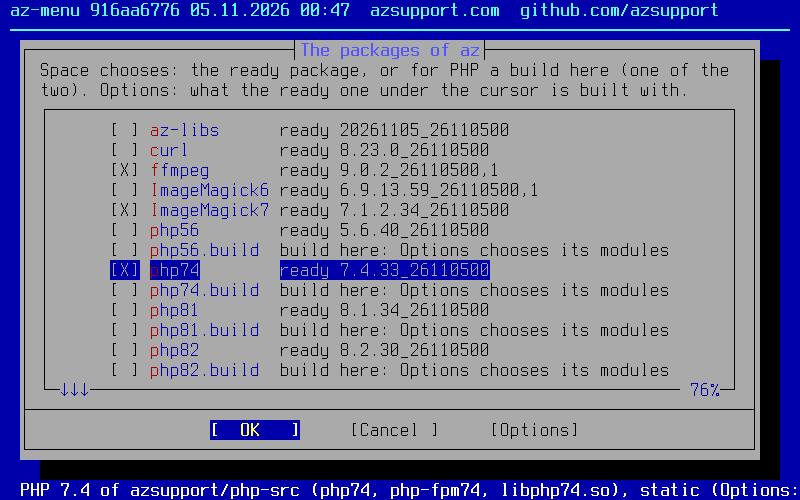</p>
<p>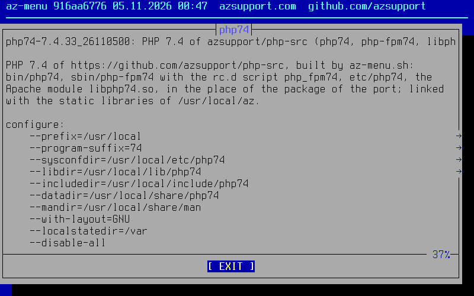</p>

The menu of a version (`sh az-menu.sh 8.4`, or `sh az-menu.sh` inside a source tree)
is the `make config` of the ports for this fork: dialogs (bsddialog on FreeBSD 14 and
later, dialog on 13) with the descriptions of the ports. Unlike the ports,
everything is built into one PHP.

| Screen | Items |
|---|---|
| Build options | the options of `lang/phpXY` and `mod_phpXY`: SAPI, ZTS, debug, IPv6, OPcache JIT, the system PCRE |
| Extensions | the extensions of `phpXY-extensions` plus the bundled PECL extensions |
| Options of single extensions | which libcurl, the OpenSSL legacy provider, the drivers of PDO, the DBA handlers, sessions, serializers and compression of redis and memcached, Argon2 of libargon2 or of OpenSSL 3.2 in 8.4, ... (GD has none: in every version it takes the libgd of the package libgd with its formats, with az its static one; FreeType text always) |

An extension with a screen of its own (curl, PDO, redis, ...) is marked `--->` in
the list. Its screen follows the list when the extension is on, and the button
**Options** of the list opens the screen of the item under the cursor at once, then
brings the list back with the cursor on that item (Cancel there undoes it); a screen
seen that way does not come again right after the list. Dialogs have no drop-down
lists, so this is the way to open the choices of one item.

What needs what is checked while you choose, from the configure scripts and the C
sources of every branch:

| Rule | For example |
|---|---|
| An extension another one needs is turned on, with a note | XSL turns on DOM, the igbinary serializer of redis turns on igbinary |
| Items that cannot go together are refused | the Apache module and the embed library, imagick and gmagick, swoole and openswoole, ZTS and the Argon2 of OpenSSL |

**BUILD** in the main menu builds PHP with the choices, makes the package `phpXY-static`
of it and offers to install it (`pkg add`). It needs the packages of az the choices link
with (`az`, which has the curl of PHP; `ImageMagick7` for imagick) and installs
them first; outside a source tree it fetches the tarball of the version. By hand,
inside the source tree after `config-check.sh`, build with the script the menu writes
instead of `config.installed.sh`:

```sh
sh az-menu.sh
sh config.menu.sh
```

| What | How |
|---|---|
| Starts from | what the installed build has (the `config.installed.sh` of `config-check.sh`), keeping its environment and its other options (layout, php.ini paths, `--build`). Without `config.installed.sh`: our base build (`--disable-all`, the CLI and OPcache; redis with igbinary and zstd, memcached on libmemcached without SASL: `--enable-redis --enable-igbinary --enable-redis-igbinary --enable-redis-zstd`, zstd in 7.4 and later, `--enable-memcached --with-libmemcached-dir=/usr/local --disable-memcached-sasl`; the SAPI and the other extensions are chosen) with the compiler flags of every build |
| Writes | `config.menu.sh`, a script of the same form, with the SAPI, the build options and the extensions chosen in the menu |
| On by default | OPcache built into PHP and no extension loading (the options of this fork, [below](#built-in-opcache-and-no-extension-loading)); the bundled curl where the base system has OpenSSL 3 (FreeBSD 14 and later); the Argon2 of OpenSSL where it has 3.2 (FreeBSD 15) |
| Off unless chosen | phpdbg: in 7.4 and later the menu writes `--disable-phpdbg`, since `--disable-all` leaves the SAPIs alone |
| Typed in on the last screen | the install directory (`/usr/local` by default, as the ports): PHP goes there in the layout of the packages (below: `--prefix`, `--program-suffix=84`, `--sysconfdir=<dir>/etc/php84`, `--libdir`, `--includedir` and `--datadir` with `php84`, `--mandir=<dir>/share/man`); a build of `/usr/local/phpXY` moves to `/usr/local`, with the other paths inside its old directory. With mysqli or pdo_mysql (5.6: the mysql extension) the MySQL socket (`/tmp/mysql.sock`): one `--with-mysql-sock` is the default of `mysqli.default_socket` and `pdo_mysql.default_socket` |
| The libraries | with `az` installed, the static libraries of its static tree `/usr/local/az/static` (through `config-check.sh` with `PHPDEPS=/usr/local/az/static`; imagick with `static/bin/MagickWand-config` of `ImageMagick7`), so that `php`, `php-fpm` and `libphp84.so` need nothing of `/usr/local/lib` |
| Left out | `--infodir` (PHP installs no info pages); `--localstatedir=/var` comes with FPM only (php-fpm alone reads it) |
| The choices | saved the way the ports save theirs, in `/var/db/az-menu/phpXY.options` (those of `php-menu.sh`, its name before 04.11.2026, in `/var/db/php-menu` are read when there are none), and the start of the next run (`--reset` starts over) |
| At the end | the packages the choices need |
| Without dialogs | `sh az-menu.sh --batch +GD -CGI` writes the script; an item of a screen of its own turns on its extension too (`+PDO_MYSQL`: PDO); `--batch --build` also builds the package, `--batch --build --install` installs it |
| `--repo` | `sh az-menu.sh --repo` writes `/usr/local/etc/pkg/repos/az.conf` for the x86-64 level of the CPU (with the public key `freebsd/az.pub`, when there is one, in `/usr/local/etc/pkg/keys/az.pub`: the signature of the catalog is checked) and updates the catalog of az |
| `--list` | `sh az-menu.sh --list` shows the items, the paths, their state and the templates |

**Templates.** The menu first asks where to start: what it found (the saved choices,
the installed build or the defaults) or a template, a set of choices for one
application; the main menu offers it again ("Templates"). A template turns its items
on and the other SAPIs and extensions it names off; the rest keeps its defaults, what
its items need is turned on as well, and every screen can still change it afterwards.
Without dialogs: `sh az-menu.sh --batch --template=roundcube`.

**The package `phpXY-static`** (origin `az/php84-static`; per version it or `phpXY` of the repository az), for 8.4:

| Files | What |
|---|---|
| `bin/php84`, `bin/php-cgi84`, `bin/phpize84`, `bin/php-config84`, `sbin/php-fpm84` | the programs, with the version at the end (`--program-suffix`) |
| `etc/php84/php.ini` | the php.ini PHP reads (`php.ini-production`; both `php.ini-*` lie next to it) |
| `etc/php84/php-fpm.conf`, `etc/php84/php-fpm.d/www.conf` | FPM: the pid file `/var/run/php-fpm84.pid`, the log `/var/log/php-fpm84.log`, the pool `www` on `/var/run/php-fpm84.sock` (user and group `www`, mode 0660) |
| `etc/rc.d/php_fpm84` | the rc.d script of the port, for this version: `sysrc php_fpm84_enable=YES`, `service php_fpm84 start`; the php-fpm of several versions run at once |
| `libexec/apache24/libphp84.so`, `etc/apache24/modules.d/280_mod_php84.conf.sample` | the Apache module and a sample of its lines (`LoadModule`, the handler of `.php`, `DirectoryIndex`): an Apache instance loads the module of one version |
| `lib/php84`, `include/php84`, `share/php84` | the rest of PHP (`phpize84` and `php-config84` take them) |

The files of `etc` are kept when changed (`@config`). The package depends on the
packages of az it is linked with (`az`, `ImageMagick7`), and its
annotations have the configure options, `CFLAGS` and the mode `static` (`pkg info -A
php84-static`).

| Template | PHP | For |
|---|---|---|
| `roundcube` | 7.4 and later | php-fpm and the CLI (the scripts in `bin/`, cron) for [Roundcube](https://roundcube.net/) 1.6 (PHP 7.3+) and 1.7 (PHP 8.1+); checked against Roundcube 1.6.20 and 1.7.5 |

What the `roundcube` template turns on and leaves out:

| Group | Extensions |
|---|---|
| Required by its installer | ctype, dom, filter, intl, json, mbstring with its regex functions, openssl, session, PDO, xml |
| Its [wiki page](https://github.com/roundcube/roundcubemail/wiki/Install-Requirements) and its libraries | fileinfo, iconv, sockets |
| Optional, all but LDAP | curl (bundled, for Guzzle), exif (the orientation of JPEG photos), gd (JPEG, WebP and FreeType for 1.7), imagick, xmlwriter, zip |
| Database | MySQL only, through PDO (pdo_mysql) |
| Not in it | mysqli, PostgreSQL, SQLite, LDAP; pspell and enchant, which only the spell checker uses (`spellcheck_engine`), and that is off by default since Roundcube 1.5.0 (`enable_spellcheck`) |

The menu with the `roundcube` template (bsddialog in the 80x25 console of FreeBSD,
Terminus font): where to start, the build options, the extensions, the drivers of PDO
through the button Options, the options of curl, GD, mbstring and OpenSSL, the main
menu and the script it writes:

<p>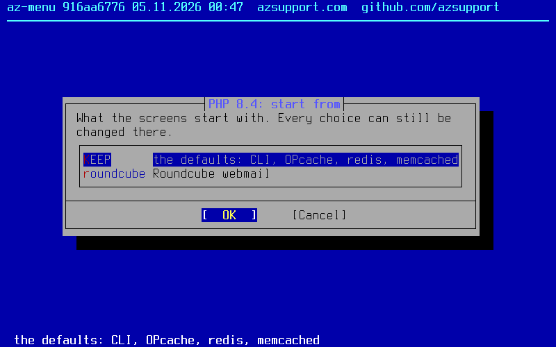</p>

The button Options on PDO, and the screen it opens:

<p>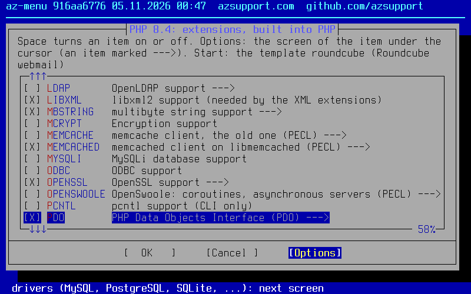</p>
<p>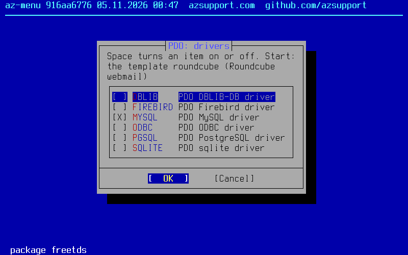</p>

The extensions with the `roundcube` template, and of the base build (the defaults:
the CLI and OPcache, redis with igbinary and zstd, memcached without SASL):

<p>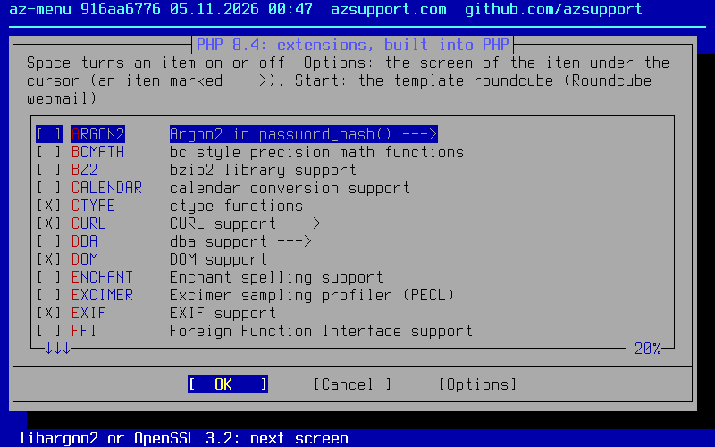</p>
<p></p>

<details>
<summary>More screens: where to start, the build options, the main menu, the scripts</summary>

<p>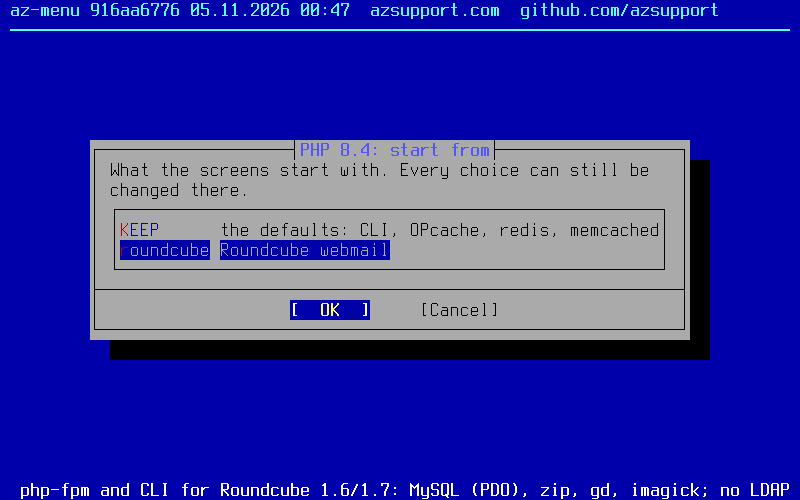</p>
<p>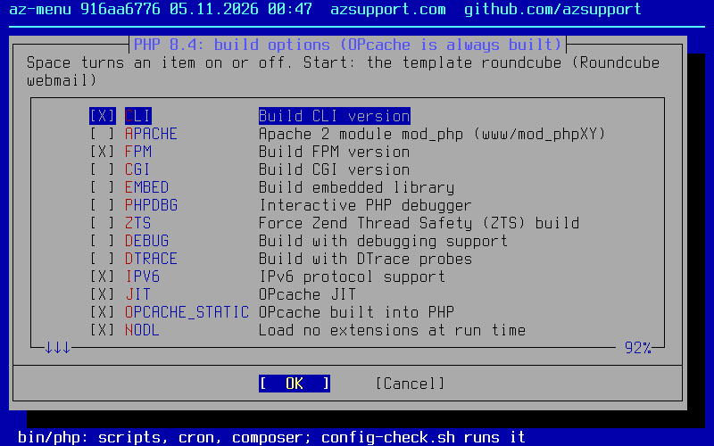</p>
<p>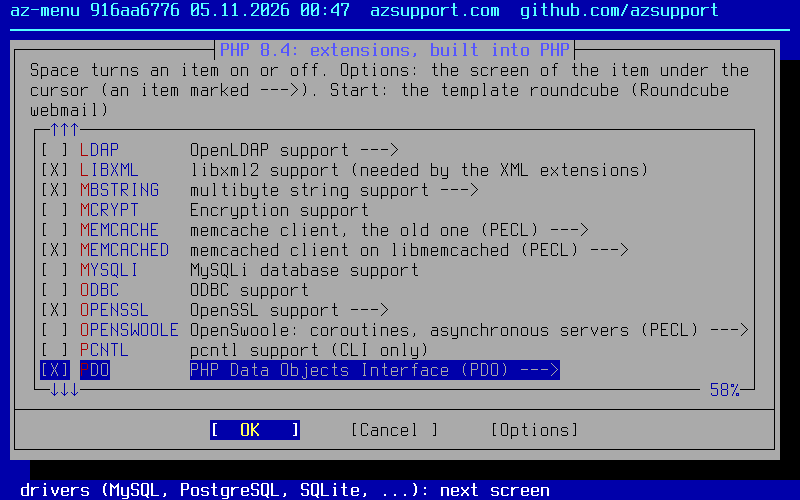</p>
<p>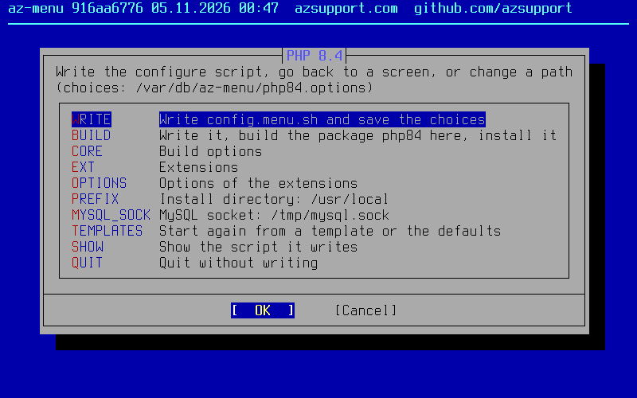</p>
<p>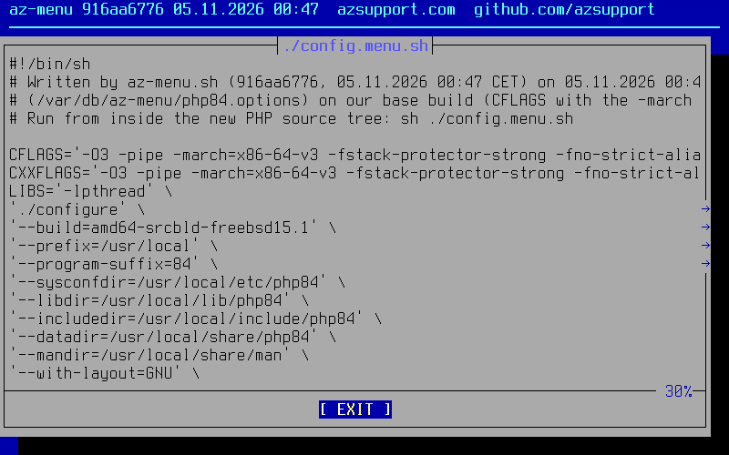</p>
<p>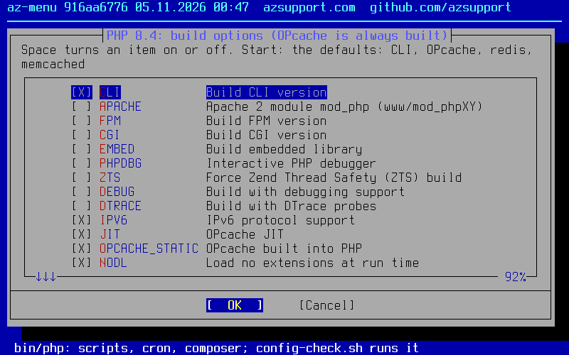</p>
<p>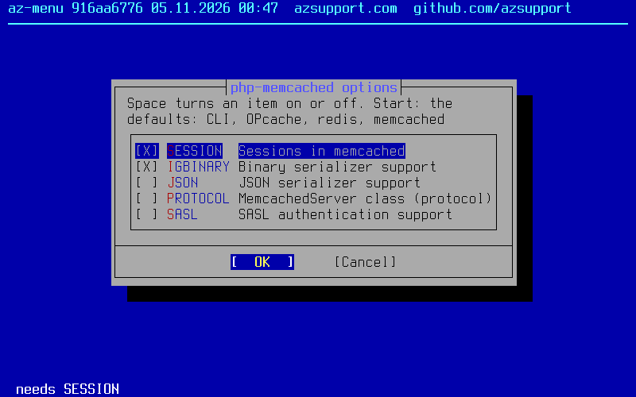</p>
<p>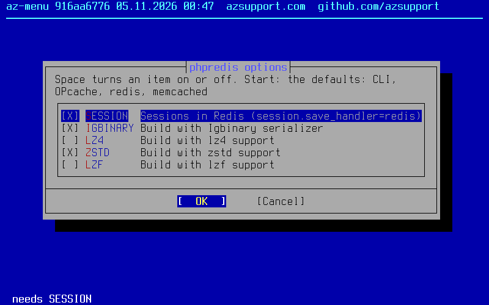</p>
<p>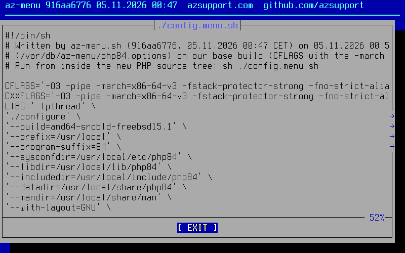</p>
<p></p>

</details>

The pictures are made by [`tools/menu-screenshots.py`](tools/menu-screenshots.py)
(pyte and Pillow): bsddialog in an 80x25 terminal, the Terminus font and the 16 colors
of the FreeBSD console.

### Built-in OPcache and no extension loading

Two configure options of this fork, in every branch (the patches
`freebsd/patches/<version>/feature-*.patch`). Both are off unless given;
`az-menu.sh` turns both on by default, also when it starts from the
`config.installed.sh` of a build made before them.

| What | `--enable-opcache-static` | `--disable-extension-loading` |
|---|---|---|
| Effect | OPcache is built into PHP (the CLI, php-fpm, php-cgi and the Apache module alike), as PHP 8.5 always does: there is no `opcache.so` and no `zend_extension` line is needed | PHP loads no extensions at run time; `php -i` shows `Dynamic Library Support => disabled (--disable-extension-loading)` |
| Old lines of php.ini | a leftover `zend_extension=opcache.so` is skipped quietly, also when an old `opcache.so` is still in `extension_dir`; `opcache.enable` and the other `opcache.*` settings work as before | `extension=` and `zend_extension=` lines, `dl()` and `php -z` are refused with a startup warning that names the file; a line for an extension that is built in (`extension=mysqli`) is skipped quietly |
| configure stops | in 8.x with ZTS and the JIT (before PHP 8.5 the JIT reaches thread-local data in a way that works only from `opcache.so`): add `--disable-opcache-jit` or build `opcache.so` | when an extension would be built as `.so` (for OPcache add `--enable-opcache-static`) |

Without the menu, add them to the build: `sh config.installed.sh
--enable-opcache-static --disable-extension-loading`. Once such a build is
installed, the `extension=` and `zend_extension=opcache.so` lines of php.ini are no
longer needed.

### Build test on FreeBSD

| What | How |
|---|---|
| Workflow | [`.github/workflows/build-test.yml`](.github/workflows/build-test.yml): start it on https://github.com/azsupport/php-src/actions/workflows/build-test.yml with **Run workflow** |
| Machine | a FreeBSD VM, by default 15.1: clang 19, base OpenSSL 3.5, libraries from `pkg` |
| Builds | the `-latest` tarballs with the configure options of our servers, the bundled curl (`--with-curl=bundled`) and `--with-openssl-legacy-provider` |
| Checks | `php -v`, `php -m`, [`tools/build-test-smoke.php`](tools/build-test-smoke.php) (parse errors, DNS and IPv6, `tls://`, `ssl://` and `https://`, the OpenSSL legacy ciphers, `openssl_seal()`, GD with FreeType, XML, sessions, the bundled curl, the php2shell fix when a script goes over `memory_limit` and more) and a part of the PHP test suite |
| Result | per version, on the run page |
| With the packages of az | the input `az`: against the static libraries of the packages `az` and `ImageMagick7` of the repository az (`az_release`: its release, by default `az-fbsd<major>-amd64-v3`), in the layout of the packages |
| On a FreeBSD machine | the same script, from a checkout of this branch with the tarballs in `dist/`: `sh tools/build-test.sh --deps 5.6 7.4` installs the packages, `sh tools/build-test.sh --tests 5.6 7.4` builds and checks; the presets are in [`tools/build-test.sh`](tools/build-test.sh) |

### Benchmark of the builds

| What | How |
|---|---|
| Workflow | [`.github/workflows/bench.yml`](.github/workflows/bench.yml): start it on https://github.com/azsupport/php-src/actions/workflows/bench.yml with **Run workflow**; the inputs are the versions (by default `7.4 8.3`) and the runs of each benchmark (by default 5) |
| Machine | one FreeBSD 15.1 VM per version: all the builds of a version are made and run in the same VM, so that their numbers compare (those of two versions come from two machines) |
| Source | the newest dated release `freebsd-<version>-<YYYYMMDD>-<commit>`, its SHA-256 checked against the `.sha256` of the release |
| Builds | the CLI only (`--disable-all --enable-cli --disable-cgi --disable-phpdbg --enable-opcache`), the same `CFLAGS` for all (`-O3 -pipe -march=x86-64-v3 -fstack-protector-strong -fno-strict-aliasing -std=gnu17`): `clang19` (the base cc, the baseline), `clang19-pgo`, `clang23`, `clang23-pgo`, `clang23-pgo-lto` (ThinLTO, linked by the lld of llvm23), `gcc16`, `gcc16-pgo`. The compilers come from the packages `llvm23` and `gcc16`, or from the newest llvm and gcc of the package repository when those are not there; the report names them with their versions. With GCC, configure finds the global register variables that the Zend VM keeps its registers in (clang has none) |
| PGO training | never the benchmarks: the `run-tests.php` of the same tree on `Zend/tests`, `ext/standard/tests/strings` and `ext/standard/tests/array`, without OPcache, then with OPcache (on 8.x with the JIT), each part at most 150 seconds |
| Benchmarks | `Zend/bench.php` and `Zend/micro_bench.php` of the same tree, every build without OPcache, with OPcache (on 8.x with the tracing JIT) and with `USE_ZEND_ALLOC_HUGE_PAGES=1` (the Zend allocator maps its 2 MB chunks with `MAP_ALIGNED_SUPER`); the builds take turns, run by run |
| Through a shared libphp | the input `embed`: the builds `clang19`, `gcc16` and `gcc16-nsi` (`-fno-semantic-interposition`), each tree configured with `--enable-embed=shared` too, so that every build runs also as `<build>-embed`, through its own `libphp.so` (the embed SAPI, from the same PIC objects as the `libphp.so` of mod_php) with a driver of a few lines, without OPcache (it does not run in the embed SAPI), next to its CLI; the report adds the change of each `-embed` against the CLI of its build and against `clang19-embed`. With `-fPIC`, GCC takes every exported function (`ZEND_API`, `PHPAPI`) as replaceable at load time, so the engine's own calls to them go through the PLT and are not inlined; `-fno-semantic-interposition` lets it bind and inline them (the CLI, an executable, is not affected) |
| Result | the median of the `Total` lines in seconds and its change against `clang19` in %, with the compiler versions, the CPU of the VM and what the training ran: in the log of the job (step Report) and in its summary |
| On another machine | `sh tools/bench.sh --local -r 3 8.3 <tarball>` takes the compilers it finds there (Linux too); the details are in [`tools/bench.sh`](tools/bench.sh) |

The results of 09.11.2026 on FreeBSD 15.1 (4 CPU of AMD EPYC, the median of 5 runs, the
change against `clang19`; minus is faster; llvm23 23.1.5, gcc16 16.1.0):

| PHP | Build | `bench.php` | `bench.php` with OPcache | `micro_bench.php` | `micro_bench.php` with OPcache |
|---|---|--:|--:|--:|--:|
| 8.3 ([42582372488](https://github.com/azsupport/php-src/actions/runs/42582372488)) | `clang19` | 0.304 s | 0.042 s (JIT) | 1.431 s | 0.428 s (JIT) |
| | `clang19-pgo` | −3.0% | 0 | −2.4% | −4.0% |
| | `clang23-pgo-lto` | +1.0% | 0 | −4.5% | −10.0% |
| | `gcc16` | −36.2% | −4.8% | −37.5% | −12.6% |
| | `gcc16-pgo` | −37.5% | −4.8% | −36.8% | −14.7% |
| 7.4 (the same run) | `clang19` | 0.615 s | 0.420 s | 2.991 s | 2.186 s |
| | `clang19-pgo` | +2.0% | −1.2% | −1.7% | −4.8% |
| | `clang23-pgo-lto` | +3.3% | −3.1% | −5.6% | −7.0% |
| | `gcc16` | −33.5% | −44.3% | −38.8% | −36.5% |
| | `gcc16-pgo` | −29.9% | −43.8% | −33.9% | −33.5% |

- GCC 16 is the gain: the Zend VM keeps its registers in global register variables,
  which only GCC has. PGO, LTO and clang 23 stay within about ±5% (the spread of the
  runs), the huge pages of the Zend allocator gain nothing (FreeBSD has transparent
  superpages). In 7.4, OPcache only caches the opcodes for the same VM (no JIT), so
  GCC gains with it too; in 8.3 the JIT compiles the hot code itself.
- Through `libphp.so`, as mod_php runs PHP (the input `embed`,
  [42623798085](https://github.com/azsupport/php-src/actions/runs/42623798085), without
  OPcache): GCC against clang through their `libphp.so`, 8.3 −32.4%, with
  `-fno-semantic-interposition` −34.0%; 7.4 −38.4% and −37.5%: the flag adds up to 2.4%
  for 8.3 and takes nothing anywhere.
- So the PHP packages of azsupport/ports build the cores, `mod_phpXY` and the modules
  in C with GCC 16 and `-fno-semantic-interposition` (`-static-libgcc`: no file needs a
  library of GCC); the C++ modules (intl, swoole, OpenSwoole) and imagick and gmagick
  stay with the clang of the base system.

### Bundled PECL extensions

The branches and tarballs carry these PECL extensions in `ext/`, so they are built
into PHP like the bundled ones and need no `phpize` or `extension=` line. Nothing
changes unless their option is given:

| Extension | PHP 8.2, 8.3, 8.4 | PHP 8.1 | PHP 7.4 | PHP 5.6 |
|---|---|---|---|---|
| redis | 6.3.0 | 6.3.0 | 6.3.0 | 4.3.0 |
| memcached | 3.4.0 | 3.4.0 | 3.4.0 | 2.2.0 |
| memcache | 8.2 | 8.2 | 4.0.5.3 | 3.0.8 |
| igbinary | 3.2.16 | 3.2.16 | 3.2.16 | 2.0.8 |
| imagick | 3.8.1 | 3.8.1 | 3.8.1 | 3.8.1 |
| gmagick | 2.0.6RC1 | 2.0.6RC1 | 2.0.6RC1 | 1.1.7RC3 |
| swoole | 6.2.5 | 6.1.12 | 4.8.13 | — |
| OpenSwoole | 4.12.1 | 4.12.1 | 4.12.1 | — |
| excimer | 1.2.7 | 1.2.7 | 1.2.7 | — |
| mcrypt | 1.0.9 | 1.0.9 | 1.0.9 | in PHP 5.6 itself |
| ssh2 | 1.6.0 | 1.6.0 | 1.4.1 | 0.13 |

How to turn them on:

| Extension | configure option | FreeBSD package |
|---|---|---|
| [redis](https://pecl.php.net/package/redis) | `--enable-redis` | |
| [memcached](https://pecl.php.net/package/memcached) | `--enable-memcached --with-libmemcached-dir=/usr/local --disable-memcached-sasl` | `libmemcached` |
| [memcache](https://pecl.php.net/package/memcache) | `--enable-memcache` | |
| [igbinary](https://pecl.php.net/package/igbinary) | `--enable-igbinary`; for its use as the serializer of redis and memcached also `--enable-redis-igbinary` and `--enable-memcached-igbinary` | |
| [imagick](https://pecl.php.net/package/imagick) | `--with-imagick=/usr/local`; not together with gmagick | `ImageMagick7` or `ImageMagick7-nox11` |
| [gmagick](https://pecl.php.net/package/gmagick) | `--with-gmagick=/usr/local`; not together with imagick | `GraphicsMagick` |
| [swoole](https://pecl.php.net/package/swoole) (7.4+) | `--enable-swoole`; not together with OpenSwoole | `brotli` (optional, for brotli compression) |
| [OpenSwoole](https://pecl.php.net/package/openswoole) (7.4+) | `--enable-openswoole`; not together with swoole | |
| [excimer](https://pecl.php.net/package/excimer) (7.4+) | `--enable-excimer` | |
| [mcrypt](https://pecl.php.net/package/mcrypt) (7.4+) | `--with-mcrypt=/usr/local` | `libmcrypt` |
| [ssh2](https://pecl.php.net/package/ssh2) | `--with-ssh2=/usr/local`: `ssh2_connect()`, SCP, `ssh2.sftp://` | `libssh2` |

The versions are the newest stable PECL releases for each PHP version, with these
exceptions:

| Exception | Why |
|---|---|
| memcache 3.0.8 for 5.6 | the release that distributions shipped for PHP 5.5/5.6; its only stable 5.x release is 2.2.7 of 2012 |
| gmagick 2.0.6RC1, and 1.1.7RC3 for 5.6 | gmagick has no stable release at all: 2.0.6RC1 (beta, 2021) plus the two later commits of its git master with the PHP 8.1 fixes |
| OpenSwoole 4.12.1 everywhere | the 4.x line the servers run (below) |

The sources come from the upstream git repositories at the commit of the release tag
(gmagick, which has no tags: the commit of the release), pinned in
[`freebsd/pecl.conf`](freebsd/pecl.conf); the fixes that make them build inside
php-src with clang 19 are in [`freebsd/pecl/`](freebsd/pecl). The extensions need
`--enable-session` (session handlers); on 5.6 and 7.4 redis also needs
`--enable-json`, and on 5.6 `--enable-hash`.

Two pairs can be built only one at a time, and configure stops when both options of a
pair are given. To have both of a pair on a server, build one into PHP and the other
as a shared module with `phpize`.

| Pair | Why not in one PHP |
|---|---|
| imagick and gmagick | GraphicsMagick and ImageMagick have the same MagickWand function names, so imagick and gmagick would call each other's library |
| swoole and OpenSwoole | OpenSwoole is a fork of swoole with the same C++ symbols |

OpenSwoole is 4.12.1 for every version from 7.4 on, the 4.x line the servers run:
OpenSwoole 22 and newer changed the API (namespace `OpenSwoole\`, `openswoole.*` ini
settings, no `Co\` and `swoole.use_shortname`). 4.12 supports PHP up to 8.2 upstream;
for 8.3 and 8.4 the patch ports it:

| PHP | Change |
|---|---|
| 8.3+ | the new `php_url_encode_hash_ex()` of 8.3 |
| 8.3+ | the C stack bounds that PHP 8.3 checks follow the coroutine stacks (otherwise every call in a coroutine fails with "Maximum call stack size reached") |
| 8.4 | `zend_str_tolower()` for `php_strtolower()` (gone in 8.4) |
| 8.4 | `exit()` in a coroutine or a server still throws `Swoole\ExitException` (exit became a function in 8.4) |
| 8.4 | the embedded PHP library declares its nullable parameters explicitly (PHP 8.4 deprecation notices) |

What else the patches change:

| Extension | Upstream | With the patch |
|---|---|---|
| swoole, OpenSwoole | on by default (`--enable-swoole`, `--enable-openswoole`), and OpenSwoole's configure tests the variable of swoole instead of its own: inside php-src that would build them into every PHP (without `--disable-all`, and OpenSwoole even with it) | off by default |
| swoole 4.8 and 6.1, OpenSwoole | their own `--enable-openssl`: inside php-src it reset the `--with-openssl` setting, and mysqlnd then built without its OpenSSL code (RSA for `caching_sha2_password`) | dropped: they use OpenSSL when PHP is built `--with-openssl` |
| swoole, OpenSwoole | `-std=c++11`/`-std=c++14` appended to `CXXFLAGS`, which inside php-src would apply to ext/intl too (ICU 75 and newer need C++17) | dropped |
| OpenSwoole | no FreeBSD port, and it did not compile on FreeBSD: its `swoole_socket.h` includes `<netinet/ip6.h>` before `<sys/types.h>`, and its hiredis sets `_XOPEN_SOURCE`, which hides the BSD types `<netinet/ip6.h>` needs | both fixed; the build test builds it with gmagick on 7.4 to 8.4 |
| excimer | FreeBSD has no `gettid()`, so excimer 1.2.4 and later did not compile there (the port `devel/pecl-excimer` stays at 1.2.3) | the thread id of its timer thread from `pthread_getthreadid_np()`; `-fvisibility=hidden` for its own sources only |

igbinary as the serializer (`--enable-memcached-igbinary`, `--enable-redis-igbinary`):

| Extension | With igbinary as the serializer |
|---|---|
| memcached | igbinary becomes the default serializer (`memcached.serializer = igbinary`) for arrays and objects. A PHP built without igbinary cannot read such values, so while servers with and without it share one memcached, set `memcached.serializer = php` in `php.ini`. Values already stored with the php serializer stay readable either way |
| redis | serializes nothing until `Redis::OPT_SERIALIZER` is set, so there igbinary is used only where the code asks for `Redis::SERIALIZER_IGBINARY` |

Adding them to a rebuild:

| Way | What to do |
|---|---|
| By hand | put the options after `sh config.installed.sh`, for example `sh config.installed.sh --enable-redis --enable-memcache`, and remove the `extension=redis.so` lines of the old shared modules from `php.ini` |
| Script | `config-check.sh` does not add them to `config.installed.sh` on its own: for the shared modules of the installed PHP that the tree bundles, it ends with the full command, `sh config.installed.sh` plus their options, ready to copy. The options carry what the modules were built with (`php --ri`: the igbinary serializer, lzf/zstd/lz4, SASL, swoole's curl, c-ares, pgsql), plus `--enable-json`, `--enable-hash` or `--enable-session` when the installed build lacks what they need; the report lists the `extension=` lines (file and line) to remove after `make install` |
| Packages | `config-check.sh --pkg` converts the installed packages of the PECL ports like the other extension packages |

New releases of these extensions are found by the daily [upstream check](#upstream-check).

### OpenSSL

| PHP | With the OpenSSL 3 of the base system (FreeBSD 14 and 15; 3.5.6 on FreeBSD 15.1) |
|---|---|
| 8.1+ | supported upstream: `--with-openssl` |
| 7.4 | [`compat-openssl3.patch`](freebsd/patches/7.4/compat-openssl3.patch): `--with-openssl` is enough, as FreeBSD ships `openssl.pc`. RC4 (the default of `openssl_seal()`), Blowfish, DES, RC2, CAST5 and MD4 need `--with-openssl-legacy-provider` (below) |
| 5.6 | [`compat-openssl3.patch`](freebsd/patches/5.6/compat-openssl3.patch) with `--with-openssl=/usr`, and the same `--with-openssl-legacy-provider` as 7.4. On top of that, `tls://` and `STREAM_CRYPTO_METHOD_TLS_*` negotiate TLS 1.0 to 1.3: 5.6 limits them to TLS 1.0, which OpenSSL 3 refuses at its default security level, so they could not connect at all (`ssl://`, `https://` and `STREAM_CRYPTO_METHOD_SSLv23_*` already negotiated the newest version) |

What behaves differently on 7.4 and 5.6 than with OpenSSL 1.1 is OpenSSL 3 itself, the
same as with PHP 8.x; a 7.4 or 5.6 build against a separate OpenSSL 1.1 behaves as
before:

| Case | With OpenSSL 3 |
|---|---|
| TLS 1.0 and 1.1 | off by default |
| RSA PKCS#1 v1.5 decryption with a wrong key | returns random bytes instead of failing (protection against the Marvin attack) |
| DSA/DH keys below 512 bits, certificates with malformed times | refused |

The option `--with-openssl-legacy-provider`:

| What | How |
|---|---|
| Effect | loads the OpenSSL 3 legacy provider together with the default one at startup, so RC4, Blowfish, DES, RC2, CAST5, MD4 and the like work without editing `openssl.cnf` |
| Where | upstream in PHP 8.4 ([php-src GH-13951](https://github.com/php/php-src/pull/13951)); this fork adds the same option to 5.6, 7.4, 8.1, 8.2 and 8.3. Off by default, as upstream |
| Module | `/usr/lib/ossl-modules/legacy.so`, part of the base system of FreeBSD 14 and 15; if it is missing, PHP starts and those algorithms stay unavailable |
| OpenSSL 1.1 | in the base system of FreeBSD 13.x: changes nothing, as the algorithms are built in there |
| Script | `config-check.sh` adds it to a build against OpenSSL 3 when the installed PHP can do RC4 (built against OpenSSL 1.1, or with the legacy provider), so that data encrypted with `openssl_encrypt(..., "rc4", ...)` on the old build stays readable, and always for 5.6 and 7.4, whose `openssl_seal()` uses RC4 by default. `sh config.installed.sh --without-openssl-legacy-provider` leaves it out |

### Bundled curl

Every branch carries curl in `ext/curl/libcurl` and the libraries it needs in
`ext/curl/deps`: the release files of their FreeBSD ports, with the SHA-256 of their
distinfo; a new release before its port only when it fixes a vulnerability that
touches us, or a bug we have. The ports are followed for their build patches and
what FreeBSD needs ([`freebsd/curl.conf`](freebsd/curl.conf),
[`freebsd/curl-deps.conf`](freebsd/curl-deps.conf); put into the tree by
[`tools/curl-sources.sh`](tools/curl-sources.sh)):

| Library | Version | FreeBSD port | What curl uses it for |
|---|---|---|---|
| curl | 8.23.0 | `ftp/curl` | with the configure patch of that port |
| c-ares | 1.34.9 | `dns/c-ares` | resolving names (below) |
| nghttp2 | 1.70.0 | `www/libnghttp2` | HTTP/2 |
| brotli | 1.2.1 | `archivers/brotli` | `br` responses (`CURLOPT_ENCODING`); 1.2.1 fixes CVE-2026-111497, an out-of-bounds write in the decoder |
| zstd | 1.5.7 | `archivers/zstd` | `zstd` responses (`CURLOPT_ENCODING`) |
| libidn2 | 2.3.8 | `dns/libidn2` | international domain names (IDN) |
| libpsl | 0.23.3 | `dns/libpsl` | the public suffix list: no cookies for a whole public suffix, such as `co.uk` |
| public suffix list | 21.09.2026 | `dns/public_suffix_list` | built into libpsl |
| libssh2 | 1.11.1 | `security/libssh2` | SCP and SFTP (`scp://`, `sftp://`), with the OpenSSL of curl and the patches of its port |

How it is built and used:

| What | How |
|---|---|
| Build | `--with-curl=bundled` builds all of it during `configure` (two or three minutes, log in `ext/curl/libcurl-build.log`) with only cc and make, and links it into PHP, static, against the OpenSSL that PHP itself takes |
| Packages | none: with `--with-curl=bundled` PHP depends neither on the curl package nor on its libraries, and its curl is as new as the tarball |
| Not among them | libunistring (libidn2 builds the part of it that it needs) and an IDN library for libpsl (curl gives it the host names in punycode, so its built-in list is enough) |
| Symbols | those of curl are not exported from `php` and `libphp.so`, those of its libraries are local in `libcurl.a`, so a module that loads the libcurl of the system, or carries a copy of nghttp2 (swoole), does not mix with them |
| The system libcurl | plain `--with-curl` still takes it |
| OpenSSL | curl 8.18.0 and later need OpenSSL 3.0 or later. FreeBSD 13.x has OpenSSL 1.1.1 in its base system, so there `config-check.sh` keeps `--with-curl` (the curl package) and says why; on FreeBSD 14 and 15 it writes `--with-curl=bundled` |
| Security fixes | of curl or of one of its libraries reach PHP with a rebuild: the daily [upstream check](#upstream-check) opens an issue for each new release (the tags of their repositories), for changes of their FreeBSD ports, and when a port takes a release file the bundle has not (its distinfo). A release comes with its port; before it only for a vulnerability that touches us, or a bug we have: the release issues name the CVE and GHSA ids of the release notes |
| The packages of az | `tools/az-build.sh` of azsupport/ports (the package `az`) builds curl and these libraries from the same files the same way, static into `/usr/local/az/static` (`phpXY-static` links them: `--with-curl=/usr/local/az/static`) and shared into `/usr/local/az/lib` (the module curl of the PHP packages). The package `curl` (`bin/curl`, `lib/libcurl.so.4`, in the place of those of the port) is a build of its own of the same release with the options of the port, apart from it ([Packages](#packages-the-repository-az)) |

The options are those of the FreeBSD port, with these differences:

| Difference | Why |
|---|---|
| c-ares resolves names (the port's `CARES` option, not `THREADED_RESOLVER`) | a lookup that hangs does not hold the worker (below) |
| no IMAP, POP3, SMTP | PHPMailer, Symfony Mailer, Roundcube and the IMAP libraries talk to mail servers over their own sockets |
| no WebSocket (`ws://`, `wss://`) | PHP has no `curl_ws_send()` or `curl_ws_recv()`; php-src master has neither, only `CURLOPT_WS_OPTIONS` |
| no NTLM | weak, opt-in in curl since 8.20 and to be removed by curl; only old Microsoft servers and proxies want it |
| no headers API, TLS session export, `curl_easy_option_*`, text progress meter | PHP calls none of them; `CURLOPT_PROGRESSFUNCTION` and `CURLOPT_XFERINFOFUNCTION` keep working |
| no DICT, Gopher, IPFS, MQTT, RTSP, Telnet, TFTP, LDAP, GSSAPI | rarely used protocols |
| SCP and SFTP (libssh2) | off in the port; on here for transfers to other servers (aZ, 10.11.2026) |

c-ares is not there for speed: the time goes into the answer of the DNS server, and
curl 8.23 asks for A and AAAA in parallel either way. The difference is a DNS server
that does not answer:

| Case | Threaded resolver (`getaddrinfo()`) | c-ares |
|---|---|---|
| A DNS server that does not answer | a `getaddrinfo()` cannot be interrupted, so the handle waits at `curl_close()` (8.x: when `$ch` is destroyed, at the latest at the end of the request) until it gives up: with the defaults of FreeBSD's `resolv.conf` at least 15 seconds per name, while the workers of Apache and FPM pile up | drops the lookup at once, so `CURLOPT_TIMEOUT` holds. Checked with a DNS server that never answers and `CURLOPT_TIMEOUT_MS` 1500: `curl_exec()` returns after 1.5 s, the handle goes at once |
| `CURLOPT_DNS_SERVERS` and its neighbours | not available | work |
| What it reads | the resolver of the system, with NSS modules | `/etc/resolv.conf`, `/etc/hosts` and the `hosts:` line of `/etc/nsswitch.conf`, itself; NSS modules are not used |

What the bundled curl keeps:

| Kept | What |
|---|---|
| Protocols | HTTP(S), FTP(S), FILE (old scripts may use it), SCP, SFTP |
| Features | HTTP/2, proxies, cookies, multipart (`CURLFile`), Unix sockets, IDN, PSL, brotli, zstd |
| Features the code has to turn on | alt-svc, HSTS, DoH, AWS SigV4, `.netrc` |

### Bundled PCRE

php-src bundles an old PCRE with known memory safety bugs, and PHP uses the JIT by
default (`pcre.jit=1`, 7.0 and later). Every branch here carries the newest release
instead ([`freebsd/pcre.conf`](freebsd/pcre.conf)):

| PHP | php-src bundles | Here |
|---|---|---|
| 8.4 | PCRE2 10.44 (php-src master too, October 2026) | PCRE2 10.49 |
| 8.3 | PCRE2 10.42 | PCRE2 10.49 |
| 8.2 | PCRE2 10.40 | PCRE2 10.49 |
| 8.1 | PCRE2 10.39 | PCRE2 10.49 |
| 7.4 | PCRE2 10.35 | PCRE2 10.49 |
| 5.6 | PCRE 8.38, of 2015 | PCRE 8.45, the last PCRE1 release |

The bugs of the old copies:

| Bug | Fixed in | Branches |
|---|---|---|
| out-of-bounds reads in the JIT compiler ([CVE-2022-1586](https://osv.dev/vulnerability/CVE-2022-1586), [CVE-2022-1587](https://osv.dev/vulnerability/CVE-2022-1587)) | PCRE2 10.40 | 7.4, 8.1 |
| out-of-bounds reads and writes, among them in `pcre2_match` after a JIT fallback on invalid UTF ([CVE-2026-89156](https://security-tracker.debian.org/tracker/CVE-2026-89156); [oss-security, 04.09.2026](https://openwall.com/lists/oss-security/2026/09/04/7)) | PCRE2 10.48 | 7.4–8.4 |
| an out-of-bounds write of the JIT with an attacker-controlled pattern ([CVE-2026-103111](https://app.opencve.io/cve/CVE-2026-103111)) | PCRE2 10.49 | 7.4–8.4 |
| the JIT bugs CVE-2017-6004 and CVE-2019-20838, the integer overflow CVE-2020-14155 and the other fixes of 8.39 to 8.45 (5.6 itself does not use the JIT) | PCRE 8.39–8.45 | 5.6 |

How a release gets into the tree:

| What | How |
|---|---|
| The release | the sync unpacks the release tarball (its SHA-256 is the one in freebsd-ports `devel/pcre2` or `devel/pcre`) |
| The import | [`freebsd/pcre/import-pcre2.sh`](freebsd/pcre/import-pcre2.sh) (5.6: [`import-pcre1.sh`](freebsd/pcre/import-pcre1.sh)), the way php-src does: the library sources, PHP's own `config.h` (plus the defaults of the release it lacks, such as `MAX_VARLOOKBEHIND` for 7.4 to 8.3), the list of sources in `ext/pcre/config0.m4` |
| Function names | PHP renames the functions of its bundled PCRE in `main/php_compat.h` (`pcre2_compile_8` becomes `php_pcre2_compile`), so a libpcre2 that Apache has loaded does not take their calls. The list in php-src misses the functions added since PCRE2 10.30 (and the JIT functions of PCRE 8.x), and `pcre2_substitute` of 10.49 calls one of them, so the import renames those too |
| Tests | the `ext/pcre` tests pass as before; the ones that print messages of the library expect the old and the new wording, as php-src has them since 8.1 and 8.3 (`freebsd/pcre/tests-<version>.patch`) |
| New features | a newer PCRE brings them to the old branches too: PHP 7.4 with 10.49 knows lookbehinds of limited variable length, such as `(?<=a{1,3})b` |
| System PCRE | `--with-external-pcre` (5.6: `--with-pcre-regex=DIR`) still takes it. `config-check.sh` leaves those options out when the PCRE of the tree is not older than the one of the system, so the build needs no `pcre2` or `pcre` package, and says so; a newer library in the system keeps the option |
| New releases | the daily [upstream check](#upstream-check) opens an issue for each new PCRE2 release |

## Packages: the repository az

The repository of pkg az for FreeBSD 15 (amd64) is built and published by
[azsupport/ports](https://github.com/azsupport/ports) since 08.11.2026: an overlay of
the FreeBSD ports, one port per package, each changed from the official port only
where it must be, with PHP from the release tarballs of this fork. Its
[README](https://github.com/azsupport/ports#readme) has the packages, the layout of
PHP on a server, how a server reads the repository and how the packages are built.
Until then this fork built them itself (the workflows `az.yml` and `az-php.yml`).

| Package | What |
|---|---|
| `az` | the libraries of the builds in `/usr/local/az`: the shared ones in `lib` (the run path `/usr/local/az/lib`, no ldconfig) for the PHP packages, the static ones in `/usr/local/az/static` for the programs and for a build of PHP on a server ([`az-menu.sh`](#az-menush-the-packages-and-what-goes-into-php) and [`config-check.sh`](tools/config-check.sh), whose `PHPDEPS` is `/usr/local/az/static`). OpenSSL, zlib and bzip2 are those of the base system |
| `curl`, `ffmpeg`, `ImageMagick6`, `ImageMagick7`, `GraphicsMagick`, `mc`, `yt-dlp` | the programs, in the place of the packages of the ports: [FFmpeg](#ffmpeg-for-the-video-sites), [ImageMagick 6 and 7](#imagemagick-6-and-7-for-the-video-sites), [mc](https://github.com/azsupport/ports#the-packages) (Midnight Commander with SFTP, no X11 and no translations; zip, 7z, rar and ISO open with `tar` of the base system) |
| `phpXY`, `mod_phpXY`, `phpXY-<module>` | the PHP of this fork as the ports have it: the core (CLI, php-fpm, phpize), the Apache module and one package per module (`php74-gd`, `php74-redis`, ...), the versions side by side |

On a server, as root, `az-menu.sh --repo` writes the repository for the level of its
CPU and updates its catalog: x86-64-v3 (the release `az-fbsd15-amd64-v3` of
azsupport/ports) when `cc -march=native` has AVX2, BMI2, FMA, F16C, LZCNT and MOVBE,
else x86-64-v2 (`az-fbsd15-amd64-v2`), with the public key; it says the level it took
and why, and the SHA-256 of the key. The packages then go in with `pkg install -r az`,
or through the menu of `sh az-menu.sh`:

```sh
fetch https://github.com/azsupport/php-src/releases/download/az-menu/az-menu.sh
sh az-menu.sh --repo
pkg install -r az curl ffmpeg ImageMagick6 ImageMagick7
pkg install -r az php84 mod_php84 php84-opcache php84-gd php84-mbstring php84-openssl-legacy
```

The same by hand, and the install lines of every version of PHP: the
[README of azsupport/ports](https://github.com/azsupport/ports#a-server-and-the-repository-az).

The catalog is signed with the key of aZ. `az-menu.sh --repo` takes its public key
[`freebsd/az.pub`](freebsd/az.pub) (the same key as `keys/az.pub` of
azsupport/ports; next to the script, in the checkout of the fork it runs from, else
fetched from `master`), puts it into `/usr/local/etc/pkg/keys/az.pub` and writes
`signature_type: "pubkey"`: `pkg update -r az` then refuses a catalog whose
signature does not verify. `sha256 /usr/local/etc/pkg/keys/az.pub` gives the SHA-256
that the README of azsupport/ports names.

| | |
|---|---|
| `priority: 100` | for a package both have, pkg prefers az to the repository of FreeBSD (priority 0) |
| From the packages of the ports | `pkg install -r az <package>` puts the package of az in the place of that of the port. `ffmpeg`, `ImageMagick6` and `ImageMagick7` of az do not have the shared libraries of the ports (`libavcodec.so`, `libMagickWand-7.so` in `/usr/local/lib`, ...): when another package needs them (`pkg info -r ffmpeg`), keep the package of the port |
| The static PHP | `phpXY-static` (origin `az/phpXY-static`), everything built into one PHP and linked with the static libraries of `az`, is built on the server by `az-menu.sh` with the options chosen in its menu ([its files](#az-menush-the-packages-and-what-goes-into-php)); per version pkg installs it or `phpXY` of the repository, they have the same files. The repository has no ready `phpXY-static` |
| From `/usr/local/phpXY` | `sh az-menu.sh` starts from the options of the PHP installed there and builds the package `phpXY-static`, in `/usr/local`: php.ini is then `/usr/local/etc/phpXY/php.ini`, php-fpm `service php_fpmXY`, the Apache module keeps its file `libexec/apache24/libphpXY.so`. The old directory stays until it is removed |

## FFmpeg for the video sites

The package `ffmpeg` of the [repository az](#packages-the-repository-az), in the
place of that of the port: `ffmpeg` and `ffprobe` for the video sites (KVS) on
FreeBSD 15, with only what the sites need:
[`multimedia/ffmpeg/files/ffmpeg.conf`](https://github.com/azsupport/ports/blob/main/multimedia/ffmpeg/files/ffmpeg.conf) of azsupport/ports. FFmpeg takes the format of a file from
its content, not from its name, so every demuxer of a build is one that an uploaded
file can reach: a playlist named `video.mp4` goes to the HLS demuxer, which reads the
files and addresses it lists. This build has no network and no playlists; the other
demuxers and decoders of FFmpeg are not built.

| | |
|---|---|
| Reads (by content) | mov (mp4, m4v, mov), matroska (mkv, webm), MPEG-TS (an HLS download of yt-dlp is MPEG-TS in an `.mp4`: yt-dlp of the grabbers copies it into MP4), JPEG, PNG and WebP pictures |
| Reads only when asked for | image2 by the name of the file (`task-%d.jpg`), concat with `-f concat` (not by content: [`concat-no-probe.patch`](https://github.com/azsupport/ports/blob/main/multimedia/ffmpeg/files/ffmpeg/concat-no-probe.patch)), the lavfi device with `-f lavfi` (`anullsrc`) |
| Decoders | H.264, HEVC, AV1 (dav1d), VP9, VP8, MJPEG; AAC, MP3, Opus, Vorbis, AC3, E-AC3, PCM; JPEG, PNG, WebP. No subtitle decoders or encoders: a conversion and a join with `-c copy` leave subtitles out (ffmpeg maps them by itself only when it has an encoder for them) and do not fail on them |
| Bitstream filters | h264_mp4toannexb (joins with concat); vp9_superframe, aac_adtstoasc and pgs_frame_merge come with the muxers mov, mp4 and matroska, which put them on what needs them (VP9 frames not yet in superframes, AAC with the ADTS headers of MPEG-TS) |
| Writes | H.264 (libx264) in 8-bit 4:2:0 only, what browsers play ([`libx264-8bit-420.patch`](https://github.com/azsupport/ports/blob/main/multimedia/ffmpeg/files/ffmpeg/libx264-8bit-420.patch)): an upload in 10 bit (HEVC of a phone), 4:2:2 (MJPEG of a camera) or 4:4:4 is converted into it without `-pix_fmt yuv420p` in the command, where it would otherwise become H.264 High 10, High 4:2:2 or High 4:4:4, which Safari and iPhones do not play; AAC; JPEG, PNG and WebP (libwebp) screenshots; mp4, mov, matroska, image2, mjpeg, null |
| Filters | all of FFmpeg that need no other library (not drawtext, which needs HarfBuzz, as in the port without HARFBUZZ) |
| Protocols | file and pipe: no http, https, tcp, udp, rtmp, ftp, hls, concat, subfile, data, crypto |
| Built | FFmpeg 9.0.2 from its FreeBSD port (its distfiles and patches), with libx264, dav1d and libwebp of `az` linked in statically: nothing of `/usr/local/lib`; `-O3 -pipe -march=<level> -fstack-protector-strong -fno-strict-aliasing`, LTO, PIE, RELRO, BIND_NOW |

On a server with the repository az:

```sh
pkg install -r az ffmpeg
ffmpeg -hide_banner -version
```

The sites keep `/usr/local/bin/ffmpeg` and `/usr/local/bin/ffprobe` in their
settings. azsupport/ports builds it (its port `multimedia/ffmpeg`, with
`files/ffmpeg.conf`, and its `tools/ffmpeg-build.sh`) and
tests it with its `tools/ffmpeg-test.sh`: samples of every
container and codec the sites take (made with the `ffmpeg` package of FreeBSD), also
H.264 in 10 bit, 4:2:2 and 4:4:4 and MJPEG of a camera; the conversion of KVS, which
must give 8-bit 4:2:0 H.264 from each; screenshots, a watermark, a rotated phone
video, joins with `-f concat -safe 0 -c copy` into mp4, mov and mkv (VP9 too), VP9
copied into MP4, MPEG-TS in an `.mp4` copied into MP4 as yt-dlp fixes an HLS download,
silence from `-f lavfi -i anullsrc`, a video from pictures; refused: AVI, FLV, MPEG-PS,
Ogg, MP3, WAV, GIF, SubRip, HLS and a concat script named `.mp4`, and every protocol
but file and pipe. The [upstream check](#upstream-check) follows the releases of
FFmpeg, dav1d and libwebp and the commits to their ports.

## ImageMagick 6 and 7 for the video sites

The packages `ImageMagick6` and `ImageMagick7` of the
[repository az](#packages-the-repository-az), in the place of those of the ports, for
the video sites (KVS) on FreeBSD 15: static programs in `/usr/local/bin`, ImageMagick
7 as `magick` and the names linked to it (`convert`, `identify`, `mogrify`,
`composite`, ...), ImageMagick 6 with 6 at the end (`convert6`, `identify6`,
`mogrify6`, `composite6`, ...), so that both can be installed at once (the packages
of the ports conflict): [`graphics/ImageMagick7/files/imagemagick.conf`](https://github.com/azsupport/ports/blob/main/graphics/ImageMagick7/files/imagemagick.conf) of azsupport/ports.
ImageMagick 7 also has its static libraries, headers and `MagickWand-config` in
`/usr/local/az/static`, which imagick of `phpXY-static` is linked with. Like FFmpeg,
ImageMagick takes the format of a file from its content, and some of its formats
run code or read other files (MVG and MSL scripts, SVG, PostScript through
Ghostscript, `text:` and `@file`); here only what the sites need is built, and the
policy [`graphics/ImageMagick7/files/policy.xml`](https://github.com/azsupport/ports/blob/main/graphics/ImageMagick7/files/policy.xml)
(`etc/ImageMagick-6/policy.xml`, `etc/ImageMagick-7/policy.xml`, kept when changed)
allows only that.

| | |
|---|---|
| Reads and writes | JPEG (mozjpeg), PNG, WebP, GIF, HEIC and AVIF (libheif with libde265 and dav1d; reading), BMP (the intermediate file of the sites' screenshots); `xc:`, `canvas:`, `label:`, `caption:` |
| Also | text (FreeType; fontconfig with the configuration and fonts of the system, `/usr/local/etc/fonts`), colour profiles (lcms2) |
| Not built | SVG, PDF, PostScript (no Ghostscript), RAW, EXR, JPEG 2000, JPEG XL, DjVu, WMF, TIFF, X11, Perl, loadable modules, libxml2 (MSL, URLs) |
| Policy | the `websafe` policy of ImageMagick with the formats above: no delegate programs, no `@file`, no reading from `/etc` or through `../`, no standard input; images up to 20000 pixels wide and high, 1 GiB of memory, 120 seconds |
| Built | from the FreeBSD ports (freebsd-ports of 04.11.2026), ImageMagick 7.1.2-35 and 6.9.13-60 ahead of the ports for security fixes (08.11.2026), with `-O3 -pipe -march=<level> -fstack-protector-strong -fno-strict-aliasing`, PIE, RELRO, BIND_NOW; the libraries of `az` are linked in, nothing of `/usr/local/lib` |

On a server with the repository az:

```sh
pkg install -r az ImageMagick6 ImageMagick7
convert6 -version
magick -version
```

The sites then take `/usr/local/bin/convert6` and the other names with 6
(ImageMagick 6), or `/usr/local/bin/magick` and `/usr/local/bin/convert`
(ImageMagick 7) in their settings; text by font name needs the `fontconfig` package
and fonts (such as `dejavu`), as the packages of the ports do. azsupport/ports
builds both (its ports `graphics/ImageMagick6` and `graphics/ImageMagick7`, with
`graphics/ImageMagick7/files/imagemagick.conf`, and its `tools/imagemagick-build.sh`) and tests them with
its `tools/imagemagick-test.sh`: samples of every format
(made with the `ImageMagick7` package of FreeBSD), identify, thumbnails, WebP,
animations, the BMP intermediate, a watermark, text, CMYK; refused: SVG, MVG, MSL,
PostScript, PDF, TIFF, MNG, `text:`, `label:@`, `-comment @`, `@file`, `inline:`, URLs, `/etc`,
`../` and standard input. The [upstream check](#upstream-check) follows the releases of ImageMagick 6
and 7 and of their libraries and the commits to their ports.

### The command lines of the sites on the packages

[`tools/kvs-test.sh`](tools/kvs-test.sh) runs the command lines the video sites (KVS 6.4.0)
give to `ffmpeg`, `ffprobe` and ImageMagick, those of the vendor's release, of its
media-security patch and of our version where they differ, on samples made with the
packages of the ports (`--samples`): the checks of an upload with and without the
whitelists of the patch, the screenshots and pictures through BMP, the formats with
watermarks, joins, previews from parts, rolls, the plugins `movie_from_image` and
`audit`, and what yt-dlp asks ffmpeg for. Each line is `ok`, `FAIL`, `gap` (the build
does not have it, a decision to take) or `bug` (the command line of KVS fails with any
build). The workflow [`kvs-test.yml`](.github/workflows/kvs-test.yml) ("KVS command
lines on the az packages") runs it in FreeBSD on the published repository az of a
level, without building anything.

## How updates happen

[`.github/workflows/sync.yml`](.github/workflows/sync.yml) runs every hour and
calls [`tools/sync.sh`](tools/sync.sh):

1. resolves the upstream commit of every target in
   [`freebsd/targets.conf`](freebsd/targets.conf) with `git ls-remote`;
2. skips targets whose branch already carries that commit and the same patch set;
3. otherwise rebuilds `freebsd/<version>`, mirrors Remi's branch, generates a
   tarball with [`tools/makedist.sh`](tools/makedist.sh) (Ubuntu 24.04 autoconf,
   bison and re2c) and publishes the releases.

A run can also be started by hand: on
https://github.com/azsupport/php-src/actions/workflows/sync.yml ("Sync FreeBSD
branches") with **Run workflow**, optionally with:

| Input | What it does |
|---|---|
| `force` | rebuilds and re-releases even if upstream did not change |
| `targets` | only these targets, for example `7.4 8.4` (empty: all) |
| `notes_only` | rewrites the notes of the current releases without rebuilding anything (regular runs do the same for targets that are up to date) |

The dated release carries the full notes; `freebsd-<version>-latest` points to it. A
second build of the same upstream commit on the same day replaces that day's dated
release. Locally: `tools/sync.sh --local` in a clone of this repository builds the
branches without pushing.

### Upstream check

A daily workflow, [`upstream-check.yml`](.github/workflows/upstream-check.yml), looks
for what the branches should take. Each finding opens one issue labelled `upstream`
([the issues](https://github.com/azsupport/php-src/issues?q=label%3Aupstream)); nothing
is applied on its own. What it follows is listed in
[`freebsd/upstream.conf`](freebsd/upstream.conf) and, for the packages of az, in the conf
files of [azsupport/ports](https://github.com/azsupport/ports), which builds them:
[`az/az/files/deps.conf`](https://github.com/azsupport/ports/blob/main/az/az/files/deps.conf) (the libraries of `az` and curl),
[`multimedia/ffmpeg/files/ffmpeg.conf`](https://github.com/azsupport/ports/blob/main/multimedia/ffmpeg/files/ffmpeg.conf) and
[`graphics/ImageMagick7/files/imagemagick.conf`](https://github.com/azsupport/ports/blob/main/graphics/ImageMagick7/files/imagemagick.conf)
(the workflow checks out azsupport/ports for them). A new release of curl, of its
libraries, of PCRE2 and of the libraries and programs of az is taken when its
FreeBSD port has it; before the port only when it fixes a vulnerability
that touches us, or a bug we have (rule of 04.11.2026). Each release issue says what
the release notes name (CVE and GHSA ids, for releases on GitHub) and stays open
until the port has the version. Such a library or program of az is then built from
the upstream release file with the patches of the port (a `take` line of its file,
[`tools/deps-take-check.sh`](https://github.com/azsupport/ports/blob/main/tools/deps-take-check.sh) of azsupport/ports checks the patches). The
ports are followed for their build patches and what FreeBSD needs. A new release of
a bundled extension is taken when it is out.

| It looks for | Of |
|---|---|
| Newer releases | the bundled PECL extensions (repository tags and PECL, checked against the PHP versions each release supports), curl, the libraries of curl, PCRE2, the libraries of `az`, FFmpeg, ImageMagick 6 and 7 (repository tags or the directory of the releases) |
| FreeBSD ports commits that change the patches or the build | their ports, `lang/php8x` and the ports of the conf files of az, FFmpeg and ImageMagick in azsupport/ports (after their ports commit) |
| A port that has the version of a `take` line now | the libraries and programs of az: the line can go |
| Release files in the distinfo of a port that the bundle has not | the ports of curl and its libraries (not while the bundle is ahead of the port) |
| The end of security support, from 60 days before it on | the branches built from php-src tags (8.2: 31.12.2026), with whether Remi Collet's backports have a branch to switch to |
| Commits of Gentoo and OpenBSD (their patches) | the ports of azsupport/ports, the libraries of az, PHP 8.x and the bundled extensions (`gentoo` and `openbsd` rows, after the day of their review) |
| Advisories of Debian (DSA, DLA) and of Freexian's Extended LTS (ELA); uploads to Debian unstable of the packages whose upstream is gone (unzip, zip, libgd, libmcrypt, libxslt, t1lib, vsftpd, 3proxy) | the same, and php7.0, php7.3, php7.4 (ELTS), php8.2, php8.4 of Debian for the PHP branches (`debian` rows) |
| Uploads of PHP to the PPA of Ondřej Surý and to Ubuntu, with their changelog: the fixes they backport to branches out of upstream support | 5.6, 7.4, 8.1 … 8.4 of Surý, php8.1 of Ubuntu 22.04, php8.3 of 24.04 (`sury` and `ubuntu` rows) |
| CVEs of NVD that name a library without an upstream | t1lib (`cve` rows) |
| Commits of a branch of an upstream on GitHub after the last one reviewed: the fixes of a port of ours ahead of its FreeBSD port | 3proxy, its LTS branch 0.9 (`github` rows) |
| A switch of the default version of Python or Perl of the ports tree (`PYTHON_DEFAULT`, `PERL5_DEFAULT` of `Mk/bsd.default-versions.mk` of freebsd-ports main): the packages of FreeBSD built after it take the new version | `python312` and `perl5` of azsupport/ports, under the names of the official packages (`default` rows: 3.12, 5.42) |

### Build compatibility patches

Patches that only make a branch build and work on current FreeBSD (and next to
the builds of the other versions) go into
`freebsd/patches/<version>/compat-*.patch` (git format, `-p1`, with `Description:`
and `Origin:` lines on top). They are always applied, as the commit "Apply build
compatibility patches" right after the ports patches, and listed in the branch
README and the release notes; one that stops applying fails the build, so that it
gets reviewed.

| Version | Patch | What it fixes |
|---|---|---|
| all | `compat-apache-module-name.patch` ([8.4](freebsd/patches/8.4/compat-apache-module-name.patch)) | `make install` puts the Apache module into the modules directory of Apache as `libphpXY.so` (`libphp56.so`, `libphp74.so`, `libphp81.so` … `libphp84.so`) instead of `libphp5.so`, `libphp7.so` or `libphp.so`, so that the builds of several versions do not overwrite each other; `httpd.conf` is not changed, the install names the `LoadModule` line it needs |
| 5.6 | [`compat-bison3.patch`](freebsd/patches/5.6/compat-bison3.patch) | parsers generated by bison 3.6+ (the tarballs use 3.8) report only "syntax error" and shift the `T_*` token numbers; now detailed errors and the token numbers of the php.net 5.6.40 tarball |
| 5.6 | [`compat-c99.patch`](freebsd/patches/5.6/compat-c99.patch) | clang 16+ (FreeBSD 14/15: clang 19) and gcc 14+ reject pre-C99 code: configure tests failed silently (no `getaddrinfo`, so no IPv6 name resolution; wrong `readdir_r` and `fopencookie` types, which broke the build; no `pread`/`pwrite`; the GNU libiconv check, so a GCC build lost the errno support of iconv, ...), and sources did not compile with GCC 16 (mbstring UTF-8-Mobile and ISO-2022-JP-KDDI, fileinfo, zip, zlib, the CLI process title, the session decoder, wddx): the configure results checked against a run with those errors as warnings, the same `main/php_config.h` |
| 5.6 | [`compat-freetype-pkgconfig.patch`](freebsd/patches/5.6/compat-freetype-pkgconfig.patch) | FreeType without `freetype-config`: found through `pkg-config`, and the bundled GD is built with FreeType, so `imagettftext()` draws |
| 5.6 | [`compat-gd-external.patch`](freebsd/patches/5.6/compat-gd-external.patch) | GD with a system libgd (`--with-gd=DIR`) as in 7.4: the libraries from its `gdlib.pc`, so that a static `libgd.a` also gets the libraries it needs itself (before, only those of the GD options were linked); `imageantialias()` also with a system libgd, as in 7.2; XPM only with `--with-xpm-dir` (libgd 2.1+ has `gdImageCreateFromXpm` also without libXpm, and `gd.c` then wanted `X11/xpm.h`) |
| 5.6 | [`compat-libxml2.patch`](freebsd/patches/5.6/compat-libxml2.patch) | libxml2 2.12+ (FreeBSD 15.1: 2.15) API changes |
| 5.6 | [`compat-oniguruma.patch`](freebsd/patches/5.6/compat-oniguruma.patch) | with the `oniguruma` package installed (7.4 and 8.x need it), its `oniguruma.h` shadowed the bundled one and `ext/mbstring` did not compile |
| 5.6 | [`compat-openssl3.patch`](freebsd/patches/5.6/compat-openssl3.patch) | OpenSSL 3: legacy provider, `tls://`, `OPENSSL_SSLV23_PADDING`, CSR public key |
| 7.4 | [`compat-c99.patch`](freebsd/patches/7.4/compat-c99.patch) | configure tests that clang 16+ and gcc 14+ reject (`write(2)` to stdout, functions in separate libraries, the reentrant time functions, the GNU libiconv check: a GCC build took libiconv for an unknown iconv and lost its errno support) |
| 8.1, 8.2 | `compat-c99.patch` ([8.1](freebsd/patches/8.1/compat-c99.patch), [8.2](freebsd/patches/8.2/compat-c99.patch)) | the GNU libiconv check of `ext/iconv`, whose `printf` had no `<stdio.h>`: gcc 14+ failed it silently and the module said `ICONV_IMPL "unknown"`; as in php-src 8.3 |
| 7.4, 8.1, 8.2 | `compat-curl-openssl3.patch` ([7.4](freebsd/patches/7.4/compat-curl-openssl3.patch), [8.1](freebsd/patches/8.1/compat-curl-openssl3.patch), [8.2](freebsd/patches/8.2/compat-curl-openssl3.patch)) | a libcurl with OpenSSL 3 was taken for an old OpenSSL (`HAVE_CURL_OLD_OPENSSL`, `curl.so` linked with libssl and libcrypto for nothing): the check program of php-src 8.3 (b222c020bf, GH-13262), with `<stdio.h>` |
| 7.4 | [`compat-openssl3.patch`](freebsd/patches/7.4/compat-openssl3.patch) | OpenSSL 3: legacy provider, `OPENSSL_SSLV23_PADDING`, CSR public key |
| 7.4, 8.1, 8.2, 8.3 | `compat-freebsd-ifunc.patch` ([7.4](freebsd/patches/7.4/compat-freebsd-ifunc.patch), [8.1](freebsd/patches/8.1/compat-freebsd-ifunc.patch), [8.2](freebsd/patches/8.2/compat-freebsd-ifunc.patch), [8.3](freebsd/patches/8.3/compat-freebsd-ifunc.patch)) | the `ifunc` hunk of the `configure.ac` patch of the port `lang/php83` (the ports of 7.4, 8.1 and 8.2 have no such hunk; the fork takes it for them too, aZ 09.11.2026): configure checks the `ifunc` and `target` function attributes on FreeBSD too, which upstream skips there, so PHP picks its SIMD code by the CPU at run time (before, with `-march=x86-64-v3` crc32 had no PCLMUL in 8.1–8.3, and base64 no AVX-512 in 8.3; with `x86-64-v2` base64 also had no AVX2, and in 8.3 mbstring neither; the SIMD code of 7.4 is all in `x86-64-v3`, so only its v2 build changes). 8.4 runs these checks upstream on FreeBSD 12+; 5.6 has no such code |

### Build options

The options of this fork (above: the built-in OPcache and no extension loading)
are patches in `freebsd/patches/<version>/feature-*.patch` (git format, `-p1`, with
`Description:`, `Option:` and `Origin:` lines on top). They change nothing unless
their configure option is given; they are applied last, in name order, as the
commit "Add the build options of this fork", and listed in the branch README and
the release notes. One that stops applying fails the build.

### Interim backports

If an end-of-life branch needs a security fix before Remi Collet publishes one,
a git-format patch (`-p1`, with `Description:` and `Origin:` lines on top) can be
put into `freebsd/patches/<version>/backport-*.patch`. It is applied as an extra
commit, "Backport security fixes", and flagged in the branch README. Once the
upstream branch contains the same change (the patch applies in reverse), it is
skipped automatically, so the branch falls back to upstream's own fix.

### Token

The workflow pushes with the repository secret `SYNC_TOKEN` when it exists: a
fine-grained personal access token for this repository (it may serve other
repositories of the owner too) with **Contents** and **Workflows** read/write. The default `GITHUB_TOKEN` is used otherwise, but it
may not push upstream history that touches `.github/workflows`, so some updates of
the `freebsd/8.x` branches could be rejected without `SYNC_TOKEN`.

## Credits and licenses

- This fork (branches, choice of FreeBSD ports patches, release tarballs and
  tooling): [aZsupport.com](https://azsupport.com): lease, setup and
  administration of FreeBSD and Linux dedicated web servers since 2004, with
  monthly managed support (24/7 monitoring, security patching, backups) for
  projects where downtime costs money.
- PHP: the PHP Group, PHP License (see `LICENSE` in each source branch).
- Security backports for end-of-life branches: Remi Collet,
  [remicollet/php-src-security](https://github.com/remicollet/php-src-security).
- FreeBSD ports patches: the FreeBSD ports maintainers, BSD-2-Clause.
- The packages of az: each program and library under its own licence, in the
  package (`/usr/local/share/licenses/<package>/`, `/usr/local/az/LICENSES/`);
  FFmpeg with x264: GPL version 2 or later.
- Tooling in this branch: BSD-2-Clause, see [LICENSE](LICENSE).
