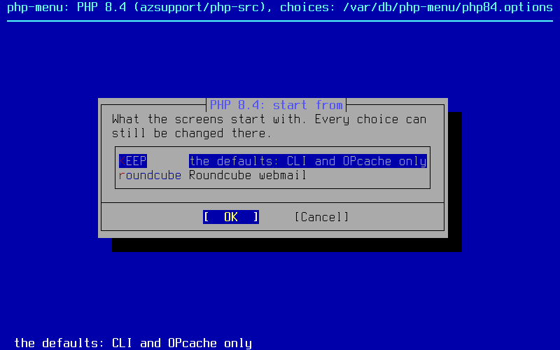
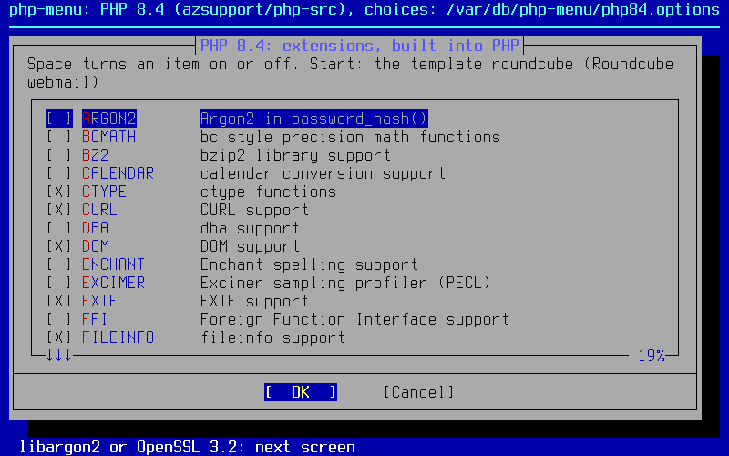
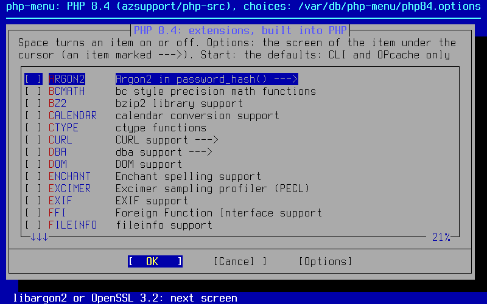
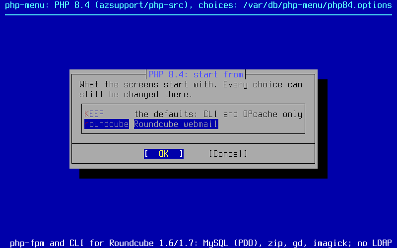
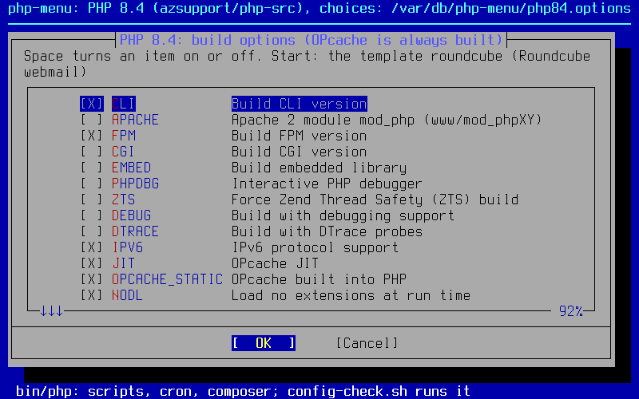
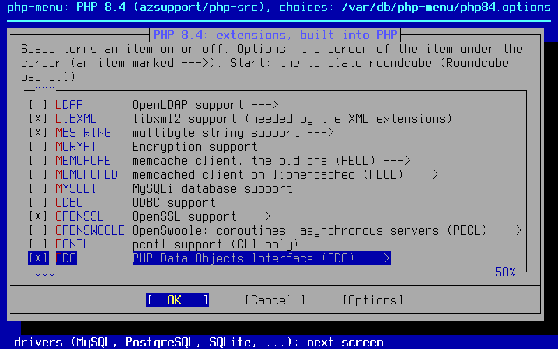
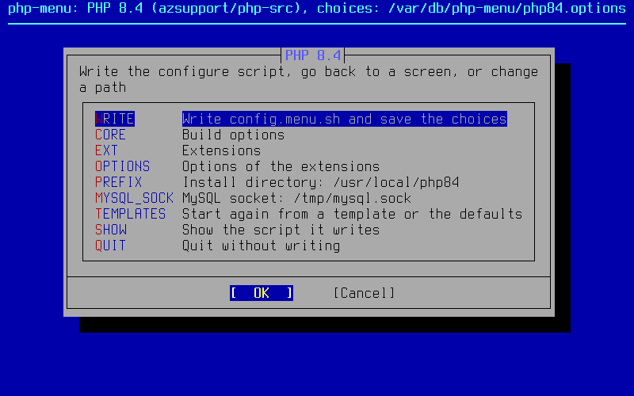
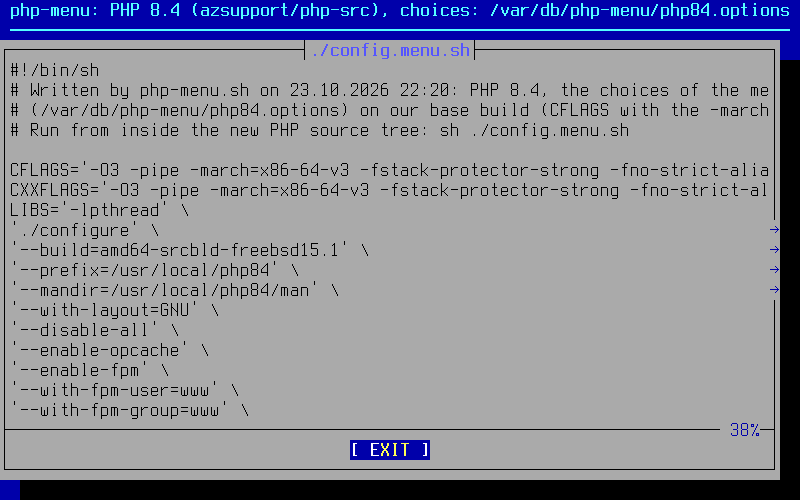
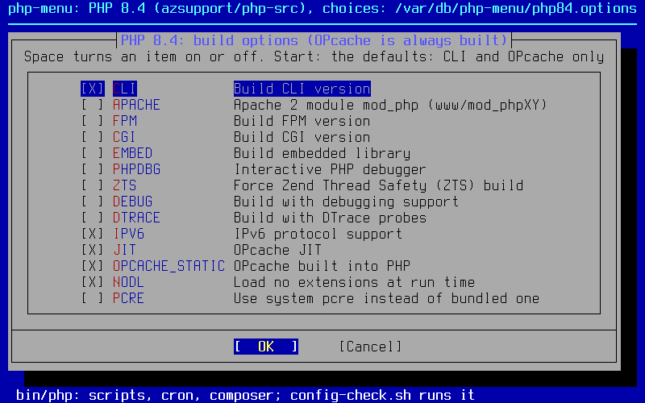

# PHP для FreeBSD: ветки исходников с исправлениями безопасности

**English: [README.md](README.md)**. Это перевод; если они разойдутся, верен английский
текст.

**Что это.** Готовые к сборке исходники PHP для серверов FreeBSD (amd64), где PHP
собирают вручную, а не ставят из портов или пакетов: PHP 5.6, 7.4, 8.1, 8.2, 8.3 и
8.4, по ветке `freebsd/<версия>` на каждую. Каждая ветка идёт за своим источником
исправлений безопасности (официальные релизы php-src для 8.2–8.4, бэкпорты Remi
Collet для 5.6, 7.4 и 8.1, у которых закончилась поддержка) и добавляет небольшой
отобранный набор патчей портов FreeBSD и исправления для современной FreeBSD. Каждое
обновление выходит ещё и тарболом в релизах, где `configure` и парсеры bison/re2c уже
сгенерированы: на сервере нужны только компилятор C и `make` — как с тарболами с
php.net.

**Зачем.** Исправления безопасности для каждой версии PHP, которая ещё работает на
сервере, — в тот же день и без ожидания портов; один PHP, в который встроено всё
(расширения, встроенные расширения PECL, curl и PCRE, а при желании и OPcache, без
загрузки расширений во время работы); несколько версий рядом, каждая в своём
`/usr/local/phpXY` и со своим файлом модуля Apache (`libphp84.so`, …, `libphp56.so`).
С остальным помогают скрипты: [`config-check.sh`](tools/config-check.sh) записывает
опции configure того PHP, что стоит на сервере, [`php-menu.sh`](tools/php-menu.sh)
выбирает, что войдёт в сборку, диалогами — как `make config` портов.

Не связано с PHP Group, Remi Collet и проектом FreeBSD.
Предоставляется как есть, без гарантий, — [aZsupport.com](https://azsupport.com).

## Содержание

- [Ветки](#ветки)
  - [Патчи портов FreeBSD: что применено и что нет](#патчи-портов-freebsd-что-применено-и-что-нет)
- [Сборка на FreeBSD из тарбола релиза](#сборка-на-freebsd-из-тарбола-релиза)
  (файл модуля Apache, `LoadModule`)
  - [PHP 8.4](#php-84), [8.3](#php-83), [8.2](#php-82), [8.1](#php-81), [7.4](#php-74), [5.6](#php-56)
  - [Что войдёт в сборку: php-menu.sh](#что-войдёт-в-сборку-php-menush)
  - [Встроенный OPcache и запрет загрузки расширений](#встроенный-opcache-и-запрет-загрузки-расширений)
  - [Тестовая сборка на FreeBSD](#тестовая-сборка-на-freebsd)
  - [Встроенные расширения PECL](#встроенные-расширения-pecl)
  - [OpenSSL](#openssl)
  - [Встроенный curl](#встроенный-curl)
  - [Встроенная PCRE](#встроенная-pcre)
- [Как приходят обновления](#как-приходят-обновления)
  - [Патчи совместимости сборки](#патчи-совместимости-сборки)
  - [Опции сборки](#опции-сборки)
  - [Временные бэкпорты](#временные-бэкпорты)
  - [Токен](#токен)
- [Авторы и лицензии](#авторы-и-лицензии)

## Ветки

| Ветка | PHP | Источник | Поддержка источника | Последний тарбол |
|---|---|---|---|---|
| [`freebsd/8.4`](https://github.com/azsupport/php-src/tree/freebsd/8.4) | 8.4.x | новейший официальный тег релиза `php-8.4.N` ([php/php-src](https://github.com/php/php-src)) | исправления безопасности до 31.12.2028 | [freebsd-8.4-latest](https://github.com/azsupport/php-src/releases/tag/freebsd-8.4-latest) |
| [`freebsd/8.3`](https://github.com/azsupport/php-src/tree/freebsd/8.3) | 8.3.x | новейший официальный тег релиза `php-8.3.N` | исправления безопасности до 31.12.2027 | [freebsd-8.3-latest](https://github.com/azsupport/php-src/releases/tag/freebsd-8.3-latest) |
| [`freebsd/8.2`](https://github.com/azsupport/php-src/tree/freebsd/8.2) | 8.2.x | новейший официальный тег релиза `php-8.2.N` | исправления безопасности до 31.12.2026 | [freebsd-8.2-latest](https://github.com/azsupport/php-src/releases/tag/freebsd-8.2-latest) |
| [`freebsd/8.1`](https://github.com/azsupport/php-src/tree/freebsd/8.1) | 8.1.34 + бэкпорты | Remi Collet, [`PHP-8.1-security-backports`](https://github.com/remicollet/php-src-security/tree/PHP-8.1-security-backports) | поддержка закончилась 31.12.2025 | [freebsd-8.1-latest](https://github.com/azsupport/php-src/releases/tag/freebsd-8.1-latest) |
| [`freebsd/7.4`](https://github.com/azsupport/php-src/tree/freebsd/7.4) | 7.4.33 + бэкпорты | Remi Collet, [`PHP-7.4-security-backports`](https://github.com/remicollet/php-src-security/tree/PHP-7.4-security-backports) | поддержка закончилась 28.11.2022 | [freebsd-7.4-latest](https://github.com/azsupport/php-src/releases/tag/freebsd-7.4-latest) |
| [`freebsd/5.6`](https://github.com/azsupport/php-src/tree/freebsd/5.6) | 5.6.40 + бэкпорты | Remi Collet, [`PHP-5.6-security-backports-openssl11`](https://github.com/remicollet/php-src-security/tree/PHP-5.6-security-backports-openssl11) (поддержка OpenSSL 1.1; OpenSSL 3 — патчем совместимости здесь) | поддержка закончилась 31.12.2018 | [freebsd-5.6-latest](https://github.com/azsupport/php-src/releases/tag/freebsd-5.6-latest) |

Про релиз безопасности PHP от 21.10.2026 (CVE-2026-109618, CVE-2026-109619,
[анонс](https://www.php.net/archive/2026.php)): в `freebsd/8.2`, `freebsd/8.3` и
`freebsd/8.4` — официальные исправленные релизы 8.2.35, 8.3.36 и 8.4.27. В
`freebsd/7.4` и `freebsd/8.1` — коммит «Avoid state corruption via bailout» (Arnaud
Le Blanc) из веток Remi Collet: минимальный бэкпорт в исходниках, который команда
безопасности PHP дала для 7.4, 8.0 и 8.1. Он меньше полного исправления 8.2+ (например,
session upload progress в нём выключен в коде), поэтому на этих версиях оставьте меры в
конфигурации из анонса. В `freebsd/5.6` — перенос того же коммита на движок PHP 5, без
проверки в апстриме: фатальные ошибки аллокатора завершают воркер через `_exit()`, а не
`longjmp()`; состояние, до которого ошибка может дотянуться к следующему запросу,
сбрасывается; разбор multipart хранит только те заголовки, которые использует; session
upload progress выключен в коде. При исчерпании памяти воркер сразу завершается, как и с
официальным исправлением: shutdown-функции не выполняются, буферизованный вывод
теряется, ошибка уходит в stderr (лог ошибок php-fpm или Apache). Меры в конфигурации
оставьте и там. Перенос из двух частей:
[`backport-php2shell-1.patch`](freebsd/patches/5.6/backport-php2shell-1.patch) — код,
предложенный в ветку Remi Collet в
[pull request #32](https://github.com/remicollet/php-src-security/pull/32), тот же
код, что и наш перенос, как есть, чтобы синк пропустил его, когда он появится в его
ветке; [`backport-php2shell-2-extra.patch`](freebsd/patches/5.6/backport-php2shell-2-extra.patch)
добавляет то, что есть в официальном исправлении и в других известных нам переносах для
5.6 (php5.6 5.6.40-104 Ondřej Surý, патч 0261, и перенос
[vperetti](https://github.com/vperetti/php-cve-2026-109618-109619-backports)), но нет в
том pull request: самые маленькие массивы для `$_GET`, `$_POST`, `$_COOKIE`, более
ранний сброс исключения после освобождения объектов и сброс header callback.

Ветка 5.6 у Remi Collet не обновлялась с 02.07.2026, а его ветка 7.4 получила
исправления релизов PHP с июля по октябрь 2026. В `freebsd/5.6` — наши переносы этих
исправлений, по патчу на область в [`freebsd/patches/5.6/`](freebsd/patches/5.6)
(`backport-*.patch`, коммиты апстрима — в строке `Origin:` каждого), с их тестами:

| Патч | Что исправляет |
|---|---|
| `backport-gd-gif-lzw.patch` | CVE-2026-9672: декодер GIF LZW встроенной libgd |
| `backport-pgsql-quotes.patch` | GHSA-7qpv-r5mr-78m4 (CVE-2026-17543): SQL-инъекция через `pg_insert()` и родственные функции (кавычки `E'...'`) |
| `backport-phar-tar.patch` | GHSA-vc5h-9ppw-p5f3 (CVE-2026-7260): циклы символических ссылок в tar-архивах; GHSA-j3wh-g957-2m85: подмена записей tar |
| `backport-date-period.patch` | повторный `DatePeriod::__construct()` (утечка), аргументы, не инициализированные своим конструктором |
| `backport-convert-filters.patch` | GHSA-88hq-2827-7pg6: чтение за границей кучи в фильтрах потоков convert.* |
| `backport-fpm-allowed-clients.patch` | GHSA-62xp-839h-2637: `listen.allowed_clients` сравнивал 96 из 128 бит адресов IPv6 |
| `backport-openssl-peer-name.patch` | GHSA-vvx9-73fr-5jjx: нет перехода на CN, если в сертификате есть имя DNS, URI или SRV; GHSA-xr7j-rvgx-xq5p: чтение за границей при сравнении по маске |
| `backport-http-redirects.patch` | GHSA-fpwc-w8rq-cr92: учётные данные сохранялись при редиректе на другой origin; GH-11274: 307/308 сохраняют POST |
| `backport-soap.patch` | GHSA-rgrp-mwpx-f6rm: неограниченная рекурсия в ext/soap; GHSA-cj93-vc83-wgqv: размеры чанков в HTTP-клиенте SOAP |
| `backport-filter-encoded.patch` | GHSA-ch8v-r6jh-4vvr: `FILTER_SANITIZE_ENCODED` оставлял 0xFF как есть |
| `backport-mysqlnd-overread.patch` | GHSA-h35g-vwh6-m678 (CVE-2024-8929) и частичное исправление GHSA-r6x9-5r99-36j7: враждебный сервер MySQL выуживал байты кучи через чтение пакетов за границей в mysqlnd |

Не перенесены: GHSA-9f67-6fw4-hpfp (только Windows) и исправления для пустого и
односимвольного `Location` (5.6 не затронута: по пустому она не переходит и читает его
в буфер фиксированного размера). Исправлению mysqlnd понадобилось и усиление 2024 года
(GHSA-h35g-vwh6-m678, CVE-2024-8929), которого нет ни в 5.6 у Remi Collet, ни у Ondřej
Surý, поэтому `backport-mysqlnd-overread.patch` переносит из PHP 7.4 и коммит 2024 года,
и частичное исправление 2026 года, с тестами протокола на поддельном сервере,
адаптированными для 5.6. Из этого alt-php56 5.6.40-135 от TuxCare (errata от
10.08.2026, например
[CLSA-2026:1786360064](https://errata.tuxcare.com/els_alt_php/el8/CLSA-2026-1786360064.html))
исправляет CVE-2026-9672, CVE-2026-17543 и CVE-2026-7260.

Каждая ветка — это апстрим плюс такие коммиты, в таком порядке:

1. **Apply curated FreeBSD ports patches**: взяты из `lang/phpXY`
   [коллекции портов FreeBSD](https://github.com/freebsd/freebsd-ports); файлы патчей с
   описанием и строкой происхождения — в [`freebsd/patches/`](freebsd/patches). Тот же
   коммит удаляет каталог `.github/` апстрима, чтобы собственный CI php-src не
   запускался в этом форке (в тарболах релизов его и так нет).
2. **Apply build compatibility patches**: во всех ветках — имя файла модуля Apache
   (`libphpXY.so`), в 5.6 и 7.4 ещё и изменения, с которыми старая ветка собирается и
   работает на современной FreeBSD, см.
   [Патчи совместимости сборки](#патчи-совместимости-сборки).
3. **Backport security fixes** (только пока такие есть, сейчас 5.6): см.
   [Временные бэкпорты](#временные-бэкпорты).
4. **Bundle PECL extensions**: redis, memcached, memcache, igbinary, imagick,
   gmagick, swoole, OpenSwoole, excimer и mcrypt в `ext/`; собираются, только если
   включены, см. [Встроенные расширения PECL](#встроенные-расширения-pecl).
5. **Bundle curl**: curl в `ext/curl/libcurl`, встраивается в PHP с
   `--with-curl=bundled`, см. [Встроенный curl](#встроенный-curl).
6. **Bundle PCRE**: новейшая PCRE2 (5.6: PCRE 8.45) вместо той, что встроена в
   апстриме, см. [Встроенная PCRE](#встроенная-pcre).
7. **Add the build options of this fork**: встроенный OPcache и запрет загрузки
   расширений, выключены, пока не заданы в configure, см.
   [Встроенный OPcache и запрет загрузки расширений](#встроенный-opcache-и-запрет-загрузки-расширений).
8. **Show the build id in the `php -v` banner**: новый макрос `PHP_FORK_BUILD`
   дописывается в баннер склейкой строковых литералов C, так что `php -v` показывает дату
   сборки и коммит апстрима, например
   `PHP 7.4.33 (cli) (built: ...) (fork: 20261021-fbsd-802c2107)`. `PHP_VERSION` остаётся
   чистой версией апстрима `7.4.33`, поэтому `phpversion()`, `version_compare()` и
   разборщики `PHP x.y.z` не сбиваются. В 8.2+ баннер общий для всех SAPI (`php -v`,
   `php-fpm -v`); в 5.6/7.4 это баннер CLI. `phpinfo()` показывает чистую версию, без id
   сборки.
9. **README: describe the freebsd/X.Y branch**: блок заметок поверх исходного README с
   точным коммитом апстрима (строка `Upstream-Commit:`) и списками применённых и не
   применённых патчей портов; в заметках релиза — те же списки.

Ветки Remi Collet зеркалируются под исходными именами
(`PHP-5.6-security-backports-openssl11`, `PHP-7.4-security-backports`,
`PHP-8.1-security-backports`) и поддерживаются в актуальном виде workflow. Теги релизов
`php-5.6.40`, `php-7.4.33`, `php-8.1.34`, `php-8.2.34`, `php-8.3.35` и `php-8.4.26`
зеркалированы один раз 21.10.2026; более новые официальные теги не зеркалируются, потому
что их push запустил бы здесь CI php-src, который срабатывает на теги, но их полная
история входит в ветки `freebsd/8.x`.

### Патчи портов FreeBSD: что применено и что нет

Применяются только патчи, которые важны для монолитной сборки на FreeBSD:

- `sapi/fpm/config.m4` (5.6–8.3): FPM узнаёт очередь listen через `SO_LISTENQLEN`; в
  `struct tcp_info` FreeBSD нет полей Linux.
- `sapi/apache2handler/config.m4`: `make install` ставит модуль Apache, не меняя
  `httpd.conf` (без `apxs -a`), что важно на серверах с несколькими сборками PHP (а наш
  `compat-apache-module-name.patch` называет файл по версии, ниже).
- `build/Makefile.global` (`Makefile.global` в 5.6): `make install` не падает, если
  `php.ini` нет.
- `sapi/fpm/www.conf.in` (7.4+): поясняет, что адреса IPv4-mapped на FreeBSD по
  умолчанию выключены.
- `TSRM/TSRM.c` (8.1+): без ассемблера TLS для Linux aarch64 на FreeBSD (на amd64 ни на
  что не влияет).
- `ext/pcre/php_pcre.h` (8.4): с `--with-external-pcre` системный `<pcre2.h>`
  подключается так же, как в порту; со встроенной PCRE ни на что не влияет.
- только 5.6, `Zend/zend.h`: без `alloca()` в потокобезопасных (ZTS) сборках на FreeBSD;
  на сборки без ZTS не влияет.
- только 5.6, `Zend/zend_compile.h`, `Zend/zend_execute.h`, `Zend/zend_list.[ch]`:
  макросы с арифметикой указателей превращены во встраиваемые функции (без
  неопределённого поведения, которое новый clang компилирует неверно) и 64-битные id
  списка ресурсов.

Не применены, по видам:

- раздельная упаковка портов, где каждое расширение — отдельный пакет:
  `configure.ac` / `configure.in` (они подключают `ext/php_config.h`, который создаёт
  только Makefile портов, так что ручная сборка упала бы, и задают `include_path` PEAR
  портов), `acinclude.m4`, `ext/mysqli/*`, `ext/zlib/config0.m4`,
  `ext/standard/image.c`, `php_session.h`;
- другие архитектуры процессоров: `sljit` и `xxhash` для PowerPC;
- `ext/openssl/openssl.c` для LibreSSL (8.4);
- 5.6: экспериментальный SAPI apache2filter и правка проверки pthreads в configure из
  портов;
- скрипты rc.d портов (`php-fpm.in`, `php_fpm.in`).

Точный список для каждой версии, по строке на файл порта с причиной, — в
`freebsd/patches/<версия>/SKIPPED`, в README ветки и в заметках релиза.

## Сборка на FreeBSD из тарбола релиза

Релиз `freebsd-<версия>-latest` всегда несёт новейший тарбол ветки; датированные релизы
(`freebsd-<версия>-<ГГГГММДД>-<коммит>`) сохраняются. Тарбол распаковывается в каталог
с датой и коммитом апстрима, например `php-7.4.33-fbsd-20261021-802c2107/`, и PHP из
него показывает то же в баннере `php -v`:
`PHP 7.4.33 (cli) (built: ...) (fork: 20261021-fbsd-802c2107)`. Сама версия остаётся
`7.4.33`. У тарболов, выпущенных до появления этого (21.10.2026), `(fork: ...)` в
баннере нет.

Каждый блок пересобирает одну версию с опциями PHP, установленного в `/usr/local/phpXY`:
скачивает и проверяет новейший тарбол, распаковывает его в `/root`, пишет
`config.installed.sh` скриптом [`tools/config-check.sh`](tools/config-check.sh), затем
конфигурирует, собирает и ставит. Вставляйте блок как есть: команды работают и в `sh`, и
в `csh`, а комментариев в них нет нарочно — интерактивный csh не считает `#`
комментарием. Если PHP стоит в другом месте (например, `/usr/local/php5640`), поменяйте
префикс в строке `config-check.sh` и в последней строке. После этого перезапустите
Apache или php-fpm, чтобы ни один воркер не остался на старом бинарнике.

Модуль Apache ставится в `/usr/local/libexec/apache24/` как `libphpXY.so`
(`libphp84.so`, `libphp83.so`, … `libphp74.so`, `libphp56.so`), а не как `libphp.so`,
`libphp7.so` или `libphp5.so`, — чтобы сборки разных версий не затирали друг друга.
`make install` не правит `httpd.conf`: после первой такой установки направьте строку
`LoadModule` на новый файл, иначе Apache продолжит грузить старый:

| Версия | Строка `LoadModule` |
|---|---|
| 8.1–8.4 | `LoadModule php_module libexec/apache24/libphp84.so` (`libphp83.so`, `libphp82.so`, `libphp81.so`) |
| 7.4 | `LoadModule php7_module libexec/apache24/libphp74.so` |
| 5.6 | `LoadModule php5_module libexec/apache24/libphp56.so` |

Один Apache грузит один модуль PHP.

### PHP 8.4

```sh
cd /root
fetch https://github.com/azsupport/php-src/releases/download/freebsd-8.4-latest/php-8.4-fbsd-latest.tar.xz
fetch https://github.com/azsupport/php-src/releases/download/freebsd-8.4-latest/php-8.4-fbsd-latest.tar.xz.sha256
sha256 -c `cut -d' ' -f1 php-8.4-fbsd-latest.tar.xz.sha256` php-8.4-fbsd-latest.tar.xz
tar xf php-8.4-fbsd-latest.tar.xz
cd /root/`tar tf php-8.4-fbsd-latest.tar.xz | head -1`
fetch https://raw.githubusercontent.com/azsupport/php-src/master/tools/config-check.sh
sh config-check.sh /usr/local/php84
sh config.installed.sh
make -j`sysctl -n hw.ncpu`
make install
/usr/local/php84/bin/php -v
```

### PHP 8.3

```sh
cd /root
fetch https://github.com/azsupport/php-src/releases/download/freebsd-8.3-latest/php-8.3-fbsd-latest.tar.xz
fetch https://github.com/azsupport/php-src/releases/download/freebsd-8.3-latest/php-8.3-fbsd-latest.tar.xz.sha256
sha256 -c `cut -d' ' -f1 php-8.3-fbsd-latest.tar.xz.sha256` php-8.3-fbsd-latest.tar.xz
tar xf php-8.3-fbsd-latest.tar.xz
cd /root/`tar tf php-8.3-fbsd-latest.tar.xz | head -1`
fetch https://raw.githubusercontent.com/azsupport/php-src/master/tools/config-check.sh
sh config-check.sh /usr/local/php83
sh config.installed.sh
make -j`sysctl -n hw.ncpu`
make install
/usr/local/php83/bin/php -v
```

### PHP 8.2

```sh
cd /root
fetch https://github.com/azsupport/php-src/releases/download/freebsd-8.2-latest/php-8.2-fbsd-latest.tar.xz
fetch https://github.com/azsupport/php-src/releases/download/freebsd-8.2-latest/php-8.2-fbsd-latest.tar.xz.sha256
sha256 -c `cut -d' ' -f1 php-8.2-fbsd-latest.tar.xz.sha256` php-8.2-fbsd-latest.tar.xz
tar xf php-8.2-fbsd-latest.tar.xz
cd /root/`tar tf php-8.2-fbsd-latest.tar.xz | head -1`
fetch https://raw.githubusercontent.com/azsupport/php-src/master/tools/config-check.sh
sh config-check.sh /usr/local/php82
sh config.installed.sh
make -j`sysctl -n hw.ncpu`
make install
/usr/local/php82/bin/php -v
```

### PHP 8.1

```sh
cd /root
fetch https://github.com/azsupport/php-src/releases/download/freebsd-8.1-latest/php-8.1-fbsd-latest.tar.xz
fetch https://github.com/azsupport/php-src/releases/download/freebsd-8.1-latest/php-8.1-fbsd-latest.tar.xz.sha256
sha256 -c `cut -d' ' -f1 php-8.1-fbsd-latest.tar.xz.sha256` php-8.1-fbsd-latest.tar.xz
tar xf php-8.1-fbsd-latest.tar.xz
cd /root/`tar tf php-8.1-fbsd-latest.tar.xz | head -1`
fetch https://raw.githubusercontent.com/azsupport/php-src/master/tools/config-check.sh
sh config-check.sh /usr/local/php81
sh config.installed.sh
make -j`sysctl -n hw.ncpu`
make install
/usr/local/php81/bin/php -v
```

### PHP 7.4

```sh
cd /root
fetch https://github.com/azsupport/php-src/releases/download/freebsd-7.4-latest/php-7.4-fbsd-latest.tar.xz
fetch https://github.com/azsupport/php-src/releases/download/freebsd-7.4-latest/php-7.4-fbsd-latest.tar.xz.sha256
sha256 -c `cut -d' ' -f1 php-7.4-fbsd-latest.tar.xz.sha256` php-7.4-fbsd-latest.tar.xz
tar xf php-7.4-fbsd-latest.tar.xz
cd /root/`tar tf php-7.4-fbsd-latest.tar.xz | head -1`
fetch https://raw.githubusercontent.com/azsupport/php-src/master/tools/config-check.sh
sh config-check.sh /usr/local/php74
sh config.installed.sh
make -j`sysctl -n hw.ncpu`
make install
/usr/local/php74/bin/php -v
```

### PHP 5.6

```sh
cd /root
fetch https://github.com/azsupport/php-src/releases/download/freebsd-5.6-latest/php-5.6-fbsd-latest.tar.xz
fetch https://github.com/azsupport/php-src/releases/download/freebsd-5.6-latest/php-5.6-fbsd-latest.tar.xz.sha256
sha256 -c `cut -d' ' -f1 php-5.6-fbsd-latest.tar.xz.sha256` php-5.6-fbsd-latest.tar.xz
tar xf php-5.6-fbsd-latest.tar.xz
cd /root/`tar tf php-5.6-fbsd-latest.tar.xz | head -1`
fetch https://raw.githubusercontent.com/azsupport/php-src/master/tools/config-check.sh
sh config-check.sh /usr/local/php56
sh config.installed.sh
make -j`sysctl -n hw.ncpu`
make install
/usr/local/php56/bin/php -v
```

Для 5.6 на FreeBSD 14 и 15 опции `--with-mcrypt=/usr/local` нужен пакет `libmcrypt`
(`--with-pcre-regex=/usr/local` со встроенной PCRE 8.45 не пишется, см.
[Встроенная PCRE](#встроенная-pcre)); FreeType находится через `pkg-config` (в пакете
`freetype2` больше нет `freetype-config`).

Аргумент `config-check.sh` — каталог установки (`/usr/local/php82`); скрипт запускает из
него `bin/php` (или `sbin/php-fpm`, `bin/php-cgi`), подойдёт и путь к одному из этих
бинарников. На сервере, где PHP из пакетов (`lang/phpXY`, `phpXY-*`, `mod_phpXY`),
используйте `sh config-check.sh --pkg` (или `--pkg php74`, если пакетами стоит несколько
версий PHP): он пишет `config.installed.sh` для ручной сборки в `/usr/local/phpXY` — по
опции на каждый установленный пакет расширения плюс опции порта `phpXY`, берёт `CFLAGS`
и `CPUTYPE` из `/etc/make.conf`, перечисляет то, что не переносит (пакеты PECL,
утилиты), и печатает строку `pkg set -A 0`, которая сохранит библиотеки, когда пакеты
потом удалят. Встроенные расширения PECL сохраняют то, с чем были собраны их пакеты, —
как показывает `php --ri` PHP из пакетов: lz4 и zstd для redis (в `databases/php-redis`
включены по умолчанию), SASL, сериализатор JSON и `MemcachedServer` для memcached
(умолчания `databases/pecl-memcached`), igbinary, хуки swoole. Одна сборка делает только
один модуль SAPI (`./configure`: «You can build only one SAPI module»), а порты собирают
модуль Apache (`mod_phpXY`) и embed-библиотеку (опция `EMBED` у `phpXY`, `libphp7.so` в
`/usr/local/lib`) отдельно: если стоит `mod_phpXY`, скрипт оставляет модуль Apache,
опускает `--enable-embed` и говорит, линкуется ли с embed-библиотекой какой-нибудь пакет
(`pkg shlib -R libphp7.so`).

`config-check.sh` берёт опции установленного PHP (`php -n -i`, строка Configure
Command) и никогда не берёт `config.nice` вслепую: `config.nice` может остаться от
запуска configure, который так и не был установлен. Он сравнивает их с `config.nice`
старой сборки, который находит сам: `/root/php-<установленная версия>/config.nice` или
новейший `/root/php-<установленная версия>-fbsd-*/config.nice` от прошлой сборки этого
форка; другой можно указать вторым аргументом
(`sh config-check.sh /usr/local/php74 /root/php-7.4.33/config.nice`). PHP 5.6 записывает
опции с пробелами в сломанных кавычках (`'CFLAGS=-O3 '-pipe' ...''`); скрипт читает их
так, как прочитал бы shell, — одной опцией. `php-config --configure-options`
(используется, когда бинарник не запускается) печатает опции совсем без кавычек, так что
`CFLAGS=-O3 -pipe ...` распадается на отдельные слова; скрипт возвращает слова после
`ИМЯ=значение` в его значение.

Окружение одинаково для каждой сборки PHP, что бы ни было у старой:

```
CFLAGS='-O3 -pipe -march=<CPUTYPE из /etc/make.conf> -fstack-protector-strong -fno-strict-aliasing'
CXXFLAGS='-O3 -pipe -march=<CPUTYPE из /etc/make.conf> -fstack-protector-strong -fno-strict-aliasing'
LIBS='-lpthread'
```

и без `LDFLAGS` (clang не нужен `-fstack-protector` при линковке; `/usr/local/phpdeps`
добавляет свои). `CXXFLAGS` получает `-std=c++17` только для intl в PHP 7.4 и новее,
когда `c++` по умолчанию берёт более старый стандарт: clang 16 и новее (FreeBSD 13.3 и
новее) и так берёт C++17, а PHP 8.1 и новее сам выбирает его для ICU 74 и новее. Строки
`CFLAGS`, `CXXFLAGS`, `LDFLAGS`, `LIBS`, `CPPFLAGS`, `CC`, `CXX` и `CPP` старого
`config.nice` и каждая опция `ИМЯ=значение` установленной сборки (окружение её запуска
configure, которое записывает autoconf: PHP 5.6 держит там `CFLAGS` и подобные, порты
оставляют `CC=cc`, `CPP=cpp`, `PKG_CONFIG`, `LDFLAGS=-fstack-protector`) отбрасываются и
перечисляются в отчёте; остальные строки окружения `config.nice` (`PKG_CONFIG_PATH`,
`OPENSSL_CFLAGS`, …) переносятся. `--build` называет нашу сборку и систему, на которой
она собрана, по образцу портов `amd64-portbld-freebsd15.1`: `amd64-srcbld-freebsd15.1`;
`build_alias` убирается.

`-march` всегда берётся из `/etc/make.conf` сервера, на котором работает скрипт
(`CPUTYPE` или `-march=` в его `CFLAGS`; без них — никакого): `-march` из `config.nice`,
скопированного с сервера с другим процессором, не переносится. Если процессору не
хватает того, что нужно этому `-march` (`x86-64-v4` нужен AVX-512, `x86-64-v3` — AVX2),
скрипт предупреждает: PHP с ним остановился бы там с `Illegal instruction`.

Собрать прямо из ветки тоже можно, но тогда нужны autoconf, bison и re2c (сначала
`./buildconf --force`).

### Что войдёт в сборку: php-menu.sh

[`tools/php-menu.sh`](tools/php-menu.sh) — это `make config` портов для этого форка:
диалоги (bsddialog на FreeBSD 14 и новее, dialog на 13) с опциями `lang/phpXY` и
`mod_phpXY` (SAPI, ZTS, отладка, IPv6, JIT OPcache, системная PCRE), расширениями
`phpXY-extensions` плюс встроенными расширениями PECL и опциями отдельных расширений
(какой libcurl, legacy-провайдер OpenSSL, какая libgd и её форматы, обработчики DBA,
сессии, сериализаторы и сжатие redis и memcached, Argon2 из libargon2 или из OpenSSL 3.2
в 8.4, …), с описаниями из портов. В отличие от портов, всё встраивается в один PHP. Что
от чего зависит, проверяется прямо при выборе — по скриптам configure и исходникам C
каждой ветки: расширение, которое нужно другому, включается с пояснением (XSL включает
DOM, сериализатор igbinary у redis включает igbinary), а то, что не может быть вместе,
не пропускается (модуль Apache и embed-библиотека, imagick и gmagick, swoole и
openswoole, ZTS и Argon2 из OpenSSL).

Запускайте его внутри дерева исходников, после `config-check.sh`, и собирайте скриптом,
который он пишет, вместо `config.installed.sh`:

```sh
fetch https://raw.githubusercontent.com/azsupport/php-src/master/tools/php-menu.sh
sh php-menu.sh
sh config.menu.sh
```

Он начинает с того, что есть в установленной сборке (`config.installed.sh` от
`config-check.sh`), сохраняет её окружение и прочие опции (layout, пути php.ini,
`--build`) и пишет `config.menu.sh` — скрипт того же вида, с SAPI, опциями сборки и
расширениями, выбранными в меню. Без `config.installed.sh` он начинает только с нашей
базовой сборки (`/usr/local/phpXY`, `--disable-all`, CLI и OPcache; SAPI и расширения
выбираются) с флагами компилятора, общими для всех сборок. OPcache внутри PHP и запрет
загрузки расширений (опции этого форка, ниже) по умолчанию включены. На последнем экране
вводятся два пути: каталог установки (по умолчанию `/usr/local/phpXY` или каталог
установленной сборки; из него получаются `--prefix` и `--mandir=<каталог>/man`, а прочие
пути установленной сборки внутри её старого каталога переезжают вместе с ним) и — с
mysqli или pdo_mysql (5.6: с расширением mysql) — сокет MySQL (`/tmp/mysql.sock`; один
`--with-mysql-sock` задаёт значение по умолчанию и `mysqli.default_socket`, и
`pdo_mysql.default_socket`). `--infodir` не пишется (PHP не ставит info-страниц),
`--localstatedir=/var` — только вместе с FPM (его читает один php-fpm). phpdbg выключен,
пока его не выбрать: в 7.4 и новее меню пишет `--disable-phpdbg`, потому что
`--disable-all` не трогает SAPI. Встроенный curl выбран по умолчанию там, где в базовой
системе OpenSSL 3 (FreeBSD 14 и новее), Argon2 из OpenSSL — где 3.2 (FreeBSD 15). Выбор
сохраняется так же, как его сохраняют порты, — в `/var/db/php-menu/phpXY.options` — и
становится началом следующего запуска (`--reset` начинает заново). В конце меню
называет пакеты, которые нужны выбору. `sh php-menu.sh --batch +GD -CGI PREFIX=/usr/local/php84`
пишет скрипт без диалогов, `sh php-menu.sh --list` показывает пункты, пути, их
состояние и шаблоны.

**Шаблоны.** Сначала меню спрашивает, с чего начать: с того, что оно нашло (сохранённый
выбор, установленная сборка или значения по умолчанию), или с шаблона — набора выборов
под одно приложение; в главном меню это есть ещё раз («Templates»). Шаблон включает свои
пункты и выключает остальные SAPI и расширения, которые в нём названы, прочее остаётся
по умолчанию, а то, что нужно его пунктам, включается тоже; на экранах после этого
можно поменять что угодно. Без диалогов: `sh php-menu.sh --batch --template=roundcube`.

- `roundcube` (7.4 и новее): php-fpm и CLI (скрипты из `bin/`, cron) для
  [Roundcube](https://roundcube.net/) 1.6 (PHP 7.3+) и 1.7 (PHP 8.1+). Расширения,
  которых требует его инсталлятор (ctype, dom, filter, intl, json, mbstring с функциями
  регэкспов, openssl, session, PDO, xml), те, что на
  [странице wiki](https://github.com/roundcube/roundcubemail/wiki/Install-Requirements)
  и у его библиотек (fileinfo, iconv, sockets), и его необязательные, кроме LDAP: curl
  (встроенный, для Guzzle), exif (ориентация фото JPEG), gd (JPEG, WebP и FreeType для
  1.7), imagick, xmlwriter, zip. Только MySQL и только через PDO (pdo_mysql): без mysqli,
  PostgreSQL, SQLite и LDAP. Сверено с Roundcube 1.6.20 и 1.7.5.

Меню с шаблоном `roundcube` (bsddialog в консоли FreeBSD 80x25, шрифт Terminus): с чего
начать, опции сборки, расширения, опции curl, GD, mbstring и OpenSSL, главное меню и
скрипт, который оно пишет:

<p></p>

Расширения с шаблоном `roundcube` и у голой сборки (по умолчанию: только CLI и OPcache):

<p></p>
<p></p>

<details>
<summary>Ещё экраны: с чего начать, опции сборки, главное меню, скрипты</summary>

<p></p>
<p></p>
<p></p>
<p></p>
<p></p>
<p></p>
<p></p>
<p></p>

</details>

Картинки делает [`tools/menu-screenshots.py`](tools/menu-screenshots.py) (pyte и
Pillow): bsddialog в терминале 80x25, шрифт Terminus и 16 цветов консоли FreeBSD.

### Встроенный OPcache и запрет загрузки расширений

Две опции configure этого форка, во всех ветках (патчи
`freebsd/patches/<версия>/feature-*.patch`). Обе выключены, пока их не задать;
`php-menu.sh` включает обе по умолчанию — в том числе когда начинает с
`config.installed.sh` сборки, сделанной до них.

- `--enable-opcache-static`: OPcache встраивается в PHP (одинаково в CLI, php-fpm,
  php-cgi и модуль Apache), как в PHP 8.5: `opcache.so` нет, строка `zend_extension` не
  нужна. Оставшаяся `zend_extension=opcache.so` молча пропускается, даже если старый
  `opcache.so` ещё лежит в `extension_dir`; `opcache.enable` и прочие настройки
  `opcache.*` работают как раньше. В 8.x не вместе с ZTS и JIT (до PHP 8.5 JIT достаёт
  данные потока способом, который работает только из `opcache.so`): configure
  останавливается — добавьте `--disable-opcache-jit` или соберите `opcache.so`.
- `--disable-extension-loading`: PHP не загружает расширения во время работы. Строки
  `extension=` и `zend_extension=`, `dl()` и `php -z` отклоняются с предупреждением при
  старте, где назван файл; строка расширения, которое уже встроено (`extension=mysqli`),
  молча пропускается; `php -i` показывает
  `Dynamic Library Support => disabled (--disable-extension-loading)`. configure
  останавливается, если какое-то расширение собиралось бы как `.so` (для OPcache
  добавьте `--enable-opcache-static`).

Без меню добавьте их к сборке: `sh config.installed.sh --enable-opcache-static
--disable-extension-loading`. Когда такая сборка установлена, строки `extension=` и
`zend_extension=opcache.so` в php.ini больше не нужны.

### Тестовая сборка на FreeBSD

[`.github/workflows/build-test.yml`](.github/workflows/build-test.yml) собирает тарболы
`-latest` в виртуальной машине FreeBSD (по умолчанию 15.1: clang 19, OpenSSL 3.5 из
базы, библиотеки из `pkg`) с опциями configure наших серверов, встроенным curl
(`--with-curl=bundled`) и `--with-openssl-legacy-provider`, затем запускает `php -v`,
`php -m`, [`tools/build-test-smoke.php`](tools/build-test-smoke.php) (ошибки разбора, DNS
и IPv6, `tls://`, `ssl://` и `https://`, legacy-шифры OpenSSL, `openssl_seal()`, GD с
FreeType, XML, сессии, встроенный curl и другое) и часть тестов PHP. Результат по каждой
версии виден на странице запуска. Запуск — на
https://github.com/azsupport/php-src/actions/workflows/build-test.yml кнопкой
**Run workflow**. На машине с FreeBSD тот же скрипт работает из checkout этой ветки, с
тарболами в `dist/`: `sh tools/build-test.sh --deps 5.6 7.4` ставит пакеты,
`sh tools/build-test.sh --tests 5.6 7.4` собирает и проверяет; наборы опций — в
[`tools/build-test.sh`](tools/build-test.sh).

### Встроенные расширения PECL

Ветки и тарболы несут эти расширения PECL в `ext/`, поэтому они встраиваются в PHP так
же, как штатные, и не требуют ни `phpize`, ни строки `extension=`. Ничего не меняется,
пока не задана их опция:

| PHP | redis | memcached | memcache | igbinary | imagick | gmagick |
|---|---|---|---|---|---|---|
| 8.2, 8.3, 8.4 | 6.3.0 | 3.4.0 | 8.2 | 3.2.16 | 3.8.1 | 2.0.6RC1 |
| 8.1 | 6.3.0 | 3.4.0 | 8.2 | 3.2.16 | 3.8.1 | 2.0.6RC1 |
| 7.4 | 6.3.0 | 3.4.0 | 4.0.5.3 | 3.2.16 | 3.8.1 | 2.0.6RC1 |
| 5.6 | 4.3.0 | 2.2.0 | 3.0.8 | 2.0.8 | 3.8.1 | 1.1.7RC3 |

| PHP | swoole | OpenSwoole | excimer | mcrypt |
|---|---|---|---|---|
| 8.2, 8.3, 8.4 | 6.2.3 | 4.12.1 | 1.2.7 | 1.0.9 |
| 8.1 | 6.1.10 | 4.12.1 | 1.2.7 | 1.0.9 |
| 7.4 | 4.8.13 | 4.12.1 | 1.2.7 | 1.0.9 |
| 5.6 | | | | в самом PHP 5.6 |

| Расширение | Опция configure | Пакет FreeBSD |
|---|---|---|
| [redis](https://pecl.php.net/package/redis) | `--enable-redis` | |
| [memcached](https://pecl.php.net/package/memcached) | `--enable-memcached --with-libmemcached-dir=/usr/local --disable-memcached-sasl` | `libmemcached` |
| [memcache](https://pecl.php.net/package/memcache) | `--enable-memcache` | |
| [igbinary](https://pecl.php.net/package/igbinary) | `--enable-igbinary`; как сериализатор для redis и memcached ещё `--enable-redis-igbinary` и `--enable-memcached-igbinary` | |
| [imagick](https://pecl.php.net/package/imagick) | `--with-imagick=/usr/local`; не вместе с gmagick | `ImageMagick7` или `ImageMagick7-nox11` |
| [gmagick](https://pecl.php.net/package/gmagick) | `--with-gmagick=/usr/local`; не вместе с imagick | `GraphicsMagick` |
| [swoole](https://pecl.php.net/package/swoole) (7.4 и новее) | `--enable-swoole`; не вместе с OpenSwoole | `brotli` (по желанию, для сжатия brotli) |
| [OpenSwoole](https://pecl.php.net/package/openswoole) (7.4 и новее) | `--enable-openswoole`; не вместе со swoole | |
| [excimer](https://pecl.php.net/package/excimer) (7.4 и новее) | `--enable-excimer` | |
| [mcrypt](https://pecl.php.net/package/mcrypt) (7.4 и новее) | `--with-mcrypt=/usr/local` | `libmcrypt` |

Версии — новейшие стабильные релизы PECL для каждой версии PHP, с такими исключениями:
- memcache для 5.6 — 3.0.8, релиз, который дистрибутивы ставили для PHP 5.5/5.6; его
  единственный стабильный релиз 5.x — 2.2.7 от 2012 года.
- у gmagick стабильного релиза нет вовсе: 2.0.6RC1 (бета, 2021) плюс два более поздних
  коммита его git master с исправлениями для PHP 8.1, и 1.1.7RC3 для 5.6.
- OpenSwoole везде 4.12.1, см. ниже.

Исходники берутся из git-репозиториев апстрима на коммите тега релиза (у gmagick, где
тегов нет, — на коммите релиза), закреплённом в [`freebsd/pecl.conf`](freebsd/pecl.conf);
исправления, с которыми они собираются внутри php-src с clang 19, — в
[`freebsd/pecl/`](freebsd/pecl). Расширениям нужен `--enable-session` (обработчики
сессий); в 5.6 и 7.4 redis нужен ещё `--enable-json`, а в 5.6 — `--enable-hash`.

Две пары можно собрать только по одному из пары, и configure останавливается, если
заданы обе опции пары. В GraphicsMagick и ImageMagick одинаковые имена функций
MagickWand, так что imagick и gmagick в одном PHP вызывали бы библиотеку друг друга;
OpenSwoole — форк swoole с теми же символами C++. Чтобы на сервере были оба из пары,
встройте один в PHP, а другой соберите отдельным модулем через `phpize`.

OpenSwoole — 4.12.1 для всех версий с 7.4, линия 4.x, на которой работают серверы:
OpenSwoole 22 и новее изменили API (пространство имён `OpenSwoole\`, настройки ini
`openswoole.*`, нет `Co\` и `swoole.use_shortname`). 4.12 в апстриме поддерживает PHP
до 8.2; для 8.3 и 8.4 патч портирует её: новый `php_url_encode_hash_ex()` из 8.3,
`zend_str_tolower()` вместо `php_strtolower()` (её нет в 8.4), границы стека C, которые
проверяет PHP 8.3, следуют за стеками корутин (иначе каждый вызов в корутине падает с
«Maximum call stack size reached»), `exit()` в корутине или сервере по-прежнему бросает
`Swoole\ExitException` на 8.4 (где exit стал функцией), а встроенная библиотека PHP явно
объявляет свои nullable-параметры (уведомления об устаревании в PHP 8.4). У OpenSwoole
нет порта FreeBSD, и в апстриме он на FreeBSD не компилировался: его `swoole_socket.h`
подключает `<netinet/ip6.h>` раньше `<sys/types.h>`, а его hiredis задаёт
`_XOPEN_SOURCE`, который прячет типы BSD, нужные `<netinet/ip6.h>`; патч исправляет и то
и другое, а тестовая сборка собирает его вместе с gmagick на 7.4–8.4.

В апстриме swoole и OpenSwoole включены по умолчанию (`--enable-swoole`,
`--enable-openswoole`), а configure OpenSwoole проверяет переменную swoole вместо своей:
внутри php-src это встроило бы их в каждый PHP (без `--disable-all`, а OpenSwoole даже с
ним); патчи делают их выключенными по умолчанию. Для swoole 4.8 и 6.1 и для OpenSwoole
патчи ещё убирают `--enable-openssl` апстрима: внутри php-src он сбрасывал настройку
`--with-openssl`, и mysqlnd тогда собирался без своего кода OpenSSL (RSA для
`caching_sha2_password`); теперь они берут OpenSSL, если PHP собран `--with-openssl`.
Патчи убирают `-std=c++11`/`-std=c++14`, которые swoole дописывает в `CXXFLAGS`, —
внутри php-src они действовали бы и на ext/intl (ICU 75 и новее нужен C++17). swoole 6.x
вызывает нигде не объявленный `sw_usleep()` в той ветке кода, которую компилирует
FreeBSD (нет futex): там `usleep()`, как в порту FreeBSD `devel/php-swoole`. excimer
добавляет `-fvisibility=hidden` только своим исходникам и на FreeBSD берёт id потока
своего таймера из `pthread_getthreadid_np()`: в FreeBSD нет `gettid()`, поэтому excimer
1.2.4 и новее там не компилировался (порт `devel/pecl-excimer` остался на 1.2.3).

С `--enable-memcached-igbinary` igbinary становится сериализатором memcached по
умолчанию (`memcached.serializer = igbinary`) для массивов и объектов. PHP без igbinary
такие значения прочитать не сможет, поэтому, пока серверы с ним и без него делят один
memcached, задайте в `php.ini` `memcached.serializer = php`. Значения, уже сохранённые
сериализатором php, читаются в любом случае. redis ничего не сериализует, пока не задан
`Redis::OPT_SERIALIZER`, так что там igbinary используется только там, где код просит
`Redis::SERIALIZER_IGBINARY`.

Чтобы добавить их к пересборке, допишите опции после `sh config.installed.sh`, например
`sh config.installed.sh --enable-redis --enable-memcache`, и уберите из `php.ini`
строки `extension=redis.so` старых отдельных модулей. `config-check.sh` сам не
добавляет их в `config.installed.sh`: для отдельных модулей установленного PHP, которые
есть в дереве, он в конце печатает готовую к копированию полную команду —
`sh config.installed.sh` с их опциями. Опции несут то, с чем модули были собраны
(`php --ri`: сериализатор igbinary, lzf/zstd/lz4, SASL, curl у swoole, c-ares, pgsql),
плюс `--enable-json`, `--enable-hash` или `--enable-session`, если в установленной
сборке нет того, что им нужно; отчёт перечисляет строки `extension=` (файл и строку),
которые надо убрать после `make install`. С `--pkg` установленные пакеты
`phpXY-pecl-*` превращаются в опции, как и прочие пакеты расширений.

Ежедневный workflow [`upstream-check.yml`](.github/workflows/upstream-check.yml) ищет
новые релизы этих расширений (теги репозиториев и PECL, сверяя с версиями PHP, которые
поддерживает каждый релиз), curl, библиотек curl и PCRE2; коммиты портов FreeBSD,
которые меняют патчи или сборку их портов и `lang/php8x`; файлы релизов в distinfo
портов curl и его библиотек, которых нет в бандле; и конец security-поддержки веток,
которые собираются из тегов php-src (8.2 — 31.12.2026), начиная за 60 дней до него, с
отметкой, есть ли у бэкпортов Remi Collet ветка, на которую можно перейти. Каждая
находка открывает одно issue с меткой `upstream`; само ничего не применяется. За чем он
следит — в [`freebsd/upstream.conf`](freebsd/upstream.conf).

### OpenSSL

- 8.1 и новее поддерживают OpenSSL 3 в апстриме: собирайте с OpenSSL базовой системы
  (`--with-openssl`).
- 7.4 собирается с OpenSSL 3 базовой системы FreeBSD 14 и 15 (3.5.6 во FreeBSD 15.1)
  благодаря [`compat-openssl3.patch`](freebsd/patches/7.4/compat-openssl3.patch):
  хватает `--with-openssl`, потому что FreeBSD поставляет `openssl.pc`. RC4 (по
  умолчанию у `openssl_seal()`), Blowfish, DES, RC2, CAST5 и MD4 там требуют
  `--with-openssl-legacy-provider` (ниже). Что ведёт себя иначе, чем с OpenSSL 1.1, —
  это сам OpenSSL 3, так же как с PHP 8.x: TLS 1.0/1.1 по умолчанию выключены,
  расшифровка RSA PKCS#1 v1.5 неверным ключом возвращает случайные байты вместо ошибки
  (защита от атаки Marvin), ключи DSA/DH короче 512 бит и сертификаты с неправильно
  записанным временем отклоняются. Сборка 7.4 с отдельным OpenSSL 1.1 ведёт себя как
  раньше.
- 5.6 собирается с тем же OpenSSL 3 базовой системы с
  [`compat-openssl3.patch`](freebsd/patches/5.6/compat-openssl3.patch)
  (`--with-openssl=/usr`), с тем же `--with-openssl-legacy-provider` и теми же
  отличиями OpenSSL 3, что и 7.4. Сверх того `tls://` и `STREAM_CRYPTO_METHOD_TLS_*`
  договариваются о TLS 1.0–1.3: 5.6 ограничивает их TLS 1.0, который OpenSSL 3 на своём
  уровне безопасности по умолчанию отвергает, так что они не могли соединиться вовсе
  (`ssl://`, `https://` и `STREAM_CRYPTO_METHOD_SSLv23_*` и так выбирали новейшую
  версию). Сборка 5.6 с отдельным OpenSSL 1.1 ведёт себя как раньше.

`--with-openssl-legacy-provider` загружает legacy-провайдер OpenSSL 3 вместе с
провайдером по умолчанию при старте, так что RC4, Blowfish, DES, RC2, CAST5, MD4 и
подобные работают без правки `openssl.cnf`. В PHP 8.4 такая опция есть в апстриме
([php-src GH-13951](https://github.com/php/php-src/pull/13951)); этот форк добавляет ту
же опцию в 5.6, 7.4, 8.1, 8.2 и 8.3. По умолчанию она выключена, как в апстриме. Модуль —
`/usr/lib/ossl-modules/legacy.so`, часть базовой системы FreeBSD 14 и 15; если его нет,
PHP стартует, а эти алгоритмы остаются недоступны. С OpenSSL 1.1 (база FreeBSD 13.x)
опция ничего не меняет — алгоритмы там встроены. `config-check.sh` добавляет её к сборке
с OpenSSL 3, если установленный PHP умеет RC4 (собран с OpenSSL 1.1 или с
legacy-провайдером), чтобы данные, зашифрованные на старой сборке
`openssl_encrypt(..., "rc4", ...)`, оставались читаемыми, и всегда для 5.6 и 7.4, у
которых `openssl_seal()` по умолчанию использует RC4.
`sh config.installed.sh --without-openssl-legacy-provider` её убирает.

### Встроенный curl

Каждая ветка несёт curl 8.23.0 в `ext/curl/libcurl` (тарбол релиза, его SHA-256 — тот
же, что в `ftp/curl` freebsd-ports, с патчем configure этого порта) и нужные ему
библиотеки в `ext/curl/deps`: c-ares 1.34.9, nghttp2 1.70.0, brotli 1.2.0, zstd 1.5.7,
libidn2 2.3.8 и libpsl 0.23.3 со списком публичных суффиксов от 21.09.2026 — файлы
релизов их портов FreeBSD ([`freebsd/curl-deps.conf`](freebsd/curl-deps.conf), в дерево
их кладёт [`tools/curl-sources.sh`](tools/curl-sources.sh)). `--with-curl=bundled`
собирает всё это во время `configure` (две-три минуты, лог в
`ext/curl/libcurl-build.log`) одними cc и make и линкует в PHP статически, с тем
OpenSSL, который берёт сам PHP. Пакеты не нужны: PHP не зависит ни от пакета curl, ни
от его библиотек, а его curl так же свеж, как тарбол. libunistring среди них нет
(libidn2 собирает ту её часть, которая ему нужна), IDN-библиотеки для libpsl тоже
(curl отдаёт ей имена хостов уже в punycode, и встроенного списка хватает). Символы curl
не экспортируются из `php` и `libphp.so`, символы его библиотек локальны в
`libcurl.a`, так что модуль, который грузит libcurl системы или несёт свою копию
nghttp2 (swoole), с ними не смешивается. Простой `--with-curl` по-прежнему берёт
системный libcurl.

Опции — как в порту FreeBSD, с такими отличиями:

| Отличие | Почему |
|---|---|
| имена резолвит c-ares (опция порта `CARES`, а не `THREADED_RESOLVER`) | Не ради скорости: время уходит на ответ DNS-сервера, а A и AAAA curl 8.23 и так спрашивает параллельно. `getaddrinfo()` прервать нельзя, поэтому с threaded-резолвером хэндл ждёт на `curl_close()` (в 8.x — когда `$ch` уничтожается, самое позднее в конце запроса), пока тот не сдастся: с `resolv.conf` FreeBSD по умолчанию — не меньше 15 секунд на имя, если DNS-сервер не отвечает, а воркеры Apache и FPM тем временем копятся. c-ares бросает запрос сразу, и `CURLOPT_TIMEOUT` соблюдается (проверено: DNS-сервер, который не отвечает, `CURLOPT_TIMEOUT_MS` 1500 — `curl_exec()` вернулся через 1,5 с, хэндл освободился сразу); заодно работают `CURLOPT_DNS_SERVERS` и соседние опции. c-ares сам читает `/etc/resolv.conf`, `/etc/hosts` и строку `hosts:` из `/etc/nsswitch.conf`; модули NSS не используются. |
| нет IMAP, POP3, SMTP | PHPMailer, Symfony Mailer, Roundcube и IMAP-библиотеки ходят к почтовым серверам своими сокетами. |
| нет WebSocket (`ws://`, `wss://`) | В PHP нет `curl_ws_send()` и `curl_ws_recv()`; в master php-src их тоже нет, только `CURLOPT_WS_OPTIONS`. |
| нет NTLM | Слабый, в curl с 8.20 только по явному включению, curl собирается его удалить; нужен лишь старым серверам и прокси Microsoft. |
| нет headers API, экспорта TLS-сессий, `curl_easy_option_*`, текстового индикатора прогресса | PHP ничего из этого не вызывает; `CURLOPT_PROGRESSFUNCTION` и `CURLOPT_XFERINFOFUNCTION` работают. |
| нет DICT, Gopher, IPFS, MQTT, RTSP, Telnet, TFTP, LDAP, SCP/SFTP (libssh2), GSSAPI | Редкие протоколы. |

Оставлено: HTTP(S), FTP(S), FILE (им могут пользоваться старые скрипты), HTTP/2, прокси,
cookies, multipart (`CURLFile`), Unix-сокеты, IDN, PSL, brotli, zstd, alt-svc, HSTS,
DoH, AWS SigV4, `.netrc`; последние несколько работают, только если код их включит.

curl 8.18.0 и новее нужен OpenSSL 3.0 или новее. Во FreeBSD 13.x в базовой системе
OpenSSL 1.1.1, поэтому там `config-check.sh` оставляет `--with-curl` (пакет curl) и
объясняет почему; на FreeBSD 14 и 15 он пишет `--with-curl=bundled`. Исправление
безопасности curl или одной из его библиотек попадает в PHP с пересборкой: ежедневная
проверка апстрима открывает issue на каждый новый релиз (теги их репозиториев), на
изменения их портов FreeBSD и когда порт взял файл релиза, которого нет в бандле (его
distinfo). `/usr/local/phpdeps` ([`tools/build-deps.sh`](tools/build-deps.sh)) берёт
curl и эти библиотеки из тех же файлов и собирает так же.

### Встроенная PCRE

php-src несёт старую PCRE: в 5.6 — PCRE 8.38, в 7.4 — PCRE2 10.35, в 8.1 — 10.39, в 8.2 —
10.40, в 8.3 — 10.42, в 8.4 — 10.44 (и в master php-src тоже, октябрь 2026). В этих копиях
известные ошибки безопасности памяти: чтение за границей в JIT-компиляторе до 10.40
([CVE-2022-1586](https://osv.dev/vulnerability/CVE-2022-1586),
[CVE-2022-1587](https://osv.dev/vulnerability/CVE-2022-1587): 7.4 и 8.1), исправления
10.48 (чтение и запись за границей, в том числе в `pcre2_match` после отката JIT на
неверном UTF,
[CVE-2026-89156](https://security-tracker.debian.org/tracker/CVE-2026-89156);
[oss-security, 04.09.2026](https://openwall.com/lists/oss-security/2026/09/04/7)) и
запись за границей в JIT с шаблоном под контролем атакующего до 10.49
([CVE-2026-103111](https://app.opencve.io/cve/CVE-2026-103111)), которая касалась всех
веток; PHP использует JIT по умолчанию (`pcre.jit=1`, с 7.0). PCRE 8.38 в 5.6 — 2015
года, в ней нет исправлений 8.39–8.45, например ошибок JIT CVE-2017-6004 и
CVE-2019-20838 и переполнения целого CVE-2020-14155 (сама 5.6 JIT не использует).
Каждая ветка здесь несёт вместо неё новейший релиз
([`freebsd/pcre.conf`](freebsd/pcre.conf)): PCRE2 10.49 в 7.4–8.4 и PCRE 8.45, последний
релиз PCRE1, в 5.6. Синк распаковывает тарбол релиза (его SHA-256 — тот же, что в
`devel/pcre2` или `devel/pcre` freebsd-ports) и импортирует его скриптом
[`freebsd/pcre/import-pcre2.sh`](freebsd/pcre/import-pcre2.sh) (5.6:
[`import-pcre1.sh`](freebsd/pcre/import-pcre1.sh)) так же, как это делает php-src:
исходники библиотеки, собственный `config.h` PHP (плюс умолчания релиза, которых в нём
нет, например `MAX_VARLOOKBEHIND` для 7.4–8.3), список исходников в
`ext/pcre/config0.m4`. PHP переименовывает функции своей встроенной PCRE в
`main/php_compat.h` (`pcre2_compile_8` становится `php_pcre2_compile`), так что
libpcre2, которую загрузил Apache, не перехватывает их вызовы; в списке php-src нет
функций, добавленных после PCRE2 10.30 (и функций JIT у PCRE 8.x), а `pcre2_substitute`
в 10.49 вызывает одну из них, поэтому импорт переименовывает и их. Тесты `ext/pcre`
проходят как раньше; те, что печатают сообщения библиотеки, ожидают и старую, и новую
формулировку, как в php-src с 8.1 и 8.3 (`freebsd/pcre/tests-<версия>.patch`). Новая
PCRE приносит в старые ветки и свои возможности: PHP 7.4 с 10.49 понимает lookbehind
ограниченной переменной длины, например `(?<=a{1,3})b`.

`--with-external-pcre` (5.6: `--with-pcre-regex=DIR`) по-прежнему берёт библиотеку
системы. `config-check.sh` не пишет эти опции, если PCRE дерева не старее системной, так
что сборке не нужен пакет `pcre2` или `pcre`, и говорит об этом; если в системе
библиотека новее, опция остаётся. Ежедневная проверка апстрима открывает issue на
каждый новый релиз PCRE2.

## Как приходят обновления

[`.github/workflows/sync.yml`](.github/workflows/sync.yml) запускается каждый час и
вызывает [`tools/sync.sh`](tools/sync.sh):

1. находит коммит апстрима для каждой цели из
   [`freebsd/targets.conf`](freebsd/targets.conf) через `git ls-remote`;
2. пропускает цели, у которых ветка уже несёт этот коммит и тот же набор патчей;
3. иначе пересобирает `freebsd/<версия>`, зеркалирует ветку Remi, собирает тарбол
   скриптом [`tools/makedist.sh`](tools/makedist.sh) (autoconf, bison и re2c из Ubuntu
   24.04) и публикует релизы.

Запуск можно сделать и вручную (Actions, «Sync FreeBSD branches», «Run workflow») — по
желанию с `force`, списком целей или `notes_only`, который переписывает заметки
текущих релизов, ничего не пересобирая (обычные запуски делают то же для актуальных
целей). Полные заметки — в датированном релизе; `freebsd-<версия>-latest` ссылается на
него. Вторая сборка того же коммита апстрима в тот же день заменяет датированный релиз
этого дня. Локально: `tools/sync.sh --local` в клоне этого репозитория собирает ветки
без push.

### Патчи совместимости сборки

Патчи, с которыми ветка просто собирается и работает на современной FreeBSD (и рядом со
сборками других версий), лежат в `freebsd/patches/<версия>/compat-*.patch` (формат git,
`-p1`, сверху строки `Description:` и `Origin:`). Они применяются всегда — коммитом
«Apply build compatibility patches» сразу после патчей портов — и перечислены в README
ветки и в заметках релиза; патч, который перестал применяться, роняет сборку, чтобы его
пересмотрели.

| Версия | Патч | Что исправляет |
|---|---|---|
| все | `compat-apache-module-name.patch` ([8.4](freebsd/patches/8.4/compat-apache-module-name.patch)) | `make install` кладёт модуль Apache в каталог модулей Apache как `libphpXY.so` (`libphp56.so`, `libphp74.so`, `libphp81.so` … `libphp84.so`) вместо `libphp5.so`, `libphp7.so` или `libphp.so`, чтобы сборки разных версий не затирали друг друга; `httpd.conf` не меняется, установка называет нужную ей строку `LoadModule` |
| 5.6 | [`compat-bison3.patch`](freebsd/patches/5.6/compat-bison3.patch) | парсеры, созданные bison 3.6+ (тарболы делаются на 3.8), сообщают только «syntax error» и сдвигают номера токенов `T_*`; теперь подробные ошибки и номера токенов тарбола 5.6.40 с php.net |
| 5.6 | [`compat-c99.patch`](freebsd/patches/5.6/compat-c99.patch) | clang 16+ (FreeBSD 14/15: clang 19) и gcc 14+ отвергают код до C99: проверки configure молча проваливались (нет `getaddrinfo` — нет разрешения имён IPv6; неверные типы `readdir_r` и `fopencookie`, ломавшие сборку; нет `pread`/`pwrite`, …), а четыре исходника не компилировались |
| 5.6 | [`compat-freetype-pkgconfig.patch`](freebsd/patches/5.6/compat-freetype-pkgconfig.patch) | FreeType без `freetype-config`: находится через `pkg-config`, и встроенная GD собирается с FreeType, так что `imagettftext()` рисует |
| 5.6 | [`compat-libxml2.patch`](freebsd/patches/5.6/compat-libxml2.patch) | изменения API libxml2 2.12+ (FreeBSD 15.1: 2.15) |
| 5.6 | [`compat-oniguruma.patch`](freebsd/patches/5.6/compat-oniguruma.patch) | с установленным пакетом `oniguruma` (он нужен 7.4 и 8.x) его `oniguruma.h` заслонял встроенный, и `ext/mbstring` не компилировался |
| 5.6 | [`compat-openssl3.patch`](freebsd/patches/5.6/compat-openssl3.patch) | OpenSSL 3: legacy-провайдер, `tls://`, `OPENSSL_SSLV23_PADDING`, открытый ключ CSR |
| 7.4 | [`compat-c99.patch`](freebsd/patches/7.4/compat-c99.patch) | проверки configure, которые отвергают clang 16+ и gcc 14+ (`write(2)` в stdout, функции в отдельных библиотеках) |
| 7.4 | [`compat-openssl3.patch`](freebsd/patches/7.4/compat-openssl3.patch) | OpenSSL 3: legacy-провайдер, `OPENSSL_SSLV23_PADDING`, открытый ключ CSR |

### Опции сборки

Опции этого форка (выше: встроенный OPcache и запрет загрузки расширений) — патчи в
`freebsd/patches/<версия>/feature-*.patch` (формат git, `-p1`, сверху строки
`Description:`, `Option:` и `Origin:`). Пока их опция configure не задана, они ничего не
меняют; применяются последними, по порядку имён, коммитом «Add the build options of
this fork» и перечислены в README ветки и в заметках релиза. Патч, который перестал
применяться, роняет сборку.

### Временные бэкпорты

Если ветке без поддержки нужно исправление безопасности раньше, чем его выпустит Remi
Collet, патч в формате git (`-p1`, сверху строки `Description:` и `Origin:`) можно
положить в `freebsd/patches/<версия>/backport-*.patch`. Он применяется отдельным
коммитом «Backport security fixes» и отмечается в README ветки. Когда в ветке апстрима
появится то же изменение (патч накладывается в обратную сторону), он пропускается сам, и
ветка возвращается к собственному исправлению апстрима.

### Токен

Workflow делает push секретом репозитория `SYNC_TOKEN`, если он есть: это
fine-grained personal access token для этого репозитория (он может обслуживать и другие
репозитории владельца) с правами **Contents** и **Workflows** на чтение и запись. Иначе
используется стандартный `GITHUB_TOKEN`, но ему может быть запрещено пушить историю
апстрима, которая трогает `.github/workflows`, так что без `SYNC_TOKEN` часть обновлений
веток `freebsd/8.x` могла бы отклоняться.

## Авторы и лицензии

- Этот форк (ветки, выбор патчей портов FreeBSD, тарболы релизов и инструменты):
  [aZsupport.com](https://azsupport.com) — аренда, настройка и администрирование
  выделенных веб-серверов на FreeBSD и Linux с 2004 года, с ежемесячным сопровождением
  (мониторинг 24/7, обновления безопасности, резервные копии) для проектов, где простой
  стоит денег.
- PHP: PHP Group, лицензия PHP (см. `LICENSE` в каждой ветке исходников).
- Бэкпорты безопасности для веток без поддержки: Remi Collet,
  [remicollet/php-src-security](https://github.com/remicollet/php-src-security).
- Патчи портов FreeBSD: мейнтейнеры портов FreeBSD, BSD-2-Clause.
- Инструменты в этой ветке: BSD-2-Clause, см. [LICENSE](LICENSE).
