# PHP для FreeBSD: ветки исходников с исправлениями безопасности

**English: [README.md](README.md)**. Это перевод; если они разойдутся, верен английский
текст.

**Что это.** Готовые к сборке исходники PHP для серверов FreeBSD (amd64), где PHP
собирают вручную, а не ставят из портов или пакетов: по ветке `freebsd/<версия>` на
каждую версию PHP. Каждая ветка идёт за своим источником исправлений безопасности и
добавляет небольшой отобранный набор патчей портов FreeBSD и исправления для
современной FreeBSD.

| Зачем | Что это даёт |
|---|---|
| Исправления безопасности | для каждой версии PHP, которая ещё работает на сервере, — в тот же день и без ожидания портов: официальные релизы php-src для 8.2–8.4, бэкпорты Remi Collet для 5.6, 7.4 и 8.1, у которых закончилась поддержка, и наши переносы для 5.6 |
| Тарболы релизов | каждое обновление, с уже сгенерированными `configure` и парсерами bison/re2c: на сервере нужны только компилятор C и `make` — как с тарболами с php.net |
| Один PHP, в который встроено всё | расширения, [встроенные расширения PECL](#встроенные-расширения-pecl), [curl](#встроенный-curl) с его библиотеками, [PCRE](#встроенная-pcre), а при желании и [OPcache](#встроенный-opcache-и-запрет-загрузки-расширений), без загрузки расширений во время работы |
| Несколько версий рядом | PHP 5.6, 7.4, 8.1, 8.2, 8.3 и 8.4: пакетами репозитория az (ядро `phpXY` и по пакету на модуль или `phpXY-static`, собранный на сервере) все в `/usr/local`, с версией в именах (`bin/php84`, `sbin/php-fpm84` со своим rc.d-скриптом `php_fpm84`, `etc/php84`), или каждая в своём `/usr/local/phpXY`; у каждой свой файл модуля Apache (`libphp84.so`, …, `libphp56.so`) |
| Скорость | пакеты [azsupport/ports](https://github.com/azsupport/ports) собирают PHP на GCC 16: с ним Zend VM держит свои регистры в глобальных регистровых переменных (у clang их нет): `Zend/bench.php` и `micro_bench.php` на 33–44% быстрее, чем с clang 19 базовой системы, у 7.4 и на 36–38% у 8.3 без OPcache (5–15% с его JIT), и через `libphp.so` mod_php — столько же ([Сравнение скорости сборок](#сравнение-скорости-сборок)) |
| Скрипты | [`config-check.sh`](tools/config-check.sh) записывает опции configure того PHP, что стоит на сервере; [`az-menu.sh`](tools/az-menu.sh) ставит пакеты az или выбирает, что войдёт в PHP, диалогами — как `make config` портов, — и собирает его пакет |
| Пакеты | репозиторий pkg [az](#пакеты-репозиторий-az) для FreeBSD 15, собранный из портов FreeBSD в [azsupport/ports](https://github.com/azsupport/ports): `curl`, `ffmpeg`, `ImageMagick6`, `ImageMagick7`, `GraphicsMagick`, `mc` и `yt-dlp` вместо пакетов портов (их библиотеки — пакет `az`) и PHP этого форка так, как он в портах (ядро `phpXY`, `mod_phpXY` и по пакету на модуль) |
| Проверки | [тестовая сборка](#тестовая-сборка-на-freebsd) в виртуальной машине FreeBSD; ежедневная [проверка апстрима](#проверка-апстрима): встроенный код, порты FreeBSD и конец поддержки PHP |

Не связано с PHP Group, Remi Collet и проектом FreeBSD.
Предоставляется как есть, без гарантий, — [aZsupport.com](https://azsupport.com).

## Содержание

- [Ветки](#ветки)
  - [Патчи портов FreeBSD: что применено и что нет](#патчи-портов-freebsd-что-применено-и-что-нет)
- [Сборка на FreeBSD из тарбола релиза](#сборка-на-freebsd-из-тарбола-релиза)
  (файл модуля Apache, `LoadModule`)
  - [PHP 8.4](#php-84), [8.3](#php-83), [8.2](#php-82), [8.1](#php-81), [7.4](#php-74), [5.6](#php-56)
  - [az-menu.sh: пакеты и что войдёт в PHP](#az-menush-пакеты-и-что-войдёт-в-php)
  - [Встроенный OPcache и запрет загрузки расширений](#встроенный-opcache-и-запрет-загрузки-расширений)
  - [Тестовая сборка на FreeBSD](#тестовая-сборка-на-freebsd)
  - [Сравнение скорости сборок](#сравнение-скорости-сборок)
  - [Встроенные расширения PECL](#встроенные-расширения-pecl)
  - [OpenSSL](#openssl)
  - [Встроенный curl](#встроенный-curl)
  - [Встроенная PCRE](#встроенная-pcre)
- [Пакеты: репозиторий az](#пакеты-репозиторий-az)
- [FFmpeg для видеосайтов](#ffmpeg-для-видеосайтов)
- [ImageMagick 6 и 7 для видеосайтов](#imagemagick-6-и-7-для-видеосайтов)
  - [Командные строки сайтов на пакетах](#командные-строки-сайтов-на-пакетах)
- [Как приходят обновления](#как-приходят-обновления)
  - [Проверка апстрима](#проверка-апстрима)
  - [Патчи совместимости сборки](#патчи-совместимости-сборки)
  - [Опции сборки](#опции-сборки)
  - [Временные бэкпорты](#временные-бэкпорты)
  - [Токен](#токен)
- [Авторы и лицензии](#авторы-и-лицензии)

## Ветки

| Ветка | PHP | Источник | Поддержка источника | Тарбол |
|---|---|---|---|---|
| [`freebsd/8.4`](https://github.com/azsupport/php-src/tree/freebsd/8.4) | 8.4.x | новейший официальный релиз (теги `php-8.4.N` в [php/php-src](https://github.com/php/php-src)) | исправления безопасности до 31.12.2028 | [latest](https://github.com/azsupport/php-src/releases/tag/freebsd-8.4-latest) |
| [`freebsd/8.3`](https://github.com/azsupport/php-src/tree/freebsd/8.3) | 8.3.x | новейший официальный релиз (`php-8.3.N`) | исправления безопасности до 31.12.2027 | [latest](https://github.com/azsupport/php-src/releases/tag/freebsd-8.3-latest) |
| [`freebsd/8.2`](https://github.com/azsupport/php-src/tree/freebsd/8.2) | 8.2.x | новейший официальный релиз (`php-8.2.N`) | исправления безопасности до 31.12.2026 | [latest](https://github.com/azsupport/php-src/releases/tag/freebsd-8.2-latest) |
| [`freebsd/8.1`](https://github.com/azsupport/php-src/tree/freebsd/8.1) | 8.1.34 + бэкпорты | Remi Collet, [`PHP-8.1-security-backports`](https://github.com/remicollet/php-src-security/tree/PHP-8.1-security-backports) | поддержка закончилась 31.12.2025 | [latest](https://github.com/azsupport/php-src/releases/tag/freebsd-8.1-latest) |
| [`freebsd/7.4`](https://github.com/azsupport/php-src/tree/freebsd/7.4) | 7.4.33 + бэкпорты | Remi Collet, [`PHP-7.4-security-backports`](https://github.com/remicollet/php-src-security/tree/PHP-7.4-security-backports) | поддержка закончилась 28.11.2022 | [latest](https://github.com/azsupport/php-src/releases/tag/freebsd-7.4-latest) |
| [`freebsd/5.6`](https://github.com/azsupport/php-src/tree/freebsd/5.6) | 5.6.40 + бэкпорты | Remi Collet, [`PHP-5.6-security-backports-openssl11`](https://github.com/remicollet/php-src-security/tree/PHP-5.6-security-backports-openssl11) (поддержка OpenSSL 1.1; OpenSSL 3 — патчем совместимости здесь) | поддержка закончилась 31.12.2018 | [latest](https://github.com/azsupport/php-src/releases/tag/freebsd-5.6-latest) |

Ссылки на тарболы ведут на релизы `freebsd-<версия>-latest`.

**Релиз безопасности PHP от 21.10.2026** (CVE-2026-109618, CVE-2026-109619,
[анонс](https://www.php.net/archive/2026.php)):

| Ветка | Исправление | Замечание |
|---|---|---|
| `freebsd/8.2`, `freebsd/8.3`, `freebsd/8.4` | официальные исправленные релизы 8.2.35, 8.3.36 и 8.4.27 | полное исправление |
| `freebsd/7.4`, `freebsd/8.1` | коммит «Avoid state corruption via bailout» (Arnaud Le Blanc) из веток Remi Collet — минимальный бэкпорт в исходниках, который команда безопасности PHP дала для 7.4, 8.0 и 8.1 | меньше полного исправления 8.2+ (например, session upload progress в нём выключен в коде): меры в конфигурации из анонса оставьте |
| `freebsd/5.6` | перенос того же коммита на движок PHP 5 (ниже) | без проверки в апстриме: меры в конфигурации из анонса оставьте |

Перенос для 5.6:

| В PHP 5.6 | С переносом |
|---|---|
| Фатальные ошибки аллокатора | завершают воркер через `_exit()`, а не `longjmp()` |
| Состояние, которое ошибка оставляет следующему запросу | сбрасывается |
| Разбор multipart | хранит только те заголовки, которые использует |
| Session upload progress | выключен в коде |
| Исчерпание памяти | воркер сразу завершается, как и с официальным исправлением: shutdown-функции не выполняются, буферизованный вывод теряется, ошибка уходит в stderr (лог ошибок php-fpm или Apache) |

Перенос из двух частей:

| Часть | Патч |
|---|---|
| 1 | [`backport-php2shell-1.patch`](freebsd/patches/5.6/backport-php2shell-1.patch): код, предложенный в ветку Remi Collet в [pull request #32](https://github.com/remicollet/php-src-security/pull/32), — тот же код, что и наш перенос, как есть, чтобы синк пропустил его, когда он появится в его ветке |
| 2 | [`backport-php2shell-2-extra.patch`](freebsd/patches/5.6/backport-php2shell-2-extra.patch): то, что есть в официальном исправлении и в других известных нам переносах для 5.6 (php5.6 5.6.40-104 Ondřej Surý, патч 0261, и перенос [vperetti](https://github.com/vperetti/php-cve-2026-109618-109619-backports)), но нет в том pull request: самые маленькие массивы для `$_GET`, `$_POST`, `$_COOKIE`, более ранний сброс исключения после освобождения объектов и сброс header callback |

**Исправления июля–октября 2026 в 5.6.** Ветка 5.6 у Remi Collet не обновлялась с
02.07.2026, а его ветка 7.4 получила исправления релизов PHP с июля по октябрь 2026. В
`freebsd/5.6` — наши переносы этих исправлений, по патчу на область в
[`freebsd/patches/5.6/`](freebsd/patches/5.6) (`backport-*.patch`, коммиты апстрима —
в строке `Origin:` каждого), с их тестами:

| Область (патч) | Что исправляет |
|---|---|
| [GD: GIF](freebsd/patches/5.6/backport-gd-gif-lzw.patch) | CVE-2026-9672: декодер GIF LZW встроенной libgd |
| [pgsql](freebsd/patches/5.6/backport-pgsql-quotes.patch) | GHSA-7qpv-r5mr-78m4 (CVE-2026-17543): SQL-инъекция через `pg_insert()` и родственные функции (кавычки `E'...'`) |
| [phar: tar](freebsd/patches/5.6/backport-phar-tar.patch) | GHSA-vc5h-9ppw-p5f3 (CVE-2026-7260): циклы символических ссылок в tar-архивах; GHSA-j3wh-g957-2m85: подмена записей tar |
| [DatePeriod](freebsd/patches/5.6/backport-date-period.patch) | повторный `DatePeriod::__construct()` (утечка), аргументы, не инициализированные своим конструктором |
| [фильтры convert.*](freebsd/patches/5.6/backport-convert-filters.patch) | GHSA-88hq-2827-7pg6: чтение за границей кучи в фильтрах потоков convert.* |
| [FPM](freebsd/patches/5.6/backport-fpm-allowed-clients.patch) | GHSA-62xp-839h-2637: `listen.allowed_clients` сравнивал 96 из 128 бит адресов IPv6 |
| [OpenSSL](freebsd/patches/5.6/backport-openssl-peer-name.patch) | GHSA-vvx9-73fr-5jjx: нет перехода на CN, если в сертификате есть имя DNS, URI или SRV; GHSA-xr7j-rvgx-xq5p: чтение за границей при сравнении по маске |
| [редиректы HTTP](freebsd/patches/5.6/backport-http-redirects.patch) | GHSA-fpwc-w8rq-cr92: учётные данные сохранялись при редиректе на другой origin; GH-11274: 307/308 сохраняют POST |
| [SOAP](freebsd/patches/5.6/backport-soap.patch) | GHSA-rgrp-mwpx-f6rm: неограниченная рекурсия в ext/soap; GHSA-cj93-vc83-wgqv: размеры чанков в HTTP-клиенте SOAP |
| [filter](freebsd/patches/5.6/backport-filter-encoded.patch) | GHSA-ch8v-r6jh-4vvr: `FILTER_SANITIZE_ENCODED` оставлял 0xFF как есть |
| [mysqlnd](freebsd/patches/5.6/backport-mysqlnd-overread.patch) | GHSA-h35g-vwh6-m678 (CVE-2024-8929) и частичное исправление GHSA-r6x9-5r99-36j7: враждебный сервер MySQL выуживал байты кучи через чтение пакетов за границей в mysqlnd |

Не перенесено:

| Исправление | Почему нет |
|---|---|
| GHSA-9f67-6fw4-hpfp | только Windows |

Исправлению mysqlnd понадобилось и усиление 2024 года (GHSA-h35g-vwh6-m678,
CVE-2024-8929), которого нет ни в 5.6 у Remi Collet, ни у Ondřej Surý, поэтому
`backport-mysqlnd-overread.patch` переносит из PHP 7.4 и коммит 2024 года, и частичное
исправление 2026 года, с тестами протокола на поддельном сервере, адаптированными для
5.6. Из этого alt-php56 5.6.40-135 от TuxCare (errata от 10.08.2026, например
[CLSA-2026:1786360064](https://errata.tuxcare.com/els_alt_php/el8/CLSA-2026-1786360064.html))
исправляет CVE-2026-9672, CVE-2026-17543 и CVE-2026-7260.

**Исправления 2025 года и мая 2026 в 5.6.** В ветке 5.6 у Remi Collet нет коммитов
с 22.11.2024 по 25.04.2026, поэтому в ней нет исправлений релизов PHP за это время и
двух исправлений мая 2026. В `freebsd/5.6` — наши переносы (04.11.2026), с тестами:

| Область (патч) | Что исправляет |
|---|---|
| [заголовки ответа HTTP](freebsd/patches/5.6/backport-http-response-headers.patch) | GHSA-v8xr-gpvj-cx9g (CVE-2025-1217): заголовки с переносом строки; GHSA-pcmh-g36c-qc44 (CVE-2025-1734): строки заголовков без двоеточия; GHSA-52jp-hrpf-2jff (CVE-2025-1861): `Location` обрезался до 1024 байт; GHSA-hgf5-96fm-v528 (CVE-2025-1736): терялся заголовок `Authorization` из URL; с проверками границ GH-23467 (CVE-2026-93682) и GH-23521 для относительного `Location` |
| [getimagesize()](freebsd/patches/5.6/backport-getimagesize.patch) | GHSA-3237-qqm7-mfv7 (CVE-2025-14177): память процесса в `$imageinfo` |
| [имена хостов](freebsd/patches/5.6/backport-hostname-nul.patch) | GHSA-3cr5-j632-f35r (CVE-2025-1220): байт NUL в имени хоста |
| [сетевые функции](freebsd/patches/5.6/backport-network-nul.patch) | GHSA-www2-q4fc-65wf: байт NUL в аргументах `dns_get_record()`, `ip2long()` и других |
| [экранирование pgsql](freebsd/patches/5.6/backport-pgsql-unchecked-escape.patch) | GHSA-hrwm-9436-5mv3 (CVE-2025-1735): не проверялись ошибки экранирования в pgsql и pdo_pgsql |
| [SOAP: карта href](freebsd/patches/5.6/backport-soap-ref-map.patch) | GHSA-85c2-q967-79q5 (CVE-2026-6722): обращение к освобождённой памяти при Apache Map и href |
| [SOAP: имена](freebsd/patches/5.6/backport-soap-qname.patch) | GHSA-453j-q27h-5p8x (CVE-2025-6491): пустое (NULL) имя узла при libxml2 версий ниже 2.13 (на серверах 2.15: для полноты) |
| [ctype](freebsd/patches/5.6/backport-unsigned-char-ctype.patch) | GHSA-m8rr-4c36-8gq4 (CVE-2026-7258): отрицательные значения в функциях ctype.h (libc FreeBSD их проверяет: для полноты) |
| [XML: тест](freebsd/patches/5.6/backport-xml-toffset-test.patch) | GHSA-wg4p-4hqh-c3g9: только тест, 5.6 не затронута |

Что меняется для скриптов:

| Где | Было | Стало |
|---|---|---|
| `file_get_contents()` и другие по `http://` | неправильная строка заголовка принималась как есть, заголовок с переносом обрезался | запрос завершается ошибкой (`HTTP invalid response format ...`), заголовок с переносом склеивается |
| `pg_escape_string()`, `pg_insert()` и родственные, `PDO::quote()` в pdo_pgsql | строка, недопустимая в кодировке клиента, уходила в запрос экранированной лишь частично | исключение, notice и `false`, `false` |
| `dns_get_record()`, `ip2long()` и другие сетевые функции | байт NUL обрезал аргумент | предупреждение и `NULL`; при аргументе не того типа в предупреждении «a valid path» вместо «string», как в 7.4 |
| `var_dump()` данных SOAP с href | объект, полученный по href, показывался с `&` | без `&`, как в PHP 7 |

Не затронуты, переносить нечего: GHSA-p3x9-6h7p-cgfc (CVE-2025-1219: 5.6 не берёт
кодировку из Content-Type потока libxml) и GHSA-h96m-rvf9-jgm2 (CVE-2025-14178:
`array_merge()` в 5.6 не складывает размеры заранее).

**Коммиты.** Каждая ветка — это апстрим плюс такие коммиты, в таком порядке:

| # | Коммит | Что делает |
|---|---|---|
| 1 | **Apply curated FreeBSD ports patches** | те патчи `lang/phpXY` из [коллекции портов FreeBSD](https://github.com/freebsd/freebsd-ports), которые здесь важны ([ниже](#патчи-портов-freebsd-что-применено-и-что-нет)), — файлами с описанием и строкой происхождения в [`freebsd/patches/`](freebsd/patches). Тот же коммит удаляет каталог `.github/` апстрима, чтобы собственный CI php-src не запускался в этом форке (в тарболах релизов его и так нет) |
| 2 | **Apply build compatibility patches** | во всех ветках — имя файла модуля Apache (`libphpXY.so`), в 5.6 и 7.4 ещё и изменения, с которыми старая ветка собирается и работает на современной FreeBSD: [Патчи совместимости сборки](#патчи-совместимости-сборки) |
| 3 | **Backport security fixes** | только пока такие есть (сейчас 5.6): [Временные бэкпорты](#временные-бэкпорты) |
| 4 | **Bundle PECL extensions** | redis, memcached, memcache, igbinary, imagick, gmagick, swoole, OpenSwoole, excimer, mcrypt и ssh2 в `ext/`; собираются, только если включены: [Встроенные расширения PECL](#встроенные-расширения-pecl) |
| 5 | **Bundle curl** | curl в `ext/curl/libcurl` и его библиотеки в `ext/curl/deps`, встраиваются в PHP с `--with-curl=bundled`: [Встроенный curl](#встроенный-curl) |
| 6 | **Bundle PCRE** | новейшая PCRE2 (5.6: PCRE 8.45) вместо той, что встроена в апстриме: [Встроенная PCRE](#встроенная-pcre) |
| 7 | **Add the build options of this fork** | встроенный OPcache и запрет загрузки расширений, выключены, пока не заданы в configure: [Встроенный OPcache и запрет загрузки расширений](#встроенный-opcache-и-запрет-загрузки-расширений) |
| 8 | **Show the build id in the `php -v` banner** | дата сборки и коммит апстрима в `php -v` (ниже) |
| 9 | **README: describe the freebsd/X.Y branch** | блок заметок поверх исходного README с точным коммитом апстрима (строка `Upstream-Commit:`) и списками применённых и не применённых патчей портов; в заметках релиза — те же списки |

Id сборки:

| Где | Что показывает |
|---|---|
| `php -v` | `PHP 7.4.33 (cli) (built: ...) (fork: 20261021-fbsd-802c2107)`: новый макрос `PHP_FORK_BUILD` дописывается в баннер склейкой строковых литералов C |
| `PHP_VERSION` | остаётся чистой версией апстрима `7.4.33`, поэтому `phpversion()`, `version_compare()` и разборщики `PHP x.y.z` не сбиваются |
| SAPI | в 8.2+ баннер общий для всех SAPI (`php -v`, `php-fpm -v`); в 5.6/7.4 это баннер CLI |
| `phpinfo()` | показывает чистую версию, без id сборки |

**Зеркала.**

| Что зеркалируется | Как |
|---|---|
| Ветки Remi Collet | под исходными именами (`PHP-5.6-security-backports-openssl11`, `PHP-7.4-security-backports`, `PHP-8.1-security-backports`), поддерживаются в актуальном виде workflow |
| Теги релизов | `php-5.6.40`, `php-7.4.33`, `php-8.1.34`, `php-8.2.34`, `php-8.3.35` и `php-8.4.26`, один раз 21.10.2026. Более новые официальные теги не зеркалируются, потому что их push запустил бы здесь CI php-src, который срабатывает на теги, но их полная история входит в ветки `freebsd/8.x` |

### Патчи портов FreeBSD: что применено и что нет

Применяются только патчи, которые важны для монолитной сборки на FreeBSD:

| Файл порта | PHP | Что делает |
|---|---|---|
| `sapi/fpm/config.m4` | 5.6–8.3 | FPM узнаёт очередь listen через `SO_LISTENQLEN`; в `struct tcp_info` FreeBSD нет полей Linux |
| `sapi/apache2handler/config.m4` | все | `make install` ставит модуль Apache, не меняя `httpd.conf` (без `apxs -a`), что важно на серверах с несколькими сборками PHP (а наш `compat-apache-module-name.patch` называет файл по версии, ниже) |
| `build/Makefile.global` (`Makefile.global` в 5.6) | все | `make test` не останавливается, если загруженный `php.ini` пуст или в каталоге сканирования нет файлов `.ini` (BSD make выполняет рецепт через `sh -e`) |
| `sapi/fpm/www.conf.in` | 7.4+ | поясняет, что адреса IPv4-mapped на FreeBSD по умолчанию выключены |
| `TSRM/TSRM.c` | 8.1+ | без ассемблера TLS для Linux aarch64 на FreeBSD (на amd64 ни на что не влияет) |
| `php.ini-production`, `php.ini-development` | 8.2+ | в обоих шаблонах `session.upload_progress.enabled = Off`, как в порту с 23.10.2026: временная мера против CVE-2026-115560 до следующего релиза PHP. `make install` шаблоны не ставит, так что `php.ini` на сервере остаются как есть, а без `php.ini` действует значение, вкомпилированное по умолчанию (On) |
| `ext/pcre/php_pcre.h` | 8.4 | с `--with-external-pcre` системный `<pcre2.h>` подключается так же, как в порту; со встроенной PCRE ни на что не влияет |
| `Zend/zend.h` | 5.6 | без `alloca()` в потокобезопасных (ZTS) сборках на FreeBSD; на сборки без ZTS не влияет |
| `Zend/zend_compile.h`, `Zend/zend_execute.h`, `Zend/zend_list.[ch]` | 5.6 | макросы с арифметикой указателей превращены во встраиваемые функции (без неопределённого поведения, которое новый clang компилирует неверно) и 64-битные id списка ресурсов |
| `ext/hash/xxhash/xxhash.h` | 8.1+ | xxHash на PowerPC с VSX и на s390x (`altivec.h` и `s390intrin.h` без утечки их макросов `bool`, `vector` и `pixel`), как в xxHash апстрима; на amd64 ни на что не влияет, наложен, чтобы патчи порта были полными (aZ, 09.11.2026) |
| `TSRM/threads.m4` | 5.6 | проверка pthreads в configure проходит, не создавая поток (для сред сборки, где его не создать); на FreeBSD итог тот же; наложен по той же причине |

Не применены, по видам:

| Файлы порта | Почему нет |
|---|---|
| `configure.ac` / `configure.in`, `acinclude.m4`, `ext/mysqli/*`, `ext/zlib/config0.m4`, `ext/standard/image.c`, `php_session.h` | раздельная упаковка портов, где каждое расширение — отдельный пакет; `configure.ac` / `configure.in` подключают `ext/php_config.h`, который создаёт только Makefile портов, так что ручная сборка упала бы, и задают `include_path` PEAR портов (остальные их куски здесь ни на что не влияют; 7.4, 8.1, 8.2 и 8.3 берут кусок `ifunc` из `configure.ac` порта 8.3 [патчем совместимости](#патчи-совместимости-сборки)) |
| `sljit` для PowerPC | уже есть в PCRE2 10.49, которую вкладывает форк ([Встроенная PCRE](#встроенная-pcre)) |
| `ext/openssl/openssl.c` (8.4) | для LibreSSL |
| `sapi/apache2filter/config.m4` (5.6) | экспериментальный SAPI apache2filter не используется; apache2handler получает то же изменение |
| `php-fpm.in`, `php_fpm.in` | скрипты rc.d портов |

Точный список для каждой версии, по строке на файл порта с причиной, — в
`freebsd/patches/<версия>/SKIPPED`, в README ветки и в заметках релиза.

## Сборка на FreeBSD из тарбола релиза

| Релиз | Что это |
|---|---|
| `freebsd-<версия>-latest` | всегда новейший тарбол ветки |
| `freebsd-<версия>-<ГГГГММДД>-<коммит>` | датированные релизы, сохраняются |

Тарбол распаковывается в каталог с датой и коммитом апстрима, например
`php-7.4.33-fbsd-20261021-802c2107/`, и PHP из него показывает то же в баннере `php -v`:
`PHP 7.4.33 (cli) (built: ...) (fork: 20261021-fbsd-802c2107)`. Сама версия остаётся
`7.4.33`. У тарболов, выпущенных до появления этого (21.10.2026), `(fork: ...)` в
баннере нет.

Каждый блок ниже пересобирает одну версию с опциями PHP, установленного в
`/usr/local/phpXY`: скачивает и проверяет новейший тарбол, распаковывает его в `/root`,
пишет `config.installed.sh` скриптом [`tools/config-check.sh`](tools/config-check.sh),
затем конфигурирует, собирает и ставит. Пакеты ставятся вместо этого в `/usr/local`,
как пакеты портов: готовые — из [репозитория az](#пакеты-репозиторий-az) (ядро
`phpXY` и по пакету на модуль), или `phpXY-static`, собранный с опциями установленного
PHP скриптом [`az-menu.sh`](#az-menush-пакеты-и-что-войдёт-в-php).

- Вставляйте блок как есть: команды работают и в `sh`, и в `csh`, а комментариев в них
  нет нарочно — интерактивный csh не считает `#` комментарием.
- Если PHP стоит в другом месте (например, `/usr/local/php5640`), поменяйте префикс в
  строке `config-check.sh` и в последней строке.
- После сборки перезапустите Apache или php-fpm, чтобы ни один воркер не остался на
  старом бинарнике.

Модуль Apache ставится в `/usr/local/libexec/apache24/` как `libphpXY.so`
(`libphp84.so`, `libphp83.so`, … `libphp74.so`, `libphp56.so`), а не как `libphp.so`,
`libphp7.so` или `libphp5.so`, — чтобы сборки разных версий не затирали друг друга.
`make install` не правит `httpd.conf`: после первой такой установки направьте строку
`LoadModule` на новый файл, иначе Apache продолжит грузить старый:

| Версия | Строка `LoadModule` |
|---|---|
| 8.1–8.4 | `LoadModule php_module libexec/apache24/libphp84.so` (`libphp83.so`, `libphp82.so`, `libphp81.so`) |
| 7.4 | `LoadModule php7_module libexec/apache24/libphp74.so` |
| 5.6 | `LoadModule php5_module libexec/apache24/libphp56.so` |

Один Apache грузит один модуль PHP.

### PHP 8.4

```sh
cd /root
fetch https://github.com/azsupport/php-src/releases/download/freebsd-8.4-latest/php-8.4-fbsd-latest.tar.xz
fetch https://github.com/azsupport/php-src/releases/download/freebsd-8.4-latest/php-8.4-fbsd-latest.tar.xz.sha256
sha256 -c `cut -d' ' -f1 php-8.4-fbsd-latest.tar.xz.sha256` php-8.4-fbsd-latest.tar.xz
tar xf php-8.4-fbsd-latest.tar.xz
cd /root/`tar tf php-8.4-fbsd-latest.tar.xz | head -1`
fetch https://raw.githubusercontent.com/azsupport/php-src/master/tools/config-check.sh
sh config-check.sh /usr/local/php84
sh config.installed.sh
make -j`sysctl -n hw.ncpu`
make install
/usr/local/php84/bin/php -v
```

### PHP 8.3

```sh
cd /root
fetch https://github.com/azsupport/php-src/releases/download/freebsd-8.3-latest/php-8.3-fbsd-latest.tar.xz
fetch https://github.com/azsupport/php-src/releases/download/freebsd-8.3-latest/php-8.3-fbsd-latest.tar.xz.sha256
sha256 -c `cut -d' ' -f1 php-8.3-fbsd-latest.tar.xz.sha256` php-8.3-fbsd-latest.tar.xz
tar xf php-8.3-fbsd-latest.tar.xz
cd /root/`tar tf php-8.3-fbsd-latest.tar.xz | head -1`
fetch https://raw.githubusercontent.com/azsupport/php-src/master/tools/config-check.sh
sh config-check.sh /usr/local/php83
sh config.installed.sh
make -j`sysctl -n hw.ncpu`
make install
/usr/local/php83/bin/php -v
```

### PHP 8.2

```sh
cd /root
fetch https://github.com/azsupport/php-src/releases/download/freebsd-8.2-latest/php-8.2-fbsd-latest.tar.xz
fetch https://github.com/azsupport/php-src/releases/download/freebsd-8.2-latest/php-8.2-fbsd-latest.tar.xz.sha256
sha256 -c `cut -d' ' -f1 php-8.2-fbsd-latest.tar.xz.sha256` php-8.2-fbsd-latest.tar.xz
tar xf php-8.2-fbsd-latest.tar.xz
cd /root/`tar tf php-8.2-fbsd-latest.tar.xz | head -1`
fetch https://raw.githubusercontent.com/azsupport/php-src/master/tools/config-check.sh
sh config-check.sh /usr/local/php82
sh config.installed.sh
make -j`sysctl -n hw.ncpu`
make install
/usr/local/php82/bin/php -v
```

### PHP 8.1

```sh
cd /root
fetch https://github.com/azsupport/php-src/releases/download/freebsd-8.1-latest/php-8.1-fbsd-latest.tar.xz
fetch https://github.com/azsupport/php-src/releases/download/freebsd-8.1-latest/php-8.1-fbsd-latest.tar.xz.sha256
sha256 -c `cut -d' ' -f1 php-8.1-fbsd-latest.tar.xz.sha256` php-8.1-fbsd-latest.tar.xz
tar xf php-8.1-fbsd-latest.tar.xz
cd /root/`tar tf php-8.1-fbsd-latest.tar.xz | head -1`
fetch https://raw.githubusercontent.com/azsupport/php-src/master/tools/config-check.sh
sh config-check.sh /usr/local/php81
sh config.installed.sh
make -j`sysctl -n hw.ncpu`
make install
/usr/local/php81/bin/php -v
```

### PHP 7.4

```sh
cd /root
fetch https://github.com/azsupport/php-src/releases/download/freebsd-7.4-latest/php-7.4-fbsd-latest.tar.xz
fetch https://github.com/azsupport/php-src/releases/download/freebsd-7.4-latest/php-7.4-fbsd-latest.tar.xz.sha256
sha256 -c `cut -d' ' -f1 php-7.4-fbsd-latest.tar.xz.sha256` php-7.4-fbsd-latest.tar.xz
tar xf php-7.4-fbsd-latest.tar.xz
cd /root/`tar tf php-7.4-fbsd-latest.tar.xz | head -1`
fetch https://raw.githubusercontent.com/azsupport/php-src/master/tools/config-check.sh
sh config-check.sh /usr/local/php74
sh config.installed.sh
make -j`sysctl -n hw.ncpu`
make install
/usr/local/php74/bin/php -v
```

### PHP 5.6

```sh
cd /root
fetch https://github.com/azsupport/php-src/releases/download/freebsd-5.6-latest/php-5.6-fbsd-latest.tar.xz
fetch https://github.com/azsupport/php-src/releases/download/freebsd-5.6-latest/php-5.6-fbsd-latest.tar.xz.sha256
sha256 -c `cut -d' ' -f1 php-5.6-fbsd-latest.tar.xz.sha256` php-5.6-fbsd-latest.tar.xz
tar xf php-5.6-fbsd-latest.tar.xz
cd /root/`tar tf php-5.6-fbsd-latest.tar.xz | head -1`
fetch https://raw.githubusercontent.com/azsupport/php-src/master/tools/config-check.sh
sh config-check.sh /usr/local/php56
sh config.installed.sh
make -j`sysctl -n hw.ncpu`
make install
/usr/local/php56/bin/php -v
```

Для 5.6 на FreeBSD 14 и 15 опции `--with-mcrypt=/usr/local` нужен пакет `libmcrypt`
(`--with-pcre-regex=/usr/local` со встроенной PCRE 8.45 не пишется, см.
[Встроенная PCRE](#встроенная-pcre)); FreeType находится через `pkg-config` (в пакете
`freetype2` больше нет `freetype-config`).

Для 5.6 `config-check.sh` и `az-menu.sh` добавляют ещё `--enable-zend-signals`
(с PHP 7.1 включено по умолчанию, в 5.6 было выключено): сигнал, например таймаут
`max_execution_time`, тогда ждёт, пока менеджер памяти выйдет из критического участка,
а не врывается в него с фатальной ошибкой. Тесты PHP 5.6 дают с ней тот же результат,
что и без неё (тестовые сборки 29.10.2026). Без неё:
`sh config.installed.sh --disable-zend-signals`.

**Что делает [`config-check.sh`](tools/config-check.sh):**

| Случай | Что делает скрипт |
|---|---|
| Его аргумент | каталог установки (`/usr/local/php82`): скрипт запускает из него `bin/php` (или `sbin/php-fpm`, `bin/php-cgi`); подойдёт и путь к одному из этих бинарников |
| Опции | из установленного PHP (`php -n -i`, строка Configure Command), никогда не из `config.nice` вслепую: `config.nice` может остаться от запуска configure, который так и не был установлен |
| Старый `config.nice` | сравнивается с этими опциями. Скрипт находит его сам: `/root/php-<установленная версия>/config.nice` или новейший `/root/php-<установленная версия>-fbsd-*/config.nice` от прошлой сборки этого форка; другой можно указать вторым аргументом (`sh config-check.sh /usr/local/php74 /root/php-7.4.33/config.nice`) |
| Кавычки PHP 5.6 | 5.6 записывает опции с пробелами в сломанных кавычках (`'CFLAGS=-O3 '-pipe' ...''`): скрипт читает их так, как прочитал бы shell, — одной опцией |
| Бинарник не запускается | опции берутся из `php-config --configure-options`, а он печатает их совсем без кавычек, так что `CFLAGS=-O3 -pipe ...` распадается на отдельные слова: скрипт возвращает слова после `ИМЯ=значение` в его значение |
| PHP из пакетов | `lang/phpXY`, `phpXY-*`, `mod_phpXY`: `sh config-check.sh --pkg` (или `--pkg php74`, если пакетами стоит несколько версий PHP) пишет `config.installed.sh` для сборки в раскладке пакетов `az-menu.sh` (`/usr/local`, `bin/php74`, `etc/php74`): по опции на каждый установленный пакет расширения плюс опции порта `phpXY`, `CFLAGS` и `CPUTYPE` из `/etc/make.conf`. Он перечисляет то, что не переносит (пакеты PECL, утилиты), и печатает строку `pkg set -A 0`, которая сохранит библиотеки, когда пакеты потом удалят |
| Пакеты встроенных расширений PECL | сохраняют то, с чем были собраны, — как показывает `php --ri` PHP из пакетов: lz4 и zstd для redis (в `databases/php-redis` включены по умолчанию), SASL, сериализатор JSON и `MemcachedServer` для memcached (умолчания порта `databases/pecl-memcached`), igbinary, хуки swoole |
| Стоит `mod_phpXY` | одна сборка делает только один модуль SAPI (`./configure`: «You can build only one SAPI module»), а порты собирают модуль Apache (`mod_phpXY`) и embed-библиотеку (опция `EMBED` у `phpXY`, `libphp7.so` в `/usr/local/lib`) отдельно: скрипт оставляет модуль Apache, опускает `--enable-embed` и говорит, линкуется ли с embed-библиотекой какой-нибудь пакет (`pkg shlib -R libphp7.so`) |

Окружение одинаково для каждой сборки PHP, что бы ни было у старой:

```
CFLAGS='-O3 -pipe -march=<CPUTYPE из /etc/make.conf> -fstack-protector-strong -fno-strict-aliasing'
CXXFLAGS='-O3 -pipe -march=<CPUTYPE из /etc/make.conf> -fstack-protector-strong -fno-strict-aliasing'
LIBS='-lpthread'
```

| Переменная или опция | Правило |
|---|---|
| `LDFLAGS` | нет: clang не нужен `-fstack-protector` при линковке; статические библиотеки `/usr/local/az/static` (`az`) добавляют свои |
| `-std=c++17` | в `CXXFLAGS` только для intl в PHP 7.4 и новее, когда `c++` по умолчанию берёт более старый стандарт: clang 16 и новее (FreeBSD 13.3 и новее) и так берёт C++17, а PHP 8.1 и новее сам выбирает его для ICU 74 и новее |
| `-march` | всегда из `/etc/make.conf` сервера, на котором работает скрипт (`CPUTYPE` или `-march=` в его `CFLAGS`; без них — никакого): `-march` из `config.nice`, скопированного с сервера с другим процессором, не переносится. Если процессору не хватает того, что нужно этому `-march` (`x86-64-v4` нужен AVX-512, `x86-64-v3` — AVX2), скрипт предупреждает: PHP с ним остановился бы там с `Illegal instruction` |
| `--build` | называет нашу сборку и систему, на которой она собрана, по образцу портов `amd64-portbld-freebsd15.1`: `amd64-srcbld-freebsd15.1`; `build_alias` убирается |
| Отбрасываются и перечисляются в отчёте | строки `CFLAGS`, `CXXFLAGS`, `LDFLAGS`, `LIBS`, `CPPFLAGS`, `CC`, `CXX` и `CPP` старого `config.nice` и каждая опция `ИМЯ=значение` установленной сборки (окружение её запуска configure, которое записывает autoconf: PHP 5.6 держит там `CFLAGS` и подобные, порты оставляют `CC=cc`, `CPP=cpp`, `PKG_CONFIG`, `LDFLAGS=-fstack-protector`) |
| Переносятся | остальные строки окружения `config.nice` (`PKG_CONFIG_PATH`, `OPENSSL_CFLAGS`, …) |

Собрать прямо из ветки тоже можно, но тогда нужны autoconf, bison и re2c (сначала
`./buildconf --force`).

### az-menu.sh: пакеты и что войдёт в PHP

[`tools/az-menu.sh`](tools/az-menu.sh) самостоятелен: скачанный на сервер сам по себе,
он берёт исходники PHP из релиза `freebsd-<версия>-latest` этого форка (с проверкой
SHA-256), а пакеты — из [репозитория az](#пакеты-репозиторий-az):

```sh
fetch https://github.com/azsupport/php-src/releases/download/az-menu/az-menu.sh
sh az-menu.sh
```

Эта копия (релиз `az-menu`, его делает [`az-menu.yml`](.github/workflows/az-menu.yml) при
каждом изменении скрипта) показывает свою версию в верхней строке каждого экрана и по
`sh az-menu.sh --version`: ревизию (число коммитов, которые его меняли), последний из этих
коммитов и его дату, например `r58 163d3c28d 04.11.2026 22:30`. Запущенный так (без
версии и не в дереве исходников PHP), он показывает пакеты az
галочками: каждый — готовый из репозитория (кнопка **Options** показывает, с чем он
собран: его описание, для PHP — опции configure и `CFLAGS` сборки, его режим `pkg` или
`static`, пакеты, от которых он зависит) или, для статического PHP, собранный здесь с
вашими опциями: **Options** на `phpXY-static` «build here» открывает меню модулей этой
версии и их опций (ниже) и запоминает выбор. На каждую версию в списке — ядро `phpXY`,
его модуль Apache `mod_phpXY` и пакеты его модулей (`phpXY-<модуль>`,
[как в портах](https://github.com/azsupport/ports#the-packages)), какие есть в репозитории,
и `phpXY-static`; ядро или `mod_phpXY` и статический PHP одной версии вместе не
принимаются, как и `phpXY-openssl` вместе с `phpXY-openssl-legacy`, модуль вместе с его
вариантом с OpenSSL (`phpXY-<модуль>-openssl`), два из четырёх пакетов redis (`phpXY-redis`
без сжатия, `phpXY-redis-lz4`, `phpXY-redis-zstd`, `phpXY-redis-lz4-zstd`), `php56-gd`
вместе с `php56-gd-t1lib` и модули на mysqlnd (mysqlnd, mysqli,
pdo_mysql, mysql, swoole, openswoole) частью с `-openssl`, частью без. По OK готовые
ставятся через `pkg install -r az` (`yt-dlp` — через `pkg install yt-dlp`: его пакеты
Python — из FreeBSD), пакет `phpXY-static` каждого PHP, который надо
собрать, собирается с его выбором и предлагается к установке; для PHP, отмеченного без
Options, сначала идёт меню его версии.

Список пакетов (отмечены ffmpeg, ImageMagick 7 и готовый php74) и Options на php74: с чем
он собран.

<p>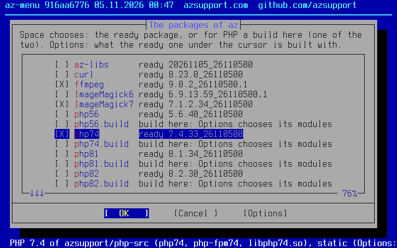</p>
<p>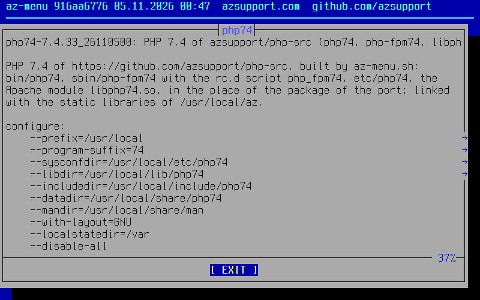</p>

Меню версии (`sh az-menu.sh 8.4` или `sh az-menu.sh` внутри дерева исходников) — это
`make config` портов для этого форка: диалоги (bsddialog на FreeBSD 14 и новее, dialog
на 13) с описаниями из портов. В отличие от портов, всё встраивается в один PHP.

| Экран | Пункты |
|---|---|
| Опции сборки | опции `lang/phpXY` и `mod_phpXY`: SAPI, ZTS, отладка, IPv6, JIT OPcache, системная PCRE |
| Расширения | расширения `phpXY-extensions` плюс встроенные расширения PECL |
| Опции отдельных расширений | какой libcurl, legacy-провайдер OpenSSL, драйверы PDO, обработчики DBA, сессии, сериализаторы и сжатие redis и memcached, Argon2 из libargon2 или из OpenSSL 3.2 в 8.4, … (у GD их нет: во всех версиях он берёт libgd пакета libgd с её форматами, с az — её статическую; текст FreeType всегда) |

Расширение со своим экраном (curl, PDO, redis, …) отмечено в списке стрелкой
`--->`. Его экран идёт после списка, если расширение включено, а кнопка **Options**
списка открывает экран пункта под курсором сразу и потом возвращает список с курсором
на этом пункте (Cancel там всё отменяет); экран, показанный так, сразу после списка
второй раз не показывается. Выпадающих списков в диалогах нет, поэтому выбор одного
пункта открывается так.

Что от чего зависит, проверяется прямо при выборе — по скриптам configure и исходникам
C каждой ветки:

| Правило | Например |
|---|---|
| Расширение, которое нужно другому, включается с пояснением | XSL включает DOM, сериализатор igbinary у redis включает igbinary |
| То, что не может быть вместе, не пропускается | модуль Apache и embed-библиотека, imagick и gmagick, swoole и openswoole, ZTS и Argon2 из OpenSSL |

**BUILD** в главном меню собирает PHP с выбранным, делает из него пакет `phpXY-static` и
предлагает его поставить (`pkg add`). Ему нужны пакеты az, с которыми линкуется
выбранное (`az`, в нём и curl для PHP; `ImageMagick7` для imagick), — их он ставит
сначала; вне дерева исходников он скачивает тарбол версии. Вручную, внутри дерева
исходников после `config-check.sh`, собирайте скриптом, который пишет меню, вместо
`config.installed.sh`:

```sh
sh az-menu.sh
sh config.menu.sh
```

| Что | Как |
|---|---|
| Начинает с | того, что есть в установленной сборке (`config.installed.sh` от `config-check.sh`), сохраняя её окружение и прочие опции (layout, пути php.ini, `--build`). Без `config.installed.sh` — с нашей базовой сборки (`--disable-all`, CLI и OPcache; redis с igbinary и zstd, memcached на libmemcached без SASL: `--enable-redis --enable-igbinary --enable-redis-igbinary --enable-redis-zstd`, zstd в 7.4 и новее, `--enable-memcached --with-libmemcached-dir=/usr/local --disable-memcached-sasl`; SAPI и остальные расширения выбираются) с флагами компилятора, общими для всех сборок |
| Пишет | `config.menu.sh` — скрипт того же вида, с SAPI, опциями сборки и расширениями, выбранными в меню |
| Включено по умолчанию | OPcache внутри PHP и запрет загрузки расширений (опции этого форка, [ниже](#встроенный-opcache-и-запрет-загрузки-расширений)); встроенный curl там, где в базовой системе OpenSSL 3 (FreeBSD 14 и новее); Argon2 из OpenSSL — где 3.2 (FreeBSD 15) |
| Выключено, пока не выбрать | phpdbg: в 7.4 и новее меню пишет `--disable-phpdbg`, потому что `--disable-all` не трогает SAPI |
| Вводится на последнем экране | каталог установки (по умолчанию `/usr/local`, как у портов): PHP ставится туда в раскладке пакетов (ниже: `--prefix`, `--program-suffix=84`, `--sysconfdir=<каталог>/etc/php84`, `--libdir`, `--includedir` и `--datadir` с `php84`, `--mandir=<каталог>/share/man`); сборка из `/usr/local/phpXY` переезжает в `/usr/local` вместе с прочими путями внутри её старого каталога. С mysqli или pdo_mysql (5.6: с расширением mysql) — сокет MySQL (`/tmp/mysql.sock`): один `--with-mysql-sock` задаёт значение по умолчанию и `mysqli.default_socket`, и `pdo_mysql.default_socket` |
| Библиотеки | при установленном `az` — статические библиотеки его статического дерева `/usr/local/az/static` (через `config-check.sh` с `PHPDEPS=/usr/local/az/static`; imagick — через `static/bin/MagickWand-config` из `ImageMagick7`), так что `php`, `php-fpm` и `libphp84.so` не требуют ничего из `/usr/local/lib` |
| Не пишется | `--infodir` (PHP не ставит info-страниц); `--localstatedir=/var` — только вместе с FPM (его читает один php-fpm) |
| Выбор | сохраняется так же, как его сохраняют порты, — в `/var/db/az-menu/phpXY.options` (выбор `php-menu.sh`, как скрипт назывался до 04.11.2026, читается из `/var/db/php-menu`, если своего нет) — и становится началом следующего запуска (`--reset` начинает заново) |
| В конце | пакеты, которые нужны выбору |
| Без диалогов | `sh az-menu.sh --batch +GD -CGI` пишет скрипт; пункт со своего экрана включает и своё расширение (`+PDO_MYSQL` — PDO); `--batch --build` ещё и собирает пакет, `--batch --build --install` и ставит его |
| `--repo` | `sh az-menu.sh --repo` пишет `/usr/local/etc/pkg/repos/az.conf` под уровень x86-64 процессора (с открытым ключом `freebsd/az.pub`, если он есть, в `/usr/local/etc/pkg/keys/az.pub`: подпись каталога проверяется) и обновляет каталог az |
| `--list` | `sh az-menu.sh --list` показывает пункты, пути, их состояние и шаблоны |

**Шаблоны.** Сначала меню спрашивает, с чего начать: с того, что оно нашло (сохранённый
выбор, установленная сборка или значения по умолчанию), или с шаблона — набора выборов
под одно приложение; в главном меню это есть ещё раз («Templates»). Шаблон включает свои
пункты и выключает остальные SAPI и расширения, которые в нём названы; прочее остаётся
по умолчанию, то, что нужно его пунктам, включается тоже, а на экранах после этого можно
поменять что угодно. Без диалогов: `sh az-menu.sh --batch --template=roundcube`.

**Пакет `phpXY-static`** (origin `az/php84-static`; на версию — он или `phpXY` из репозитория az), для 8.4:

| Файлы | Что это |
|---|---|
| `bin/php84`, `bin/php-cgi84`, `bin/phpize84`, `bin/php-config84`, `sbin/php-fpm84` | программы, с версией в конце имени (`--program-suffix`) |
| `etc/php84/php.ini` | php.ini, который читает PHP (`php.ini-production`; оба `php.ini-*` лежат рядом) |
| `etc/php84/php-fpm.conf`, `etc/php84/php-fpm.d/www.conf` | FPM: pid-файл `/var/run/php-fpm84.pid`, лог `/var/log/php-fpm84.log`, пул `www` на `/var/run/php-fpm84.sock` (пользователь и группа `www`, права 0660) |
| `etc/rc.d/php_fpm84` | rc.d-скрипт порта под эту версию: `sysrc php_fpm84_enable=YES`, `service php_fpm84 start`; php-fpm нескольких версий работают одновременно |
| `libexec/apache24/libphp84.so`, `etc/apache24/modules.d/280_mod_php84.conf.sample` | модуль Apache и образец его строк (`LoadModule`, обработчик `.php`, `DirectoryIndex`): инстанс Apache грузит модуль одной версии |
| `lib/php84`, `include/php84`, `share/php84` | остальное от PHP (их берут `phpize84` и `php-config84`) |

Файлы из `etc` сохраняются, если их поменяли (`@config`). Пакет зависит от пакетов az,
с которыми слинкован (`az`, `ImageMagick7`), а в его аннотациях — опции
configure, `CFLAGS` и режим `static` (`pkg info -A php84-static`).

| Шаблон | PHP | Для чего |
|---|---|---|
| `roundcube` | 7.4 и новее | php-fpm и CLI (скрипты из `bin/`, cron) для [Roundcube](https://roundcube.net/) 1.6 (PHP 7.3+) и 1.7 (PHP 8.1+); сверено с Roundcube 1.6.20 и 1.7.5 |

Что шаблон `roundcube` включает и чего в нём нет:

| Группа | Расширения |
|---|---|
| Требует его инсталлятор | ctype, dom, filter, intl, json, mbstring с функциями регэкспов, openssl, session, PDO, xml |
| Его [страница wiki](https://github.com/roundcube/roundcubemail/wiki/Install-Requirements) и его библиотеки | fileinfo, iconv, sockets |
| Необязательные, кроме LDAP | curl (встроенный, для Guzzle), exif (ориентация фото JPEG), gd (JPEG, WebP и FreeType для 1.7), imagick, xmlwriter, zip |
| База данных | только MySQL и только через PDO (pdo_mysql) |
| Нет в нём | mysqli, PostgreSQL, SQLite, LDAP; pspell и enchant — их использует только проверка орфографии (`spellcheck_engine`), а она с Roundcube 1.5.0 по умолчанию выключена (`enable_spellcheck`) |

Меню с шаблоном `roundcube` (bsddialog в консоли FreeBSD 80x25, шрифт Terminus): с чего
начать, опции сборки, расширения, драйверы PDO через кнопку Options, опции curl, GD,
mbstring и OpenSSL, главное меню и скрипт, который оно пишет:

<p>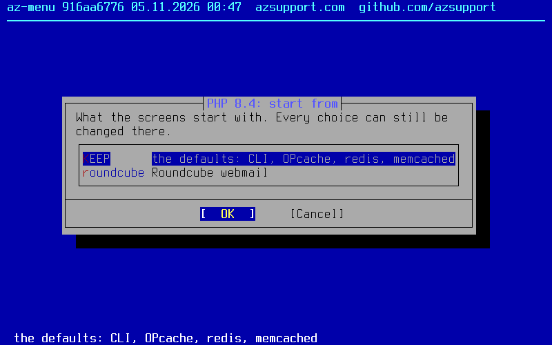</p>

Кнопка Options на PDO и экран, который она открывает:

<p>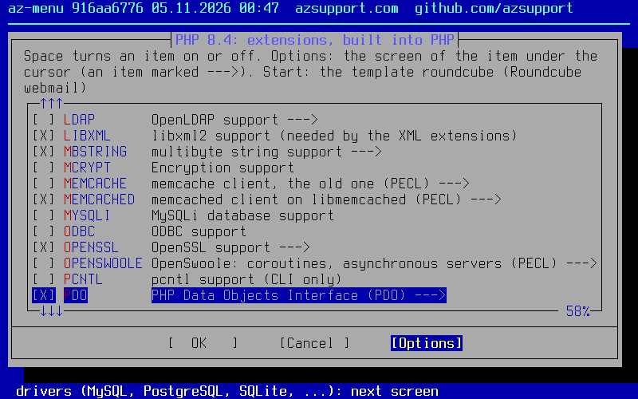</p>
<p>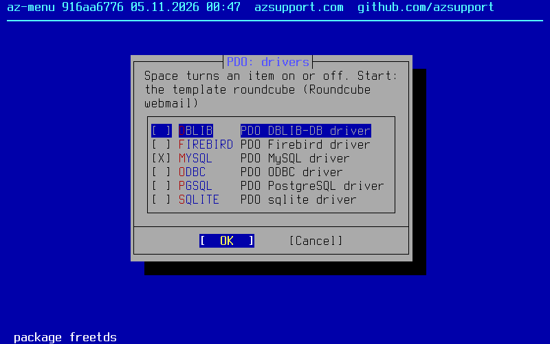</p>

Расширения с шаблоном `roundcube` и у базовой сборки (по умолчанию: CLI и OPcache, redis с igbinary и zstd, memcached без SASL):

<p>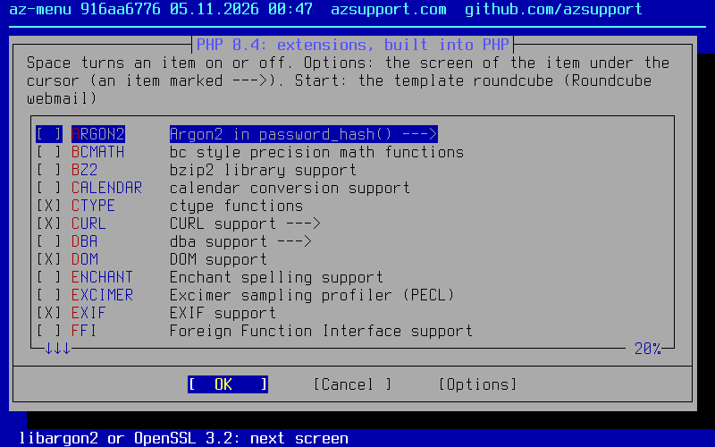</p>
<p></p>

<details>
<summary>Ещё экраны: с чего начать, опции сборки, главное меню, скрипты</summary>

<p>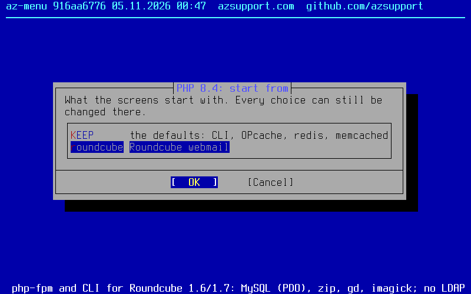</p>
<p>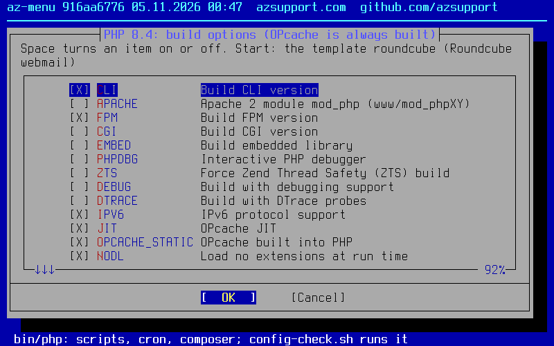</p>
<p>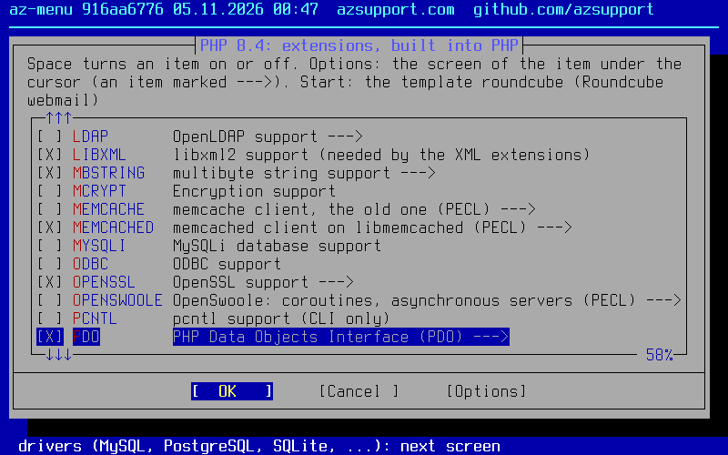</p>
<p>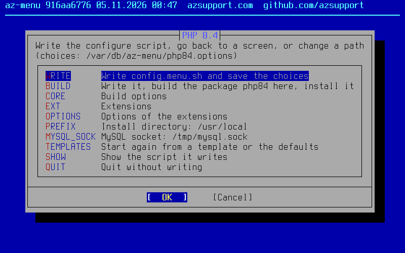</p>
<p>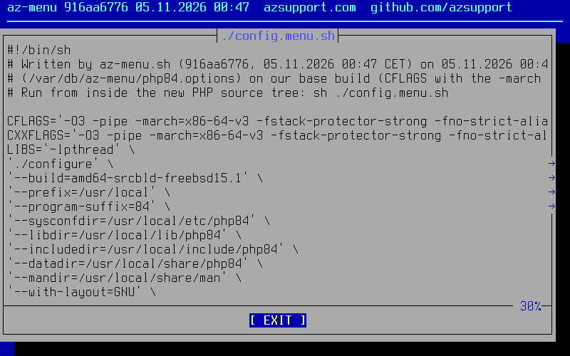</p>
<p>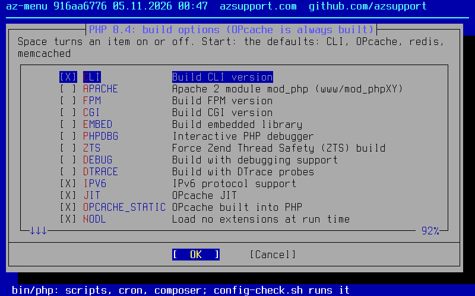</p>
<p>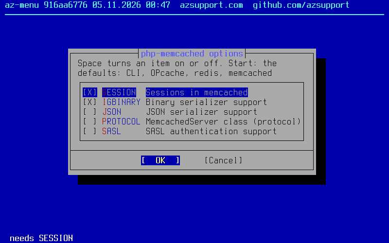</p>
<p>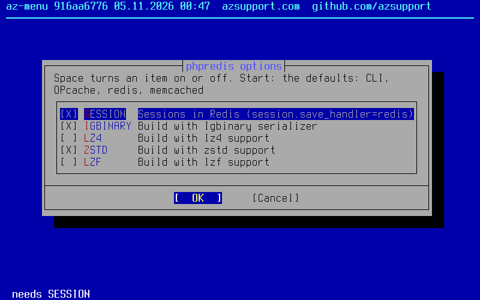</p>
<p>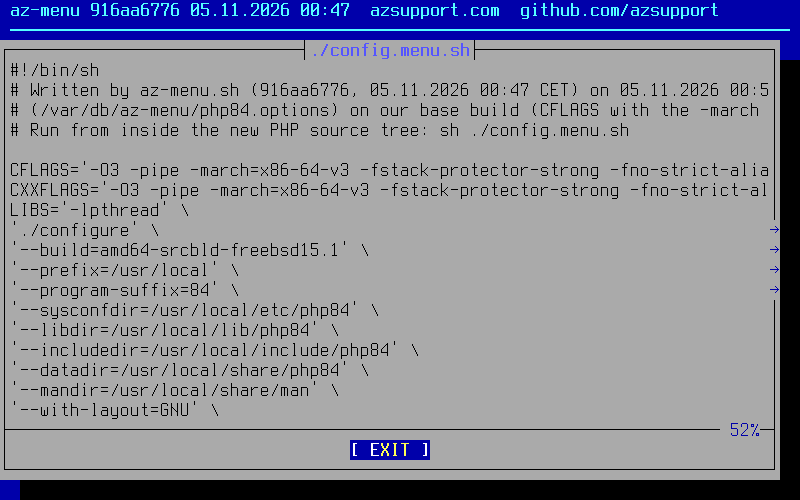</p>
<p></p>

</details>

Картинки делает [`tools/menu-screenshots.py`](tools/menu-screenshots.py) (pyte и
Pillow): bsddialog в терминале 80x25, шрифт Terminus и 16 цветов консоли FreeBSD.

### Встроенный OPcache и запрет загрузки расширений

Две опции configure этого форка, во всех ветках (патчи
`freebsd/patches/<версия>/feature-*.patch`). Обе выключены, пока их не задать;
`az-menu.sh` включает обе по умолчанию — в том числе когда начинает с
`config.installed.sh` сборки, сделанной до них.

| Что | `--enable-opcache-static` | `--disable-extension-loading` |
|---|---|---|
| Действие | OPcache встраивается в PHP (одинаково в CLI, php-fpm, php-cgi и модуль Apache), как в PHP 8.5: `opcache.so` нет, строка `zend_extension` не нужна | PHP не загружает расширения во время работы; `php -i` показывает `Dynamic Library Support => disabled (--disable-extension-loading)` |
| Старые строки php.ini | оставшаяся `zend_extension=opcache.so` молча пропускается, даже если старый `opcache.so` ещё лежит в `extension_dir`; `opcache.enable` и прочие настройки `opcache.*` работают как раньше | строки `extension=` и `zend_extension=`, `dl()` и `php -z` отклоняются с предупреждением при старте, где назван файл; строка расширения, которое уже встроено (`extension=mysqli`), молча пропускается |
| configure останавливается | в 8.x вместе с ZTS и JIT (до PHP 8.5 JIT достаёт данные потока способом, который работает только из `opcache.so`): добавьте `--disable-opcache-jit` или соберите `opcache.so` | если какое-то расширение собиралось бы как `.so` (для OPcache добавьте `--enable-opcache-static`) |

Без меню добавьте их к сборке: `sh config.installed.sh --enable-opcache-static
--disable-extension-loading`. Когда такая сборка установлена, строки `extension=` и
`zend_extension=opcache.so` в php.ini больше не нужны.

### Тестовая сборка на FreeBSD

| Что | Как |
|---|---|
| Workflow | [`.github/workflows/build-test.yml`](.github/workflows/build-test.yml): запуск — на https://github.com/azsupport/php-src/actions/workflows/build-test.yml кнопкой **Run workflow** |
| Машина | виртуальная машина FreeBSD, по умолчанию 15.1: clang 19, OpenSSL 3.5 из базы, библиотеки из `pkg` |
| Собирает | тарболы `-latest` с опциями configure наших серверов, встроенным curl (`--with-curl=bundled`) и `--with-openssl-legacy-provider` |
| Проверяет | `php -v`, `php -m`, [`tools/build-test-smoke.php`](tools/build-test-smoke.php) (ошибки разбора, DNS и IPv6, `tls://`, `ssl://` и `https://`, legacy-шифры OpenSSL, `openssl_seal()`, GD с FreeType, XML, сессии, встроенный curl, фикс php2shell при превышении `memory_limit` и другое) и часть тестов PHP |
| Результат | по каждой версии, на странице запуска |
| С пакетами az | вход `az`: со статическими библиотеками пакетов `az` и `ImageMagick7` из репозитория az (`az_release` — его релиз, по умолчанию `az-fbsd<major>-amd64-v3`), в раскладке пакетов |
| На машине с FreeBSD | тот же скрипт, из checkout этой ветки с тарболами в `dist/`: `sh tools/build-test.sh --deps 5.6 7.4` ставит пакеты, `sh tools/build-test.sh --tests 5.6 7.4` собирает и проверяет; наборы опций — в [`tools/build-test.sh`](tools/build-test.sh) |

### Сравнение скорости сборок

| Что | Как |
|---|---|
| Workflow | [`.github/workflows/bench.yml`](.github/workflows/bench.yml): запуск — на https://github.com/azsupport/php-src/actions/workflows/bench.yml кнопкой **Run workflow**; входы — версии (по умолчанию `7.4 8.3`) и число прогонов каждого бенчмарка (по умолчанию 5) |
| Машина | по виртуальной машине FreeBSD 15.1 на версию: все сборки одной версии собираются и запускаются в одной машине, поэтому их цифры сравнимы (цифры двух версий получены на двух машинах) |
| Исходники | самый новый датированный релиз `freebsd-<версия>-<ГГГГММДД>-<коммит>`, SHA-256 сверяется с `.sha256` релиза |
| Сборки | только CLI (`--disable-all --enable-cli --disable-cgi --disable-phpdbg --enable-opcache`), у всех одни `CFLAGS` (`-O3 -pipe -march=x86-64-v3 -fstack-protector-strong -fno-strict-aliasing -std=gnu17`): `clang19` (cc из базы, точка отсчёта), `clang19-pgo`, `clang23`, `clang23-pgo`, `clang23-pgo-lto` (ThinLTO, линкует lld из llvm23), `gcc16`, `gcc16-pgo`. Компиляторы — из пакетов `llvm23` и `gcc16`, а если их нет — самые новые llvm и gcc репозитория пакетов; отчёт называет их с версиями. С GCC configure находит глобальные регистровые переменные, в которых VM Zend держит свои регистры (у clang их нет) |
| Обучение PGO | никогда не бенчмарки: `run-tests.php` того же дерева на `Zend/tests`, `ext/standard/tests/strings` и `ext/standard/tests/array`, без OPcache, потом с OPcache (на 8.x с JIT), каждая часть не дольше 150 секунд |
| Бенчмарки | `Zend/bench.php` и `Zend/micro_bench.php` того же дерева, каждая сборка без OPcache, с OPcache (на 8.x с трассирующим JIT) и с `USE_ZEND_ALLOC_HUGE_PAGES=1` (аллокатор Zend отображает свои куски по 2 МБ с `MAP_ALIGNED_SUPER`); сборки чередуются от прогона к прогону |
| Через разделяемую libphp | вход `embed`: сборки `clang19`, `gcc16` и `gcc16-nsi` (`-fno-semantic-interposition`), каждое дерево ещё и с `--enable-embed=shared`, так что каждая сборка запускается и как `<сборка>-embed`, через свою `libphp.so` (SAPI embed, из тех же PIC-объектов, что и `libphp.so` mod_php) маленьким драйвером, без OPcache (в SAPI embed он не работает), рядом со своим CLI; отчёт добавляет изменение каждого `-embed` относительно CLI той же сборки и относительно `clang19-embed`. С `-fPIC` GCC считает каждую экспортируемую функцию (`ZEND_API`, `PHPAPI`) заменяемой при загрузке, поэтому собственные вызовы движка к ним идут через PLT и не инлайнятся; `-fno-semantic-interposition` позволяет их связать и инлайнить (CLI — исполняемый файл, его это не касается) |
| Результат | медиана строк `Total` в секундах и её изменение относительно `clang19` в %, с версиями компиляторов, CPU машины и тем, что прогнало обучение: в логе задачи (шаг Report) и в её summary |
| На другой машине | `sh tools/bench.sh --local -r 3 8.3 <тарбол>` берёт компиляторы, которые найдёт (и на Linux); подробности — в [`tools/bench.sh`](tools/bench.sh) |

Результаты 09.11.2026 на FreeBSD 15.1 (4 CPU AMD EPYC, медиана 5 прогонов, изменение к
`clang19`; минус — быстрее; llvm23 23.1.5, gcc16 16.1.0):

| PHP | Сборка | `bench.php` | `bench.php` с OPcache | `micro_bench.php` | `micro_bench.php` с OPcache |
|---|---|--:|--:|--:|--:|
| 8.3 ([42582372488](https://github.com/azsupport/php-src/actions/runs/42582372488)) | `clang19` | 0,304 с | 0,042 с (JIT) | 1,431 с | 0,428 с (JIT) |
| | `clang19-pgo` | −3,0% | 0 | −2,4% | −4,0% |
| | `clang23-pgo-lto` | +1,0% | 0 | −4,5% | −10,0% |
| | `gcc16` | −36,2% | −4,8% | −37,5% | −12,6% |
| | `gcc16-pgo` | −37,5% | −4,8% | −36,8% | −14,7% |
| 7.4 (тот же прогон) | `clang19` | 0,615 с | 0,420 с | 2,991 с | 2,186 с |
| | `clang19-pgo` | +2,0% | −1,2% | −1,7% | −4,8% |
| | `clang23-pgo-lto` | +3,3% | −3,1% | −5,6% | −7,0% |
| | `gcc16` | −33,5% | −44,3% | −38,8% | −36,5% |
| | `gcc16-pgo` | −29,9% | −43,8% | −33,9% | −33,5% |

- Выигрыш даёт GCC 16: Zend VM держит свои регистры в глобальных регистровых
  переменных, которые есть только у GCC. PGO, LTO и clang 23 — в пределах примерно ±5%
  (разброс прогонов), большие страницы аллокатора Zend — ничего (у FreeBSD и так
  прозрачные суперстраницы). В 7.4 OPcache только кэширует опкоды для той же VM (JIT
  нет), поэтому GCC выигрывает и с ним; в 8.3 горячий код компилирует сам JIT.
- Через `libphp.so`, как PHP работает в mod_php (вход `embed`,
  [42623798085](https://github.com/azsupport/php-src/actions/runs/42623798085), без
  OPcache): GCC против clang через их `libphp.so` — у 8.3 −32,4%, с
  `-fno-semantic-interposition` −34,0%; у 7.4 −38,4% и −37,5%: флаг добавляет до 2,4%
  у 8.3 и нигде ничего не отнимает.
- Поэтому PHP-пакеты azsupport/ports собирают ядра, `mod_phpXY` и модули на C с GCC 16 и
  `-fno-semantic-interposition` (`-static-libgcc`: ни одному файлу не нужна библиотека
  GCC); модули на C++ (intl, swoole, OpenSwoole), imagick и gmagick остаются на clang
  базовой системы.

### Встроенные расширения PECL

Ветки и тарболы несут эти расширения PECL в `ext/`, поэтому они встраиваются в PHP так
же, как штатные, и не требуют ни `phpize`, ни строки `extension=`. Ничего не меняется,
пока не задана их опция:

| Расширение | PHP 8.2, 8.3, 8.4 | PHP 8.1 | PHP 7.4 | PHP 5.6 |
|---|---|---|---|---|
| redis | 6.3.0 | 6.3.0 | 6.3.0 | 4.3.0 |
| memcached | 3.4.0 | 3.4.0 | 3.4.0 | 2.2.0 |
| memcache | 8.2 | 8.2 | 4.0.5.3 | 3.0.8 |
| igbinary | 3.2.16 | 3.2.16 | 3.2.16 | 2.0.8 |
| imagick | 3.8.1 | 3.8.1 | 3.8.1 | 3.8.1 |
| gmagick | 2.0.6RC1 | 2.0.6RC1 | 2.0.6RC1 | 1.1.7RC3 |
| swoole | 6.2.5 | 6.1.12 | 4.8.13 | — |
| OpenSwoole | 4.12.1 | 4.12.1 | 4.12.1 | — |
| excimer | 1.2.7 | 1.2.7 | 1.2.7 | — |
| mcrypt | 1.0.9 | 1.0.9 | 1.0.9 | в самом PHP 5.6 |
| ssh2 | 1.6.0 | 1.6.0 | 1.4.1 | 0.13 |

Как их включить:

| Расширение | Опция configure | Пакет FreeBSD |
|---|---|---|
| [redis](https://pecl.php.net/package/redis) | `--enable-redis` | |
| [memcached](https://pecl.php.net/package/memcached) | `--enable-memcached --with-libmemcached-dir=/usr/local --disable-memcached-sasl` | `libmemcached` |
| [memcache](https://pecl.php.net/package/memcache) | `--enable-memcache` | |
| [igbinary](https://pecl.php.net/package/igbinary) | `--enable-igbinary`; как сериализатор для redis и memcached ещё `--enable-redis-igbinary` и `--enable-memcached-igbinary` | |
| [imagick](https://pecl.php.net/package/imagick) | `--with-imagick=/usr/local`; не вместе с gmagick | `ImageMagick7` или `ImageMagick7-nox11` |
| [gmagick](https://pecl.php.net/package/gmagick) | `--with-gmagick=/usr/local`; не вместе с imagick | `GraphicsMagick` |
| [swoole](https://pecl.php.net/package/swoole) (7.4+) | `--enable-swoole`; не вместе с OpenSwoole | `brotli` (по желанию, для сжатия brotli) |
| [OpenSwoole](https://pecl.php.net/package/openswoole) (7.4+) | `--enable-openswoole`; не вместе со swoole | |
| [excimer](https://pecl.php.net/package/excimer) (7.4+) | `--enable-excimer` | |
| [mcrypt](https://pecl.php.net/package/mcrypt) (7.4+) | `--with-mcrypt=/usr/local` | `libmcrypt` |
| [ssh2](https://pecl.php.net/package/ssh2) | `--with-ssh2=/usr/local`: `ssh2_connect()`, SCP, `ssh2.sftp://` | `libssh2` |

Версии — новейшие стабильные релизы PECL для каждой версии PHP, с такими исключениями:

| Исключение | Почему |
|---|---|
| memcache 3.0.8 для 5.6 | релиз, который дистрибутивы ставили для PHP 5.5/5.6; его единственный стабильный релиз 5.x — 2.2.7 от 2012 года |
| gmagick 2.0.6RC1, и 1.1.7RC3 для 5.6 | у gmagick стабильного релиза нет вовсе: 2.0.6RC1 (бета, 2021) плюс два более поздних коммита его git master с исправлениями для PHP 8.1 |
| OpenSwoole везде 4.12.1 | линия 4.x, на которой работают серверы (ниже) |

Исходники берутся из git-репозиториев апстрима на коммите тега релиза (у gmagick, где
тегов нет, — на коммите релиза), закреплённом в [`freebsd/pecl.conf`](freebsd/pecl.conf);
исправления, с которыми они собираются внутри php-src с clang 19, — в
[`freebsd/pecl/`](freebsd/pecl). Расширениям нужен `--enable-session` (обработчики
сессий); в 5.6 и 7.4 redis нужен ещё `--enable-json`, а в 5.6 — `--enable-hash`.

Две пары можно собрать только по одному из пары, и configure останавливается, если
заданы обе опции пары. Чтобы на сервере были оба из пары, встройте один в PHP, а другой
соберите отдельным модулем через `phpize`.

| Пара | Почему не в одном PHP |
|---|---|
| imagick и gmagick | в GraphicsMagick и ImageMagick одинаковые имена функций MagickWand, так что imagick и gmagick вызывали бы библиотеку друг друга |
| swoole и OpenSwoole | OpenSwoole — форк swoole с теми же символами C++ |

OpenSwoole — 4.12.1 для всех версий с 7.4, линия 4.x, на которой работают серверы:
OpenSwoole 22 и новее изменили API (пространство имён `OpenSwoole\`, настройки ini
`openswoole.*`, нет `Co\` и `swoole.use_shortname`). 4.12 в апстриме поддерживает PHP
до 8.2; для 8.3 и 8.4 патч портирует её:

| PHP | Изменение |
|---|---|
| 8.3+ | новый `php_url_encode_hash_ex()` из 8.3 |
| 8.3+ | границы стека C, которые проверяет PHP 8.3, следуют за стеками корутин (иначе каждый вызов в корутине падает с «Maximum call stack size reached») |
| 8.4 | `zend_str_tolower()` вместо `php_strtolower()` (её нет в 8.4) |
| 8.4 | `exit()` в корутине или сервере по-прежнему бросает `Swoole\ExitException` (в 8.4 exit стал функцией) |
| 8.4 | встроенная библиотека PHP явно объявляет свои nullable-параметры (уведомления об устаревании в PHP 8.4) |

Что ещё меняют патчи:

| Расширение | В апстриме | С патчем |
|---|---|---|
| swoole, OpenSwoole | включены по умолчанию (`--enable-swoole`, `--enable-openswoole`), а configure OpenSwoole проверяет переменную swoole вместо своей: внутри php-src это встроило бы их в каждый PHP (без `--disable-all`, а OpenSwoole даже с ним) | выключены по умолчанию |
| swoole 4.8 и 6.1, OpenSwoole | свой `--enable-openssl`: внутри php-src он сбрасывал настройку `--with-openssl`, и mysqlnd тогда собирался без своего кода OpenSSL (RSA для `caching_sha2_password`) | убран: они берут OpenSSL, если PHP собран `--with-openssl` |
| swoole, OpenSwoole | дописывают `-std=c++11`/`-std=c++14` в `CXXFLAGS`, а внутри php-src это действовало бы и на ext/intl (ICU 75 и новее нужен C++17) | убрано |
| OpenSwoole | порта FreeBSD нет, и на FreeBSD он не компилировался: его `swoole_socket.h` подключает `<netinet/ip6.h>` раньше `<sys/types.h>`, а его hiredis задаёт `_XOPEN_SOURCE`, который прячет типы BSD, нужные `<netinet/ip6.h>` | исправлено и то и другое; тестовая сборка собирает его вместе с gmagick на 7.4–8.4 |
| excimer | в FreeBSD нет `gettid()`, поэтому excimer 1.2.4 и новее там не компилировался (порт `devel/pecl-excimer` остался на 1.2.3) | id потока своего таймера берёт из `pthread_getthreadid_np()`; `-fvisibility=hidden` только своим исходникам |

igbinary как сериализатор (`--enable-memcached-igbinary`, `--enable-redis-igbinary`):

| Расширение | С igbinary как сериализатором |
|---|---|
| memcached | igbinary становится сериализатором по умолчанию (`memcached.serializer = igbinary`) для массивов и объектов. PHP без igbinary такие значения прочитать не сможет, поэтому, пока серверы с ним и без него делят один memcached, задайте в `php.ini` `memcached.serializer = php`. Значения, уже сохранённые сериализатором php, читаются в любом случае |
| redis | ничего не сериализует, пока не задан `Redis::OPT_SERIALIZER`, так что там igbinary используется только там, где код просит `Redis::SERIALIZER_IGBINARY` |

Как добавить их к пересборке:

| Способ | Что делать |
|---|---|
| Вручную | допишите опции после `sh config.installed.sh`, например `sh config.installed.sh --enable-redis --enable-memcache`, и уберите из `php.ini` строки `extension=redis.so` старых отдельных модулей |
| Скрипт | `config-check.sh` сам не добавляет их в `config.installed.sh`: для отдельных модулей установленного PHP, которые есть в дереве, он в конце печатает готовую к копированию полную команду — `sh config.installed.sh` с их опциями. Опции несут то, с чем модули были собраны (`php --ri`: сериализатор igbinary, lzf/zstd/lz4, SASL, curl у swoole, c-ares, pgsql), плюс `--enable-json`, `--enable-hash` или `--enable-session`, если в установленной сборке нет того, что им нужно; отчёт перечисляет строки `extension=` (файл и строку), которые надо убрать после `make install` |
| Пакеты | `config-check.sh --pkg` превращает установленные пакеты портов расширений PECL в опции, как и прочие пакеты расширений |

Новые релизы этих расширений находит ежедневная [проверка апстрима](#проверка-апстрима).

### OpenSSL

| PHP | С OpenSSL 3 базовой системы (FreeBSD 14 и 15; 3.5.6 во FreeBSD 15.1) |
|---|---|
| 8.1+ | поддерживается в апстриме: `--with-openssl` |
| 7.4 | [`compat-openssl3.patch`](freebsd/patches/7.4/compat-openssl3.patch): хватает `--with-openssl`, потому что FreeBSD поставляет `openssl.pc`. RC4 (по умолчанию у `openssl_seal()`), Blowfish, DES, RC2, CAST5 и MD4 требуют `--with-openssl-legacy-provider` (ниже) |
| 5.6 | [`compat-openssl3.patch`](freebsd/patches/5.6/compat-openssl3.patch) с `--with-openssl=/usr` и тем же `--with-openssl-legacy-provider`, что и 7.4. Сверх того `tls://` и `STREAM_CRYPTO_METHOD_TLS_*` договариваются о TLS 1.0–1.3: 5.6 ограничивает их TLS 1.0, который OpenSSL 3 на своём уровне безопасности по умолчанию отвергает, так что они не могли соединиться вовсе (`ssl://`, `https://` и `STREAM_CRYPTO_METHOD_SSLv23_*` и так выбирали новейшую версию) |

Что в 7.4 и 5.6 ведёт себя иначе, чем с OpenSSL 1.1, — это сам OpenSSL 3, так же как с
PHP 8.x; сборка 7.4 или 5.6 с отдельным OpenSSL 1.1 ведёт себя как раньше:

| Случай | С OpenSSL 3 |
|---|---|
| TLS 1.0 и 1.1 | по умолчанию выключены |
| Расшифровка RSA PKCS#1 v1.5 неверным ключом | возвращает случайные байты вместо ошибки (защита от атаки Marvin) |
| Ключи DSA/DH короче 512 бит, сертификаты с неправильно записанным временем | отклоняются |

Опция `--with-openssl-legacy-provider`:

| Что | Как |
|---|---|
| Действие | загружает legacy-провайдер OpenSSL 3 вместе с провайдером по умолчанию при старте, так что RC4, Blowfish, DES, RC2, CAST5, MD4 и подобные работают без правки `openssl.cnf` |
| Где есть | в апстриме PHP 8.4 ([php-src GH-13951](https://github.com/php/php-src/pull/13951)); этот форк добавляет ту же опцию в 5.6, 7.4, 8.1, 8.2 и 8.3. По умолчанию выключена, как в апстриме |
| Модуль | `/usr/lib/ossl-modules/legacy.so`, часть базовой системы FreeBSD 14 и 15; если его нет, PHP стартует, а эти алгоритмы остаются недоступны |
| OpenSSL 1.1 | в базовой системе FreeBSD 13.x: ничего не меняет — алгоритмы там встроены |
| Скрипт | `config-check.sh` добавляет её к сборке с OpenSSL 3, если установленный PHP умеет RC4 (собран с OpenSSL 1.1 или с legacy-провайдером), чтобы данные, зашифрованные на старой сборке `openssl_encrypt(..., "rc4", ...)`, оставались читаемыми, и всегда для 5.6 и 7.4, у которых `openssl_seal()` по умолчанию использует RC4. `sh config.installed.sh --without-openssl-legacy-provider` её убирает |

### Встроенный curl

Каждая ветка несёт curl в `ext/curl/libcurl` и нужные ему библиотеки в
`ext/curl/deps` — файлы релизов их портов FreeBSD, с SHA-256 из их distinfo; новый
релиз раньше порта — только если он закрывает уязвимость, которая нас касается, или
нашу ошибку. Порты отслеживаются ради патчей сборки и нужного для FreeBSD
([`freebsd/curl.conf`](freebsd/curl.conf),
[`freebsd/curl-deps.conf`](freebsd/curl-deps.conf); в дерево их кладёт
[`tools/curl-sources.sh`](tools/curl-sources.sh)):

| Библиотека | Версия | Порт FreeBSD | Для чего она curl |
|---|---|---|---|
| curl | 8.23.0 | `ftp/curl` | с патчем configure этого порта |
| c-ares | 1.34.9 | `dns/c-ares` | резолвит имена (ниже) |
| nghttp2 | 1.70.0 | `www/libnghttp2` | HTTP/2 |
| brotli | 1.2.1 | `archivers/brotli` | ответы в `br` (`CURLOPT_ENCODING`); 1.2.1 исправляет CVE-2026-111497 — запись за границей в декодере |
| zstd | 1.5.7 | `archivers/zstd` | ответы в `zstd` (`CURLOPT_ENCODING`) |
| libidn2 | 2.3.8 | `dns/libidn2` | международные доменные имена (IDN) |
| libpsl | 0.23.3 | `dns/libpsl` | список публичных суффиксов: никаких cookies на целый публичный суффикс вроде `co.uk` |
| список публичных суффиксов | 21.09.2026 | `dns/public_suffix_list` | встроен в libpsl |
| libssh2 | 1.11.1 | `security/libssh2` | SCP и SFTP (`scp://`, `sftp://`), с OpenSSL самого curl и патчами своего порта |

Как он собирается и работает:

| Что | Как |
|---|---|
| Сборка | `--with-curl=bundled` собирает всё это во время `configure` (две-три минуты, лог в `ext/curl/libcurl-build.log`) одними cc и make и линкует в PHP статически, с тем OpenSSL, который берёт сам PHP |
| Пакеты | не нужны: с `--with-curl=bundled` PHP не зависит ни от пакета curl, ни от его библиотек, а его curl так же свеж, как тарбол |
| Чего среди них нет | libunistring (libidn2 собирает ту её часть, которая ему нужна) и IDN-библиотеки для libpsl (curl отдаёт ей имена хостов уже в punycode, и встроенного списка хватает) |
| Символы | символы curl не экспортируются из `php` и `libphp.so`, символы его библиотек локальны в `libcurl.a`, так что модуль, который грузит libcurl системы или несёт свою копию nghttp2 (swoole), с ними не смешивается |
| Системный libcurl | его по-прежнему берёт простой `--with-curl` |
| OpenSSL | curl 8.18.0 и новее нужен OpenSSL 3.0 или новее. Во FreeBSD 13.x в базовой системе OpenSSL 1.1.1, поэтому там `config-check.sh` оставляет `--with-curl` (пакет curl) и объясняет почему; на FreeBSD 14 и 15 он пишет `--with-curl=bundled` |
| Исправления безопасности | curl или одной из его библиотек попадают в PHP с пересборкой: ежедневная [проверка апстрима](#проверка-апстрима) открывает issue на каждый новый релиз (теги их репозиториев), на изменения их портов FreeBSD и когда порт взял файл релиза, которого нет в бандле (его distinfo). Релиз приходит вместе с портом; раньше — только ради уязвимости, которая нас касается, или нашей ошибки: issue о релизе называет CVE и GHSA из его заметок |
| Пакеты az | `tools/az-build.sh` из azsupport/ports (пакет `az`) собирает curl и эти библиотеки из тех же файлов так же: статически в `/usr/local/az/static` (с ними линкуется `phpXY-static`: `--with-curl=/usr/local/az/static`) и разделяемыми в `/usr/local/az/lib` (модуль curl PHP-пакетов). Пакет `curl` (`bin/curl`, `lib/libcurl.so.4` вместо тех, что из порта) — отдельная сборка того же релиза с опциями порта ([Пакеты](#пакеты-репозиторий-az)) |

Опции — как в порту FreeBSD, с такими отличиями:

| Отличие | Почему |
|---|---|
| имена резолвит c-ares (опция порта `CARES`, а не `THREADED_RESOLVER`) | зависший запрос к DNS не держит воркер (ниже) |
| нет IMAP, POP3, SMTP | PHPMailer, Symfony Mailer, Roundcube и IMAP-библиотеки ходят к почтовым серверам своими сокетами |
| нет WebSocket (`ws://`, `wss://`) | в PHP нет `curl_ws_send()` и `curl_ws_recv()`; в master php-src их тоже нет, только `CURLOPT_WS_OPTIONS` |
| нет NTLM | слабый, в curl с 8.20 только по явному включению, curl собирается его удалить; нужен лишь старым серверам и прокси Microsoft |
| нет headers API, экспорта TLS-сессий, `curl_easy_option_*`, текстового индикатора прогресса | PHP ничего из этого не вызывает; `CURLOPT_PROGRESSFUNCTION` и `CURLOPT_XFERINFOFUNCTION` работают |
| нет DICT, Gopher, IPFS, MQTT, RTSP, Telnet, TFTP, LDAP, GSSAPI | редкие протоколы |
| SCP и SFTP (libssh2) | в порте выключены; здесь включены для передачи файлов на другие серверы (aZ, 10.11.2026) |

c-ares здесь не ради скорости: время уходит на ответ DNS-сервера, а A и AAAA curl 8.23 и
так спрашивает параллельно. Разница — когда DNS-сервер не отвечает:

| Случай | Threaded-резолвер (`getaddrinfo()`) | c-ares |
|---|---|---|
| DNS-сервер не отвечает | `getaddrinfo()` прервать нельзя, поэтому хэндл ждёт на `curl_close()` (в 8.x — когда `$ch` уничтожается, самое позднее в конце запроса), пока тот не сдастся: с `resolv.conf` FreeBSD по умолчанию — не меньше 15 секунд на имя, а воркеры Apache и FPM тем временем копятся | бросает запрос сразу, и `CURLOPT_TIMEOUT` соблюдается. Проверено с DNS-сервером, который не отвечает, и `CURLOPT_TIMEOUT_MS` 1500: `curl_exec()` вернулся через 1,5 с, хэндл освободился сразу |
| `CURLOPT_DNS_SERVERS` и соседние опции | недоступны | работают |
| Что читает | резолвер системы, с модулями NSS | сам читает `/etc/resolv.conf`, `/etc/hosts` и строку `hosts:` из `/etc/nsswitch.conf`; модули NSS не используются |

Что встроенный curl оставляет:

| Оставлено | Что |
|---|---|
| Протоколы | HTTP(S), FTP(S), FILE (им могут пользоваться старые скрипты), SCP, SFTP |
| Возможности | HTTP/2, прокси, cookies, multipart (`CURLFile`), Unix-сокеты, IDN, PSL, brotli, zstd |
| Возможности, которые код должен включить сам | alt-svc, HSTS, DoH, AWS SigV4, `.netrc` |

### Встроенная PCRE

php-src несёт старую PCRE с известными ошибками безопасности памяти, а PHP использует JIT
по умолчанию (`pcre.jit=1`, с 7.0). Каждая ветка здесь несёт вместо неё новейший релиз
([`freebsd/pcre.conf`](freebsd/pcre.conf)):

| PHP | В php-src | Здесь |
|---|---|---|
| 8.4 | PCRE2 10.44 (и в master php-src тоже, октябрь 2026) | PCRE2 10.49 |
| 8.3 | PCRE2 10.42 | PCRE2 10.49 |
| 8.2 | PCRE2 10.40 | PCRE2 10.49 |
| 8.1 | PCRE2 10.39 | PCRE2 10.49 |
| 7.4 | PCRE2 10.35 | PCRE2 10.49 |
| 5.6 | PCRE 8.38, 2015 года | PCRE 8.45, последний релиз PCRE1 |

Ошибки старых копий:

| Ошибка | Исправлена в | Ветки |
|---|---|---|
| чтение за границей в JIT-компиляторе ([CVE-2022-1586](https://osv.dev/vulnerability/CVE-2022-1586), [CVE-2022-1587](https://osv.dev/vulnerability/CVE-2022-1587)) | PCRE2 10.40 | 7.4, 8.1 |
| чтение и запись за границей, в том числе в `pcre2_match` после отката JIT на неверном UTF ([CVE-2026-89156](https://security-tracker.debian.org/tracker/CVE-2026-89156); [oss-security, 04.09.2026](https://openwall.com/lists/oss-security/2026/09/04/7)) | PCRE2 10.48 | 7.4–8.4 |
| запись за границей в JIT с шаблоном под контролем атакующего ([CVE-2026-103111](https://app.opencve.io/cve/CVE-2026-103111)) | PCRE2 10.49 | 7.4–8.4 |
| ошибки JIT CVE-2017-6004 и CVE-2019-20838, переполнение целого CVE-2020-14155 и прочие исправления 8.39–8.45 (сама 5.6 JIT не использует) | PCRE 8.39–8.45 | 5.6 |

Как релиз попадает в дерево:

| Что | Как |
|---|---|
| Релиз | синк распаковывает тарбол релиза (его SHA-256 — тот же, что в `devel/pcre2` или `devel/pcre` freebsd-ports) |
| Импорт | [`freebsd/pcre/import-pcre2.sh`](freebsd/pcre/import-pcre2.sh) (5.6: [`import-pcre1.sh`](freebsd/pcre/import-pcre1.sh)) так же, как это делает php-src: исходники библиотеки, собственный `config.h` PHP (плюс умолчания релиза, которых в нём нет, например `MAX_VARLOOKBEHIND` для 7.4–8.3), список исходников в `ext/pcre/config0.m4` |
| Имена функций | PHP переименовывает функции своей встроенной PCRE в `main/php_compat.h` (`pcre2_compile_8` становится `php_pcre2_compile`), так что libpcre2, которую загрузил Apache, не перехватывает их вызовы. В списке php-src нет функций, добавленных после PCRE2 10.30 (и функций JIT у PCRE 8.x), а `pcre2_substitute` в 10.49 вызывает одну из них, поэтому импорт переименовывает и их |
| Тесты | тесты `ext/pcre` проходят как раньше; те, что печатают сообщения библиотеки, ожидают и старую, и новую формулировку, как в php-src с 8.1 и 8.3 (`freebsd/pcre/tests-<версия>.patch`) |
| Новые возможности | новая PCRE приносит их и в старые ветки: PHP 7.4 с 10.49 понимает lookbehind ограниченной переменной длины, например `(?<=a{1,3})b` |
| Системная PCRE | её по-прежнему берёт `--with-external-pcre` (5.6: `--with-pcre-regex=DIR`). `config-check.sh` не пишет эти опции, если PCRE дерева не старее системной, так что сборке не нужен пакет `pcre2` или `pcre`, и говорит об этом; если в системе библиотека новее, опция остаётся |
| Новые релизы | ежедневная [проверка апстрима](#проверка-апстрима) открывает issue на каждый новый релиз PCRE2 |

## Пакеты: репозиторий az

Репозиторий pkg az для FreeBSD 15 (amd64) с 08.11.2026 собирает и публикует
[azsupport/ports](https://github.com/azsupport/ports): оверлей портов FreeBSD, по порту
на пакет, каждый изменён против официального порта только там, где это нужно; PHP —
из тарболов релизов этого форка. В его [README](https://github.com/azsupport/ports#readme)
— пакеты, раскладка PHP на сервере, как сервер читает репозиторий и как пакеты
собираются. До этого их собирал сам форк (workflow `az.yml` и `az-php.yml`).

| Пакет | Что в нём |
|---|---|
| `az` | библиотеки сборок в `/usr/local/az`: разделяемые в `lib` (run path `/usr/local/az/lib`, без ldconfig) — для PHP-пакетов, статические в `/usr/local/az/static` — для программ и для сборки PHP на сервере ([`az-menu.sh`](#az-menush-пакеты-и-что-войдёт-в-php) и [`config-check.sh`](tools/config-check.sh), у которых `PHPDEPS` — `/usr/local/az/static`). OpenSSL, zlib и bzip2 — базовой системы |
| `curl`, `ffmpeg`, `ImageMagick6`, `ImageMagick7`, `GraphicsMagick`, `mc`, `yt-dlp` | программы, вместо пакетов портов: [FFmpeg](#ffmpeg-для-видеосайтов), [ImageMagick 6 и 7](#imagemagick-6-и-7-для-видеосайтов), [mc](https://github.com/azsupport/ports/blob/main/README.ru.md#пакеты) (Midnight Commander с SFTP, без X11 и переводов; zip, 7z, rar и ISO открывает через `tar` базы) |
| `phpXY`, `mod_phpXY`, `phpXY-<модуль>` | PHP этого форка так, как он в портах: ядро (CLI, php-fpm, phpize), модуль Apache и по пакету на модуль (`php74-gd`, `php74-redis`, …), версии рядом |

На сервере от root `az-menu.sh --repo` записывает репозиторий под уровень его
процессора и обновляет его каталог: x86-64-v3 (релиз `az-fbsd15-amd64-v3` из
azsupport/ports), если `cc -march=native` знает у процессора AVX2, BMI2, FMA, F16C,
LZCNT и MOVBE, иначе x86-64-v2 (`az-fbsd15-amd64-v2`), с открытым ключом; он пишет,
какой уровень взял и почему, и SHA-256 ключа. Дальше пакеты ставятся через
`pkg install -r az` или через меню `sh az-menu.sh`:

```sh
fetch https://github.com/azsupport/php-src/releases/download/az-menu/az-menu.sh
sh az-menu.sh --repo
pkg install -r az curl ffmpeg ImageMagick6 ImageMagick7
pkg install -r az php84 mod_php84 php84-opcache php84-gd php84-mbstring php84-openssl-legacy
```

То же вручную и строки установки каждой версии PHP — в
[README azsupport/ports](https://github.com/azsupport/ports/blob/main/README.ru.md#сервер-и-репозиторий-az).

Каталог подписан ключом aZ. `az-menu.sh --repo` берёт его открытый ключ
[`freebsd/az.pub`](freebsd/az.pub) (тот же ключ, что `keys/az.pub` в azsupport/ports;
рядом со скриптом, из клона форка, откуда он запущен, иначе — с `master`), кладёт его в
`/usr/local/etc/pkg/keys/az.pub` и пишет `signature_type: "pubkey"`: `pkg update -r az`
тогда не примет каталог, подпись которого не сходится. `sha256
/usr/local/etc/pkg/keys/az.pub` даёт SHA-256, названный в README azsupport/ports.

| | |
|---|---|
| `priority: 100` | для пакета, который есть в обоих, pkg предпочитает az репозиторию FreeBSD (приоритет 0) |
| С пакетов портов | `pkg install -r az <пакет>` ставит пакет az на место пакета порта. В `ffmpeg`, `ImageMagick6` и `ImageMagick7` из az нет разделяемых библиотек портов (`libavcodec.so`, `libMagickWand-7.so` в `/usr/local/lib`, …): если они нужны другому пакету (`pkg info -r ffmpeg`), оставьте пакет порта |
| Статический PHP | `phpXY-static` (origin `az/phpXY-static`), всё вшито в один PHP и слинковано со статическими библиотеками `az`, собирает на сервере `az-menu.sh` с опциями, выбранными в его меню ([его файлы](#az-menush-пакеты-и-что-войдёт-в-php)); на версию pkg ставит либо его, либо `phpXY` из репозитория — файлы у них те же. Готовых `phpXY-static` в репозитории нет |
| С `/usr/local/phpXY` | `sh az-menu.sh` начинает с опций PHP, установленного там, и собирает пакет `phpXY-static` в `/usr/local`: php.ini тогда — `/usr/local/etc/phpXY/php.ini`, php-fpm — `service php_fpmXY`, а модуль Apache остаётся файлом `libexec/apache24/libphpXY.so`. Старый каталог остаётся, пока его не удалить |

## FFmpeg для видеосайтов

Пакет `ffmpeg` из [репозитория az](#пакеты-репозиторий-az) вместо пакета порта:
`ffmpeg` и `ffprobe` для видеосайтов (KVS) на FreeBSD 15, только с тем, что сайтам
нужно: [`multimedia/ffmpeg/files/ffmpeg.conf`](https://github.com/azsupport/ports/blob/main/multimedia/ffmpeg/files/ffmpeg.conf) в azsupport/ports. FFmpeg определяет формат файла по
содержимому, а не по имени, поэтому любой собранный демультиплексор доступен
загруженному файлу: плейлист с именем `video.mp4` попадёт в демультиплексор HLS, а тот
читает перечисленные в нём файлы и адреса. В этой сборке нет сети и плейлистов;
остальные демультиплексоры и декодеры FFmpeg не собраны.

| | |
|---|---|
| Читает (по содержимому) | mov (mp4, m4v, mov), matroska (mkv, webm), MPEG-TS (HLS-загрузка yt-dlp — это MPEG-TS в `.mp4`: yt-dlp граберов переупаковывает её в MP4), картинки JPEG, PNG и WebP |
| Читает, только когда попросят | image2 по имени файла (`task-%d.jpg`), concat с `-f concat` (не по содержимому: [`concat-no-probe.patch`](https://github.com/azsupport/ports/blob/main/multimedia/ffmpeg/files/ffmpeg/concat-no-probe.patch)), устройство lavfi с `-f lavfi` (`anullsrc`) |
| Декодеры | H.264, HEVC, AV1 (dav1d), VP9, VP8, MJPEG; AAC, MP3, Opus, Vorbis, AC3, E-AC3, PCM; JPEG, PNG, WebP. Декодеров и кодировщиков субтитров нет: конвертация и склейка с `-c copy` субтитры не переносят (сам ffmpeg берёт их, только если для них есть кодировщик) и из-за них не падают |
| Фильтры битового потока | h264_mp4toannexb (склейки через concat); vp9_superframe, aac_adtstoasc и pgs_frame_merge приходят с мультиплексорами mov, mp4 и matroska, которые сами ставят их, где нужно (кадры VP9, ещё не собранные в суперкадры; AAC с заголовками ADTS из MPEG-TS) |
| Пишет | H.264 (libx264) только в 8 бит 4:2:0 — то, что играют браузеры ([`libx264-8bit-420.patch`](https://github.com/azsupport/ports/blob/main/multimedia/ffmpeg/files/ffmpeg/libx264-8bit-420.patch)): загрузку в 10 бит (HEVC с телефона), 4:2:2 (MJPEG с фотоаппарата) или 4:4:4 он переводит в него без `-pix_fmt yuv420p` в команде — иначе вышли бы H.264 High 10, High 4:2:2 или High 4:4:4, которые Safari и айфоны не играют; AAC; скриншоты JPEG, PNG и WebP (libwebp); mp4, mov, matroska, image2, mjpeg, null |
| Фильтры | все фильтры FFmpeg, которым не нужны другие библиотеки (без drawtext: ему нужен HarfBuzz, как и в порту без HARFBUZZ) |
| Протоколы | file и pipe: ни http, https, tcp, udp, rtmp, ftp, hls, concat, subfile, data, crypto |
| Сборка | FFmpeg 9.0.2 из его порта FreeBSD (дистфайлы и патчи порта), с libx264, dav1d и libwebp из `az`, слинкованными статически: ничего из `/usr/local/lib`; `-O3 -pipe -march=<уровень> -fstack-protector-strong -fno-strict-aliasing`, LTO, PIE, RELRO, BIND_NOW |

На сервере с репозиторием az:

```sh
pkg install -r az ffmpeg
ffmpeg -hide_banner -version
```

В настройках сайтов остаются `/usr/local/bin/ffmpeg` и `/usr/local/bin/ffprobe`.
azsupport/ports собирает его (свой порт `multimedia/ffmpeg` с `files/ffmpeg.conf` и свой
`tools/ffmpeg-build.sh`) и проверяет своим
`tools/ffmpeg-test.sh`: образцы всех контейнеров и кодеков,
которые принимают сайты (сделаны пакетом `ffmpeg` из FreeBSD), а также H.264 в 10 бит,
4:2:2 и 4:4:4 и MJPEG с фотоаппарата; конвертация KVS, которая из каждого должна дать
H.264 в 8 бит 4:2:0; скриншоты, водяной знак, повёрнутое видео с телефона, склейка
через `-f concat -safe 0 -c copy` в mp4, mov и mkv (и VP9), копия VP9 в MP4, MPEG-TS
в `.mp4`, переупакованный в MP4 так, как yt-dlp чинит HLS-загрузку, тишина из
`-f lavfi -i anullsrc`, видео из картинок; отвергаются AVI, FLV, MPEG-PS, Ogg, MP3,
WAV, GIF, SubRip, HLS и скрипт concat с именем `.mp4`, и любой протокол, кроме file и
pipe.
[Проверка апстрима](#проверка-апстрима) следит за релизами FFmpeg, dav1d и libwebp и
за коммитами в их порты.

## ImageMagick 6 и 7 для видеосайтов

Пакеты `ImageMagick6` и `ImageMagick7` из [репозитория az](#пакеты-репозиторий-az)
вместо пакетов портов, для видеосайтов (KVS) на FreeBSD 15: статические программы в
`/usr/local/bin`, ImageMagick 7 — `magick` и имена-ссылки на него (`convert`,
`identify`, `mogrify`, `composite`, …), ImageMagick 6 — с 6 на конце (`convert6`,
`identify6`, `mogrify6`, `composite6`, …), так что их можно поставить одновременно
(пакеты портов конфликтуют): [`graphics/ImageMagick7/files/imagemagick.conf`](https://github.com/azsupport/ports/blob/main/graphics/ImageMagick7/files/imagemagick.conf) в azsupport/ports.
У ImageMagick 7 ещё есть статические библиотеки, заголовки и `MagickWand-config` в
`/usr/local/az/static` — с ними линкуется imagick в `phpXY-static`. Как и FFmpeg, ImageMagick
определяет формат по содержимому файла, а часть его форматов выполняет код или
читает другие файлы (скрипты MVG и MSL, SVG, PostScript через Ghostscript, `text:` и
`@файл`); здесь собрано только нужное сайтам, и политика
[`graphics/ImageMagick7/files/policy.xml`](https://github.com/azsupport/ports/blob/main/graphics/ImageMagick7/files/policy.xml)
(`etc/ImageMagick-6/policy.xml`, `etc/ImageMagick-7/policy.xml`; сохраняются, если их
поменяли) разрешает только это.

| | |
|---|---|
| Читает и пишет | JPEG (mozjpeg), PNG, WebP, GIF, HEIC и AVIF (libheif с libde265 и dav1d; чтение), BMP (промежуточный файл скриншотов сайтов); `xc:`, `canvas:`, `label:`, `caption:` |
| Ещё | текст (FreeType; fontconfig с настройками и шрифтами системы, `/usr/local/etc/fonts`), цветовые профили (lcms2) |
| Не собрано | SVG, PDF, PostScript (без Ghostscript), RAW, EXR, JPEG 2000, JPEG XL, DjVu, WMF, TIFF, X11, Perl, подгружаемые модули, libxml2 (MSL, URL) |
| Политика | политика ImageMagick `websafe` с форматами выше: без внешних программ, без `@файл`, без чтения из `/etc` и через `../`, без стандартного ввода; картинки до 20000 точек в ширину и высоту, 1 ГиБ памяти, 120 секунд |
| Сборка | из портов FreeBSD (freebsd-ports от 04.11.2026), ImageMagick 7.1.2-35 и 6.9.13-60 — раньше портов, ради исправлений безопасности (08.11.2026), с `-O3 -pipe -march=<уровень> -fstack-protector-strong -fno-strict-aliasing`, PIE, RELRO, BIND_NOW; библиотеки из `az` вшиты, из `/usr/local/lib` ничего |

На сервере с репозиторием az:

```sh
pkg install -r az ImageMagick6 ImageMagick7
convert6 -version
magick -version
```

Затем в настройках сайтов указать `/usr/local/bin/convert6` и остальные имена с 6
(ImageMagick 6) или `/usr/local/bin/magick` и `/usr/local/bin/convert` (ImageMagick 7);
для текста по имени шрифта нужны пакет `fontconfig` и шрифты (например, `dejavu`), как
и пакетам портов. azsupport/ports собирает оба (свои порты `graphics/ImageMagick6` и
`graphics/ImageMagick7` с `graphics/ImageMagick7/files/imagemagick.conf` и свой
`tools/imagemagick-build.sh`) и проверяет своим `tools/imagemagick-test.sh`: образцы всех форматов
(сделаны пакетом `ImageMagick7` из FreeBSD), identify, миниатюры, WebP, анимации,
промежуточный BMP, водяной знак, текст, CMYK; отвергаются SVG, MVG, MSL, PostScript,
PDF, TIFF, MNG, `text:`, `label:@`, `-comment @`, `@файл`, `inline:`, URL, `/etc`, `../` и стандартный ввод.
[Проверка апстрима](#проверка-апстрима) следит за релизами ImageMagick 6 и 7 и их
библиотек и за коммитами в их порты.

### Командные строки сайтов на пакетах

[`tools/kvs-test.sh`](tools/kvs-test.sh) гоняет командные строки, которые видеосайты (KVS 6.4.0)
дают `ffmpeg`, `ffprobe` и ImageMagick, — вендорского релиза, его патча media-security и
нашей версии, где они различаются, — на образцах, сделанных пакетами портов
(`--samples`): проверки загрузки с белыми списками патча и без них, скриншоты и картинки
через BMP, форматы с водяными знаками, склейки, превью из частей, ролики, плагины
`movie_from_image` и `audit` и то, что у ffmpeg просит yt-dlp. Каждая строка — `ok`,
`FAIL`, `gap` (этого нет в сборке, решение за нами) или `bug` (командная строка KVS
падает с любой сборкой). Workflow [`kvs-test.yml`](.github/workflows/kvs-test.yml) («KVS
command lines on the az packages») запускает его во FreeBSD на опубликованном репозитории
az уровня, ничего не собирая.

## Как приходят обновления

[`.github/workflows/sync.yml`](.github/workflows/sync.yml) запускается каждый час и
вызывает [`tools/sync.sh`](tools/sync.sh):

1. находит коммит апстрима для каждой цели из
   [`freebsd/targets.conf`](freebsd/targets.conf) через `git ls-remote`;
2. пропускает цели, у которых ветка уже несёт этот коммит и тот же набор патчей;
3. иначе пересобирает `freebsd/<версия>`, зеркалирует ветку Remi, собирает тарбол
   скриптом [`tools/makedist.sh`](tools/makedist.sh) (autoconf, bison и re2c из Ubuntu
   24.04) и публикует релизы.

Запуск можно сделать и вручную: на
https://github.com/azsupport/php-src/actions/workflows/sync.yml («Sync FreeBSD
branches») кнопкой **Run workflow**, по желанию с такими параметрами:

| Параметр | Что делает |
|---|---|
| `force` | пересобирает и перевыпускает, даже если апстрим не менялся |
| `targets` | только эти цели, например `7.4 8.4` (пусто — все) |
| `notes_only` | переписывает заметки текущих релизов, ничего не пересобирая (обычные запуски делают то же для актуальных целей) |

Полные заметки — в датированном релизе; `freebsd-<версия>-latest` ссылается на него.
Вторая сборка того же коммита апстрима в тот же день заменяет датированный релиз этого
дня. Локально: `tools/sync.sh --local` в клоне этого репозитория собирает ветки без
push.

### Проверка апстрима

Ежедневный workflow [`upstream-check.yml`](.github/workflows/upstream-check.yml) ищет
то, что веткам стоит взять. Каждая находка открывает одно issue с меткой `upstream`
([эти issue](https://github.com/azsupport/php-src/issues?q=label%3Aupstream)); само
ничего не применяется. За чем он следит — в
[`freebsd/upstream.conf`](freebsd/upstream.conf), а для пакетов az — в файлах
[azsupport/ports](https://github.com/azsupport/ports), который их собирает:
[`az/az/files/deps.conf`](https://github.com/azsupport/ports/blob/main/az/az/files/deps.conf) (библиотеки `az` и curl),
[`multimedia/ffmpeg/files/ffmpeg.conf`](https://github.com/azsupport/ports/blob/main/multimedia/ffmpeg/files/ffmpeg.conf) и
[`graphics/ImageMagick7/files/imagemagick.conf`](https://github.com/azsupport/ports/blob/main/graphics/ImageMagick7/files/imagemagick.conf)
(workflow берёт для них клон azsupport/ports). Новый релиз curl, его
библиотек, PCRE2 и библиотек и программ az берётся, когда он есть в порту FreeBSD; раньше порта —
только если закрывает уязвимость, которая нас касается, или нашу ошибку (правило от
04.11.2026). Каждое issue о релизе пишет, что называют заметки к релизу (CVE и GHSA,
для релизов на GitHub), и остаётся открытым, пока версии нет в порту. Такая
библиотека или программа az тогда собирается из файла релиза апстрима с патчами
порта (строка `take` в её файле, патчи проверяет
[`tools/deps-take-check.sh`](https://github.com/azsupport/ports/blob/main/tools/deps-take-check.sh) из azsupport/ports). Порты отслеживаются ради
патчей сборки и нужного для FreeBSD. Новый релиз встроенного расширения берётся
сразу.

| Что ищет | Чего |
|---|---|
| Новые релизы | встроенных расширений PECL (теги репозиториев и PECL, сверяя с версиями PHP, которые поддерживает каждый релиз), curl, библиотек curl, PCRE2, библиотек `az`, FFmpeg, ImageMagick 6 и 7 (теги репозиториев или каталог релизов) |
| Коммиты портов FreeBSD, которые меняют патчи или сборку | их портов, `lang/php8x` и портов из файлов az, FFmpeg и ImageMagick в azsupport/ports (после их коммита портов) |
| Порт, в котором теперь есть версия строки `take` | библиотек и программ az: строку можно убрать |
| Файлы релизов в distinfo порта, которых нет в бандле | портов curl и его библиотек (не пока бандл впереди порта) |
| Конец security-поддержки, начиная за 60 дней до него | веток, которые собираются из тегов php-src (8.2 — 31.12.2026), с отметкой, есть ли у бэкпортов Remi Collet ветка, на которую можно перейти |
| Коммиты Gentoo и OpenBSD (их патчи) | портов azsupport/ports, библиотек az, PHP 8.x и встроенных расширений (строки `gentoo` и `openbsd`, после дня их разбора) |
| Бюллетени Debian (DSA, DLA) и Extended LTS от Freexian (ELA); загрузки в Debian unstable пакетов, у которых нет живого апстрима (unzip, zip, libgd, libmcrypt, libxslt, t1lib, vsftpd, 3proxy) | того же, а для веток PHP — php7.0, php7.3, php7.4 (ELTS), php8.2, php8.4 Debian (строки `debian`) |
| Загрузки PHP в PPA Ондржея Сури и в Ubuntu с их changelog: исправления, которые они переносят в ветки без поддержки апстрима | 5.6, 7.4, 8.1 … 8.4 у Сури, php8.1 Ubuntu 22.04, php8.3 Ubuntu 24.04 (строки `sury` и `ubuntu`) |
| CVE в NVD, где названа библиотека без апстрима | t1lib (строки `cve`) |
| Коммиты ветки апстрима на GitHub после последнего разобранного: исправления нашего порта, который впереди своего порта FreeBSD | 3proxy, его LTS-ветка 0.9 (строки `github`) |
| Смена версии Python или Perl по умолчанию в дереве портов (`PYTHON_DEFAULT`, `PERL5_DEFAULT` в `Mk/bsd.default-versions.mk` main freebsd-ports): пакеты FreeBSD, собранные после неё, берут новую версию | `python312` и `perl5` из azsupport/ports под именами официальных пакетов (строки `default`: 3.12, 5.42) |

### Патчи совместимости сборки

Патчи, с которыми ветка просто собирается и работает на современной FreeBSD (и рядом со
сборками других версий), лежат в `freebsd/patches/<версия>/compat-*.patch` (формат git,
`-p1`, сверху строки `Description:` и `Origin:`). Они применяются всегда — коммитом
«Apply build compatibility patches» сразу после патчей портов — и перечислены в README
ветки и в заметках релиза; патч, который перестал применяться, роняет сборку, чтобы его
пересмотрели.

| Версия | Патч | Что исправляет |
|---|---|---|
| все | `compat-apache-module-name.patch` ([8.4](freebsd/patches/8.4/compat-apache-module-name.patch)) | `make install` кладёт модуль Apache в каталог модулей Apache как `libphpXY.so` (`libphp56.so`, `libphp74.so`, `libphp81.so` … `libphp84.so`) вместо `libphp5.so`, `libphp7.so` или `libphp.so`, чтобы сборки разных версий не затирали друг друга; `httpd.conf` не меняется, установка называет нужную ей строку `LoadModule` |
| 5.6 | [`compat-bison3.patch`](freebsd/patches/5.6/compat-bison3.patch) | парсеры, созданные bison 3.6+ (тарболы делаются на 3.8), сообщают только «syntax error» и сдвигают номера токенов `T_*`; теперь подробные ошибки и номера токенов тарбола 5.6.40 с php.net |
| 5.6 | [`compat-c99.patch`](freebsd/patches/5.6/compat-c99.patch) | clang 16+ (FreeBSD 14/15: clang 19) и gcc 14+ отвергают код до C99: проверки configure молча проваливались (нет `getaddrinfo` — нет разрешения имён IPv6; неверные типы `readdir_r` и `fopencookie`, ломавшие сборку; нет `pread`/`pwrite`; проверка GNU libiconv — сборка GCC теряла поддержку errno у iconv, …), а исходники не компилировались под GCC 16 (mbstring UTF-8-Mobile и ISO-2022-JP-KDDI, fileinfo, zip, zlib, заголовок процесса CLI, декодер сессий, wddx); результаты configure сверены с прогоном, где эти ошибки — предупреждения: `main/php_config.h` тот же |
| 5.6 | [`compat-freetype-pkgconfig.patch`](freebsd/patches/5.6/compat-freetype-pkgconfig.patch) | FreeType без `freetype-config`: находится через `pkg-config`, и встроенная GD собирается с FreeType, так что `imagettftext()` рисует |
| 5.6 | [`compat-gd-external.patch`](freebsd/patches/5.6/compat-gd-external.patch) | GD с системной libgd (`--with-gd=DIR`) как в 7.4: библиотеки из её `gdlib.pc`, так что и статическая `libgd.a` получает нужные ей самой библиотеки (раньше линковались только библиотеки опций GD); `imageantialias()` и с системной libgd, как в 7.2; XPM только с `--with-xpm-dir` (в libgd 2.1+ `gdImageCreateFromXpm` есть и без libXpm, и `gd.c` тогда требовал `X11/xpm.h`) |
| 5.6 | [`compat-libxml2.patch`](freebsd/patches/5.6/compat-libxml2.patch) | изменения API libxml2 2.12+ (FreeBSD 15.1: 2.15) |
| 5.6 | [`compat-oniguruma.patch`](freebsd/patches/5.6/compat-oniguruma.patch) | с установленным пакетом `oniguruma` (он нужен 7.4 и 8.x) его `oniguruma.h` заслонял встроенный, и `ext/mbstring` не компилировался |
| 5.6 | [`compat-openssl3.patch`](freebsd/patches/5.6/compat-openssl3.patch) | OpenSSL 3: legacy-провайдер, `tls://`, `OPENSSL_SSLV23_PADDING`, открытый ключ CSR |
| 7.4 | [`compat-c99.patch`](freebsd/patches/7.4/compat-c99.patch) | проверки configure, которые отвергают clang 16+ и gcc 14+ (`write(2)` в stdout, функции в отдельных библиотеках, реентерабельные функции времени, проверка GNU libiconv: сборка GCC принимала libiconv за неизвестный iconv и теряла поддержку errno) |
| 8.1, 8.2 | `compat-c99.patch` ([8.1](freebsd/patches/8.1/compat-c99.patch), [8.2](freebsd/patches/8.2/compat-c99.patch)) | проверка GNU libiconv в `ext/iconv`, где `printf` без `<stdio.h>`: gcc 14+ молча её проваливал, и модуль писал `ICONV_IMPL "unknown"`; как в php-src 8.3 |
| 7.4, 8.1, 8.2 | `compat-curl-openssl3.patch` ([7.4](freebsd/patches/7.4/compat-curl-openssl3.patch), [8.1](freebsd/patches/8.1/compat-curl-openssl3.patch), [8.2](freebsd/patches/8.2/compat-curl-openssl3.patch)) | libcurl с OpenSSL 3 принимался за старый OpenSSL (`HAVE_CURL_OLD_OPENSSL`, `curl.so` зря линковался с libssl и libcrypto): тестовая программа php-src 8.3 (b222c020bf, GH-13262), с `<stdio.h>` |
| 7.4 | [`compat-openssl3.patch`](freebsd/patches/7.4/compat-openssl3.patch) | OpenSSL 3: legacy-провайдер, `OPENSSL_SSLV23_PADDING`, открытый ключ CSR |
| 7.4, 8.1, 8.2, 8.3 | `compat-freebsd-ifunc.patch` ([7.4](freebsd/patches/7.4/compat-freebsd-ifunc.patch), [8.1](freebsd/patches/8.1/compat-freebsd-ifunc.patch), [8.2](freebsd/patches/8.2/compat-freebsd-ifunc.patch), [8.3](freebsd/patches/8.3/compat-freebsd-ifunc.patch)) | кусок `ifunc` из патча `configure.ac` порта `lang/php83` (в портах 7.4, 8.1 и 8.2 такого куска нет; форк берёт его и для них, aZ 09.11.2026): configure проверяет атрибуты функций `ifunc` и `target` и на FreeBSD, где апстрим их пропускает, так что PHP выбирает свой SIMD-код под процессор при запуске (раньше с `-march=x86-64-v3` у crc32 в 8.1–8.3 не было PCLMUL, а у base64 в 8.3 — AVX-512; с `x86-64-v2` у base64 не было ещё и AVX2, а в 8.3 и у mbstring; SIMD-код 7.4 весь входит в `x86-64-v3`, так что у 7.4 меняется только сборка v2). 8.4 делает эти проверки на FreeBSD 12+ сам; в 5.6 такого кода нет |

### Опции сборки

Опции этого форка (выше: встроенный OPcache и запрет загрузки расширений) — патчи в
`freebsd/patches/<версия>/feature-*.patch` (формат git, `-p1`, сверху строки
`Description:`, `Option:` и `Origin:`). Пока их опция configure не задана, они ничего не
меняют; применяются последними, по порядку имён, коммитом «Add the build options of
this fork» и перечислены в README ветки и в заметках релиза. Патч, который перестал
применяться, роняет сборку.

### Временные бэкпорты

Если ветке без поддержки нужно исправление безопасности раньше, чем его выпустит Remi
Collet, патч в формате git (`-p1`, сверху строки `Description:` и `Origin:`) можно
положить в `freebsd/patches/<версия>/backport-*.patch`. Он применяется отдельным
коммитом «Backport security fixes» и отмечается в README ветки. Когда в ветке апстрима
появится то же изменение (патч накладывается в обратную сторону), он пропускается сам, и
ветка возвращается к собственному исправлению апстрима.

### Токен

Workflow делает push секретом репозитория `SYNC_TOKEN`, если он есть: это
fine-grained personal access token для этого репозитория (он может обслуживать и другие
репозитории владельца) с правами **Contents** и **Workflows** на чтение и запись. Иначе
используется стандартный `GITHUB_TOKEN`, но ему может быть запрещено пушить историю
апстрима, которая трогает `.github/workflows`, так что без `SYNC_TOKEN` часть обновлений
веток `freebsd/8.x` могла бы отклоняться.

## Авторы и лицензии

- Этот форк (ветки, выбор патчей портов FreeBSD, тарболы релизов и инструменты):
  [aZsupport.com](https://azsupport.com) — аренда, настройка и администрирование
  выделенных веб-серверов на FreeBSD и Linux с 2004 года, с ежемесячным сопровождением
  (мониторинг 24/7, обновления безопасности, резервные копии) для проектов, где простой
  стоит денег.
- PHP: PHP Group, лицензия PHP (см. `LICENSE` в каждой ветке исходников).
- Бэкпорты безопасности для веток без поддержки: Remi Collet,
  [remicollet/php-src-security](https://github.com/remicollet/php-src-security).
- Патчи портов FreeBSD: мейнтейнеры портов FreeBSD, BSD-2-Clause.
- Пакеты az: у каждой программы и библиотеки своя лицензия, она в пакете
  (`/usr/local/share/licenses/<пакет>/`, `/usr/local/az/LICENSES/`); FFmpeg с x264 —
  GPL версии 2 или новее.
- Инструменты в этой ветке: BSD-2-Clause, см. [LICENSE](LICENSE).
